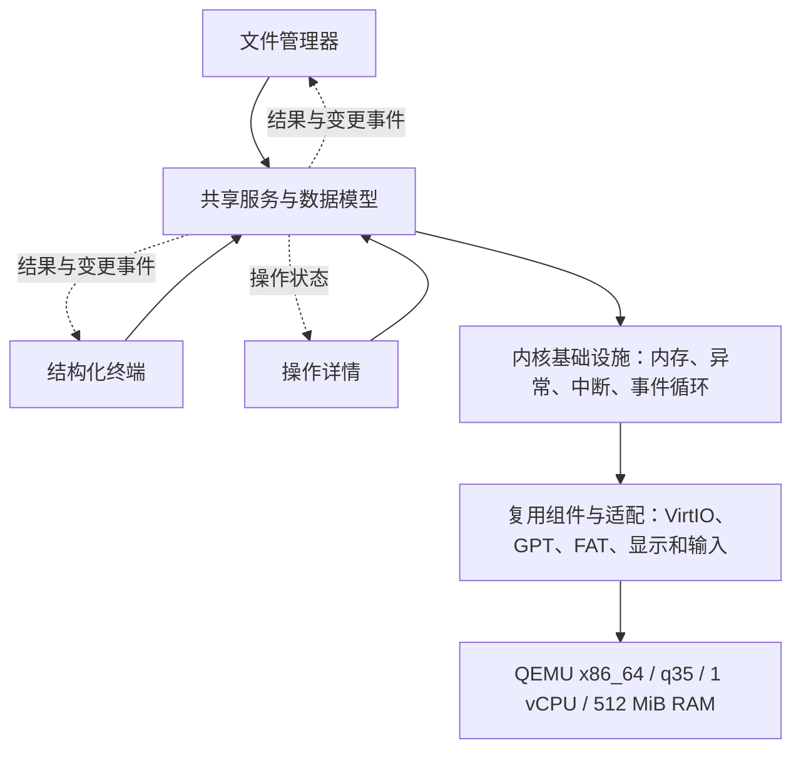
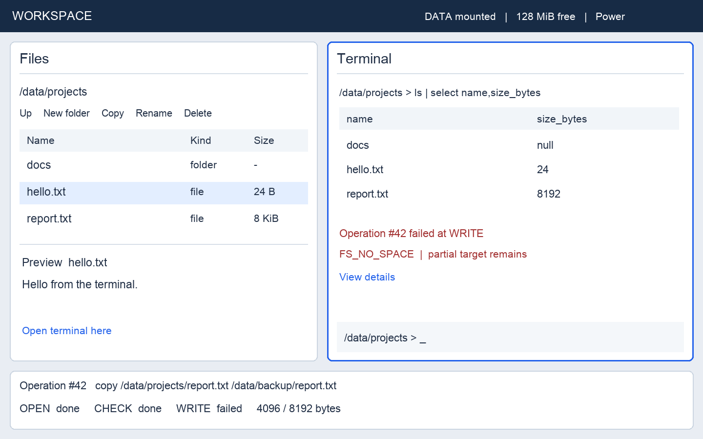

# RadishRoot（萝卜根系）MVP 项目规划

可解释的系统、文件管理器与结构化终端

文档基线 **2.0** · 2026 年 10 月 13 日 · 产品目标 **MVP v0.1** · 实施状态见[当前状态](status/current.md)

## 项目概览

### 定位与正式来源

RadishRoot OS 是以可解释操作与结构化交互为核心的 Rust 实验操作系统，标语为“看见状态，理解操作”。长期定位与后续候选见[完整产品规划](product-plan.md)，实际进度见[当前状态](status/current.md)。本文是第一 MVP 的技术、架构、UI、任务和验收真相源。

第一阶段在固定 QEMU 配置中独立运行，复用引导程序、VirtIO、GPT 与 FAT32 组件，自研必要的内核适配、共享服务和图形工作台。UI 与终端操作同一份真实数据；解释来自真实状态与错误链，不由语言模型生成事实。

### 第一 MVP 成功标准

从安装介质部署到空白虚拟盘，移除介质后独立进入工作台；在文件管理器中新建目录，在终端写入文件，列表自动刷新并能预览；触发一次复制失败并查看准确阶段和副作用；正常关机重启后数据保持，并由宿主独立读盘校验。

### 开发策略变化

- M0 保留真实存储可行性门槛；M1 就贯通双面板、真实 FAT、最小命令、操作记录和正常重启，形成内部预览。
- 文件操作与查询在已有完整路径上逐项扩展；完整自动验收不等到安装器完成才开始建设。
- 使用 FileEntry、VolumeInfo、MemoryStats、OperationRecord 等明确类型，公共接口服务真实重复，不预建万能对象系统。
- 每个阶段区分宿主测试、真实 QEMU、GUI 和独立磁盘校验；M1 预览不替代最终 MVP。
- 家族视觉采用 Workbench 原则；文档与治理保持轻量，工程任务按单人实际投入计算。

| 决策 | MVP 基线 |
| --- | --- |
| 运行环境 | QEMU x86_64 / 固定 q35 机器版本 / OVMF UEFI / 1 vCPU / 512 MiB 内存；TCG 验收 |
| 产品形态 | 固定双面板或单应用铺满，文件管理器、终端与操作详情 |
| 内核形态 | 模块化单体、单地址空间、单核事件循环、内置应用 |
| 存储与安装 | 1 GiB GPT raw 镜像、FAT32 ESP / DATA；复用 Linux Live 安装环境 |
| 首次交互门槛 | M1：已有开发镜像中的真实最小闭环，尚无完整安装交付 |
| 最终交付 | 源码、锁定依赖、镜像、安装介质、运行说明及验收报告 |
| 计划方式 | 32 项任务、94 人日占位估算；M0 后重估，不作日历交付承诺 |

### 使用说明

第 1–8 节定义契约，第 9 节定义阶段门槛，第 10–15 节列出 32 项任务，第 16–17 节列出 24 项验收及证据要求，第 18–19 节记录风险、冻结点和参考资料。FR 编号保留；T / AT 在 2.0 中重新编排，旧稿同号不能直接引用。

任务复选框只记录最终完成，进行中 / 受阻及证据入口在当前状态维护。规划不是实现证明；只有对应环境、行为与失败路径获得证据后才能勾选。

## 1 功能范围与需求编号

下表全部为完整 MVP v0.1 的必需范围（范围优先级 P0，与缺陷等级分开）。M1 只验证其最小纵向子集，不代表本表全部完成。采用受限而完整的功能集；新需求先判断是否影响启动、存储、交互或验收链路，再决定纳入当前版本。

| 编号 | 范围 | 完成边界 |
| --- | --- | --- |
| FR01 | 启动与安装 | UEFI 从固定规格磁盘启动；安装介质可部署系统并校验；可移除介质独立启动 |
| FR02 | 电源管理 | sync、reboot、shutdown；写回失败时保留错误状态，不伪报成功 |
| FR03 | 图形工作台 | 文件管理器和终端双面板或单应用铺满；鼠标、键盘、焦点和滚动 |
| FR04 | 文件管理 | 路径导航、列表、详情、新建目录、单文件复制、重命名、删除文件及空目录 |
| FR05 | 文本预览 | 有大小上限的只读文本预览；超限、二进制和不支持字形有明确提示 |
| FR06 | 终端交互 | 命令行编辑、退格、历史、输出滚动、基础帮助和路径参数 |
| FR07 | 结构化查询 | 记录及表格结果；where、select、sort；字段和类型错误可解释 |
| FR08 | 系统可观察性 | system、memory、disks、volumes，显示真实状态及失败原因 |
| FR09 | 操作记录 | 唯一操作编号、阶段、结果、错误链、部分完成状态；有限容量记录 |
| FR10 | 双应用联动 | 打开终端定位目录；命令修改触发列表刷新；结果定位文件；共享操作详情 |
| FR11 | 持久化 | FAT32 文件在正常 sync 和关机重启后保持；不承诺突然断电后的事务一致性 |
| FR12 | 可重复交付 | 一组固定脚本完成构建、启动、测试；输出依赖和运行环境清单 |

### 明确的首版限制

单用户、单核、单地址空间。仅支持选定 QEMU 配置及固定设备；不包含真机、网络、USB、GPU 加速、第三方程序、POSIX 兼容、包管理、进程隔离和完整窗口管理器。

文件操作限定在数据卷内；复制和删除不递归，不支持跨卷移动、符号链接、权限管理、文件撤销、版本快照或热拔插。覆盖已有目标默认拒绝，终端显式参数或 UI 确认后才允许。

首版命令和界面文案使用英文，存储层保留 UTF-8 数据。中文输入法、完整 CJK 字库和复杂文字排版另行规划；遇到不支持的字形显示占位或转义，不损坏原始路径和文件内容。

## 2 技术选型与版本策略

“选定”表示本规划的默认方向；“待验证”表示必须在 M0 的目标环境中证明可用。没有任何库可以替代内核的资源所有权、地址映射和错误处理设计。

| 层次 | 默认选择 | 适配工作与状态 |
| --- | --- | --- |
| 虚拟硬件 | QEMU x86_64 + q35 + OVMF | 锁定 QEMU 版本、带版本机器名、固件和配置；TCG 为跨平台验收基线 [R1] |
| 引导 | Limine + Rust limine crate | 对齐协议修订；获得内存图与 framebuffer；校验请求是否受支持 [R2] |
| 工具链 | 固定日期 nightly；x86_64-unknown-none | no_std + alloc；提交 rust-toolchain.toml 和 Cargo.lock；精确日期在 M0 冻结 |
| CPU 与内存 | x86_64 + linked_list_allocator | 自建物理页分配与映射策略；预留内核、固件信息、framebuffer 和 DMA 内存 [R3] |
| 磁盘 | virtio-drivers / modern VirtIO-blk PCI | PCI 发现、BAR 映射、总线主控、DMA 分配、地址转换和完成等待 [R4] |
| 分区 | gpt_disk_io | 提供 BlockIo；校验边界、CRC 和主备结构；不实现交互式分区编辑 [R5] |
| 文件系统 | rust-fatfs / FAT32 | 关闭 std 等默认特性；块到字节流适配；固定可编译 release 或 commit [R6] |
| 显示 | framebuffer + embedded-graphics | 实现 DrawTarget；后台缓冲区、文字、图标和控件；软件绘制 [R7] |
| 输入与串口 | PS/2 + pc-keyboard；uart_16550 | 自建 i8042 接入与鼠标协议适配；接入现有扫描码解析 [R8] [R9] |
| 宿主 UI 验证 | embedded-graphics-simulator | 只用于宿主 runner；生产内核不链接宿主窗口库 [R10] |
| 镜像与安装 | Linux 工具环境 + GPT/FAT 工具 | 固定工具版本；复用已有 Linux Live 环境和部署工具，自研薄包装 |
| 构建与测试 | Cargo workspace + xtask + QEMU | 统一入口、超时、退出码、串口事件收集和结果校验 |

### 依赖管理规则

M0 记录每个组件的版本或 commit、许可证、功能开关、目标平台编译结果。Git 依赖必须固定 commit；默认禁止在持续集成中跟随主分支。保留上游许可证和必要声明。

若 FAT、VirtIO 或 Limine 的既定组合失败，先定位接口或工具链问题，再评估版本调整或兼容替代库。替换必须保留相同服务接口和验收用例；不同时维护两套引导或文件系统路线。

## 3 系统架构与责任边界

图 1  运行时依赖从界面到硬件逐层收敛  结构化结果和事件反向更新界面

文件管理器、终端和操作详情都调用共享服务。文件管理器直接提交类型化请求，不拼接 shell 命令。终端解析后也转换成相同请求，因此路径规则、写回规则和错误语义只有一份。

| 模块 | 职责 | 不得依赖 |
| --- | --- | --- |
| system-core | FileEntry、VolumeInfo、MemoryStats、OperationRecord 等明确类型与公共错误 / 事件契约 | 硬件、字体、终端排版 |
| services | FileService、SystemService、操作记录与变更发布 | 具体 UI 控件或命令字符串 |
| shell | 命令解析、参数校验、结构化查询 | framebuffer 和驱动细节 |
| ui | 视图状态、控件、焦点、渲染与应用联动 | 直接访问磁盘或解析 FAT |
| kernel / platform | 启动、内存、中断、时间、设备和电源适配 | 宿主 std 或桌面窗口库 |
| host-runner / xtask | 宿主模拟、镜像工具、构建与测试 | 不能成为内核运行时依赖 |

### 执行与内存模型

采用单核事件循环。中断只采集输入和计时事件，主循环执行服务与 UI 更新。长复制按块推进，阶段之间处理输入和重绘；首版不依赖线程、异步运行时或用户态进程。

轮询磁盘请求必须有超时。超时后若设备仍可能访问 DMA 缓冲区，不能直接释放或复用内存；先完成设备复位或将设备离线。内核与应用暂不隔离，一个内核缺陷可能影响全系统。

## 4 结构化数据与错误契约

| 契约 | 最小字段 | 规则 |
| --- | --- | --- |
| FileEntry / FileRef | volume_id、path、kind、size_bytes、generation | 文件大小为整数，目录大小为空；引用携带卷与代次，使用前重新验证 |
| VolumeInfo / DiskInfo | id、capacity_bytes、read_only、mount_state、flush_support | 从真实驱动与挂载状态读取，未知字段为空并标明范围 |
| MemoryStats | total_bytes、tracked_bytes、allocated_bytes、scope | 已统计与未知范围分开，不把未统计内存当作可用 |
| OperationRecord | boot_id、operation_id、request_kind、target、stage、status、error | 有限内存记录；事件累积形成视图，不能反过来改写执行事实 |
| TypedResult | schema、records、truncated | 值支持字符串、整数、布尔、空值；字节数保持数值类型；结果有容量上限 |
| CommandRequest | command、typed_args、context | 命令注册表声明参数、输出字段、是否修改数据；先校验再执行 |
| OperationEvent | boot_id、operation_id、seq、stage、status | 事件有序、关联到同一操作；时间使用启动后单调时钟 |
| SystemError | code、stage、object、cause、partial_effect | 保留底层错误来源；不知道原因时明确 unknown；记录已产生的副作用 |
| ChangeEvent | volume、paths、generation、operation_id | 成功修改或部分修改后通知；订阅者检测版本缺口后重新查询 |

### 具体类型优先

`SystemObject` 不作为万能属性字典落地。共享对象引用使用有穷枚举或明确结构，命令注册表声明具体输入与输出 schema。`TypedResult` 只承担公共展示和查询投影，底层服务保留领域类型；不为任意动态字段、插件注册和反射建立首版框架。

文件引用不是 FAT inode 身份承诺。卷代次变化后重新查询路径，不能把同路径的新文件当作旧对象；终端历史保留快照，定位时提示失效或要求用户重新选择。对象 ID、操作 ID、错误码的角色分开。

解释视图分别显示“已知事实 / 未知信息 / 可采取的动作”。建议重试不等于操作已经恢复；没有底层依据时不推断权限、磁盘损坏或数据完整性。

### 命令结果不等于打印文本

ls 返回 FileEntry 记录，包含 name、path、kind、size_bytes。目录大小暂用空值；UI 显示为横线。管道先在记录上筛选和选择字段，最后由串口或图形表格渲染。

示例：ls /data | where kind == "file" | select name,size_bytes。首版 where 仅支持一个字段与字面量的比较；select 接受字段列表；sort 接受一个字段及方向。null 仅支持相等 / 不等判断，排序固定置后；等值记录保留原顺序，字符串首版按 UTF-8 字节序比较，不承诺本地化排序。未知字段、类型不匹配和超限必须报明确错误。

首版管道只接受查询和变换命令，修改类命令单独执行。所有阶段先完成参数和 schema 校验；查询结果超限采用显式报错；目录列表另用分页，不允许悄悄返回看似完整的查询结果。

### 操作状态机

Created → Validating → Running → Flushing → Succeeded。任何阶段均可进入 Failed，并记录最后成功步骤、错误步骤及 partial_effect；只读操作不进入 Flushing。

“Succeeded”只有在该操作要求的文件系统写回与块设备 flush 完成后才发布。取消长操作暂不承诺；运行期间允许查看状态。磁盘满导致目标文件只写入一部分时，必须显示已写字节数和目标是否保留。

### 记录与稳定性

操作事件先写入有上限的内存环形缓冲区，并输出到专用调试通道；第一阶段不要求跨重启保存。事件被淘汰时保留缺失提示。常规日志、命令输出和机器可读测试事件应区分通道或采用明确帧格式。

## 5 图形工作台与布局

图 2  早期双面板布局参考；仅说明信息组织，非已实现界面或最终配色稿。正式视觉与状态规则以本节为准。

默认请求 1024 × 768 显示模式，实际按引导提供的尺寸和像素格式初始化。双面板以该尺寸作为设计与验收基线；支持单应用铺满。较小显示区域可以使用单面板布局，无法安全绘制时保留串口诊断。

### 家族视觉与首轮状态设计

参考 RadishX family-ui `v26.7.3` 的 Workbench：近白或低眩光中性工作面、克制的灰玉强调、有序密度、清楚的文本层级与状态。只借鉴规则，不复制 Web 组件、外部参考截图或整套主题运行库。M1 将 background、surface、text、muted、border、focus、accent、success、warning、error 映射为本地 Rust 样式值；映射集中定义，数值在实际 framebuffer 上核对后冻结。

M1 先覆盖启动中、空目录、正常列表、命令执行、成功、失败、操作详情和关机失败八种状态。M2 / M3 按功能扩展分页、预览、覆盖确认、只读、满卷、部分完成和事件缺口。每次增加状态同时验键盘、鼠标与清楚的恢复入口；错误不能只靠颜色区分。

第一版只要求一个可读主题，不预做主题编辑器、复杂动画或品牌欢迎页。字号、对比度、焦点、截断提示与 1024 × 768 下的可操作性优先。文档使用中文；产品英文界面与 UTF-8 保真分开，中文显示和输入另行评估。

### 工作台组成

顶部提供系统简况、应用切换和电源入口；左侧文件管理器包含路径、工具栏、文件表格和预览；右侧终端包含历史结果和命令输入；底部按需展开操作详情。焦点面板具有明确边框或标题状态。

### 绘制与控件

自研控件限定为文本、按钮、单行输入框、列表或表格、滚动条、分隔面板、对话框和进度条。图标使用简单几何或小型位图资源，首版不引入复杂主题或动画系统。

通过 embedded-graphics 绘制到内存后台缓冲区，再复制到 framebuffer。先完成正确的整帧刷新，测量后再增加局部刷新；UI 状态变化或光标更新才触发绘制。framebuffer 适配必须处理行跨度、像素格式和边界。

### 输入规则

统一输入事件包含按键、文本输入、指针移动、按下与释放。点击决定焦点；Tab 在可操作控件间切换，Enter 激活动作，Esc 关闭对话框。首版鼠标左键和拖动滚动条即可完成操作，滚轮属于可选增强。

## 6 文件管理器与终端行为

| 场景 | 文件管理器行为 | 终端与共享服务行为 |
| --- | --- | --- |
| 进入目录 | 路径栏、上级按钮、双击目录或 Enter | cd 修改当前目录；“在终端打开”显式同步目录 |
| 显示目录 | 名称、类型、大小；选中后显示详情 | ls 返回同一 FileEntry 数据；排序和字段筛选使用类型化值 |
| 创建与修改 | 新建目录、重命名、单文件复制；不做完整文本编辑器 | mkdir、write、cp、mv；mv 首版仅同卷重命名 |
| 删除 | 确认后删除文件或空目录；非空目录显示受限原因 | rm 使用同一删除服务；无回收站，帮助中写明语义 |
| 目标已存在 | 默认拒绝；明确确认后才能覆盖文件 | cp 和 write 需要显式覆盖参数；目录不能被文件覆盖 |
| 失败与部分完成 | 显示错误入口；部分修改后仍刷新相关目录 | 返回 SystemError，并提供 explain &lt;operation_id&gt; |
| 切换与定位 | 可打开终端到当前目录；查询结果可定位到文件 | 切换目录不隐式改变另一面板，只有显式联动动作才同步 |

### 必须实现的界面状态

文件区覆盖加载中、空目录、正常列表、读取失败、只读卷、磁盘满、对象已消失和路径过期。终端覆盖空输入、编辑中、执行中、成功、失败、结果超限和历史耗尽。每种状态都要能通过测试数据稳定触发。

目录采用分批加载和有限可见行，加载期间界面可响应。预览仅读取前 64 KiB；超过上限明确标示截断；二进制或非法编码显示“无法文本预览”，不得把预览错误当成文件损坏结论。

### 变更一致性

FileService 在修改成功或留下部分副作用后发布 ChangeEvent。文件管理器按路径范围重新查询；终端历史结果保留当时快照，不自动改写。点击旧结果定位文件时重新验证对象，重命名或删除后显示明确状态。

### 路径与文件语义

统一路径层负责绝对 / 相对路径、`.`、`..`、分隔符与卷边界；不得用字符串前缀替代边界判断。FAT 名称长度、非法字符、大小写与碰撞规则以锁定库的实测语义冻结，UI 与终端采用同一校验，不静默改名或转码。M0 验证 UTF-8 名称的写入与独立读回；不支持的名字明确拒绝，原始合法名称不得因显示缺字而损坏。

`write` 首版写入命令中的文本，不是完整编辑器；显式覆盖可能在失败时留下部分结果，不承诺原子替换。`mv` 只支持同目录或同卷的既定重命名能力，跨目录能力须由锁定 FAT 库验证；若库不能可靠实现，则在 M0 冻结为同目录重命名并在帮助中明确，不伪称支持跨卷移动。

### 终端能力边界

提供命令行插入、退格、光标移动、上下历史、输出滚动，以及结构化结果的文件定位动作。它运行内置命令；第一阶段不承诺终端模拟器兼容性、PTY、ANSI 全集、外部程序或 shell 脚本。

最小命令集为 help、clear、history、system、memory、disks、volumes、ls、cd、pwd、cat、mkdir、write、cp、mv、rm、where、select、sort、operations、inspect、explain、sync、reboot、shutdown。

## 7 存储与电源行为

| 区域 | 格式与容量 | 读写策略 |
| --- | --- | --- |
| 整盘 | 1 GiB raw 镜像，GPT，512 字节逻辑块 | 固定容量首版；根据实际容量校验主备 GPT 与分区边界 |
| EFI 系统分区 | 128 MiB FAT32 | 包含 Limine、内核、启动配置；系统内只读 |
| DATA 分区 | 其余可用空间，FAT32 | 挂载至 /data；目录和文件由统一服务访问 |
| 内存对象 | 启动事件、操作记录和 UI 状态 | 有限容量；不承诺跨重启保存 |

### 完整的读写路径

FileService → FAT 文件系统 → 分区字节流适配 → 块设备接口 → VirtIO-blk → QEMU 磁盘镜像。分区适配层负责起始偏移、长度和越界校验；不能让普通文件操作触及整盘或启动分区。

字节流适配处理非对齐读写、seek 和跨扇区访问。块设备明确容量、块大小、只读状态及 flush 能力；写入采用有边界的读改写，不假设 FAT 每次都给出完整扇区。

系统按分区类型与标识定位卷，不写死扇区偏移。GPT 主结构损坏但备份可验证时，可在明确降级状态下继续只读诊断；两者均无效时拒绝挂载。首版不自动修复损坏的分区和文件系统。

### 错误和写回

区分无空间、只读、未挂载、找不到文件、非法路径、设备 I/O 失败、超时和格式错误。FAT 库、字节流适配和驱动错误逐层保留原因。库不提供的信息不能通过猜测生成。

修改命令完成时刷新文件及目录元数据，再传递到底层块设备 flush；若设备不支持所需持久化能力，M0 不得通过。默认不另加全局异步写缓存，先减少写回状态数量。

### 正常关机

进入关机状态后拒绝新的修改请求，完成在途操作，刷新文件系统与设备，再由固定 QEMU 平台适配执行关机。第一版可使用针对该机器配置的电源实现，不要求通用 ACPI 解释器。

flush 失败时停止正常关机流程，界面保留错误和已知状态。测试中主动强制终止 QEMU 属于故障注入，不等同于正常关机成功。FAT32 没有被本项目增加事务保证；断电后一致性恢复另行规划。

## 8 构建运行与安装交付

### 工作区结构

| 目录或 crate | 职责 |
| --- | --- |
| kernel | 启动入口、平台适配、内存、中断、设备与电源 |
| system-core / services | 数据契约与服务实现；以 no_std + alloc 为共同基线 |
| shell / ui | 命令与结构化查询；视图、控件和双应用交互 |
| host-runner | 模拟显示和输入；内存后端或测试磁盘后端 |
| xtask / tests / assets | 构建和镜像工具；验收夹具；字体和图标资源 |
| docs / third-party | 架构决策、运行说明、验收记录；许可证清单 |

### 统一入口

计划提供 `cargo xtask build`、`image`、`run --serial`、`run --gui`、`test --host`、`test --vm`、`demo`、`package` 和 `verify-install` 子命令。它们是待实现接口，不是当前可执行命令；按 T01、T13、T24、T29–T31 随真实能力分批建立。每个入口需给出明确退出码、参数说明、超时和输出位置；不建立默认返回成功的占位入口。开发 shell 包装仅转发至同一 xtask 实现。

构建在宿主执行；镜像制作使用锁定的 Linux 工具环境，复用 GPT、mkfs.fat 和文件复制工具。固定工具链、固件、机器配置及依赖，并记录版本和校验值。目标是可重复构建和运行，不在首版承诺镜像逐字节可重现。

### 安装介质

复用已有 Linux Live 环境及磁盘工具，附带系统 raw 镜像、校验文件和部署包装。首版只处理指定的空白 1 GiB 虚拟磁盘；安装前展示目标容量与标识，拒绝源介质、非空盘和不符合规格的目标。

部署程序验证源镜像，写入整盘，执行写回，再从目标盘读取并校验。任何步骤失败都不能报告安装成功。中断后保留失败磁盘用于诊断，重新创建空白虚拟盘再安装，不自动覆盖已变为非空的目标。完成后移除安装介质，使用新的 UEFI 变量存储验证从目标盘启动，避免依赖安装环境留下的启动项。

### 首版交付包

交付源码与锁定依赖、system.img、安装介质、QEMU 启动脚本、校验清单、许可证声明、用户操作说明和 acceptance-report。报告记录代码版本、环境、用例结果、日志及截图位置。

镜像生成和安装仅操作任务创建的文件及测试虚拟磁盘。开发用磁盘副本与发布镜像分开保存；重新生成启动镜像不能默默覆盖用户数据盘。

## 9 里程碑与完成规则

| 阶段 | 目标 | 任务 | 退出门槛 | 估算人日 |
| --- | --- | --- | --- | --- |
| M0 | 依赖与真实存储可行性 | T01–T05 | 内核写入、flush、重启读回、宿主独立校验与候选组合冻结 | 14 |
| M1 | 第一条真实图形闭环 | T06–T13 | 在 QEMU 中完成列表、终端写入、刷新、操作详情和正常重启 | 24 |
| M2 | 完整文件工作流 | T14–T18 | 文件增改复制删除、覆盖边界、预览、分页、双应用定位与历史 | 16 |
| M3 | 结构化查询与完整解释 | T19–T23 | 查询管道、真实状态、部分失败、事件缺口及长操作均可验证 | 16 |
| M4 | 稳定性与复验收敛 | T24–T27 | 自动主路径、独立校验、压力、输入延迟和缺陷门槛通过 | 11 |
| M5 | 安装与 MVP 交付 | T28–T32 | 空白盘安装、移除介质独立启动、全部验收及复现材料 | 13 |
| 合计 | 完整 MVP | T01–T32 | 阶段预览不能替代发布验收 | 94 |

### 开发顺序与投入

按 M0 → M1 → M2 → M3 → M4 → M5 串行推进。M1 中宿主视图与服务测试可交替迭代，但阶段完成必须在真实 QEMU 与同一持久化磁盘成立，不假设额外并行人力。

每人日按 8 小时计，94 人日只是任务拆分的工作量占位（752 小时），尚无本项目实测速度。全职 40 小时 / 周约 19 周；预留 20%–30% 后约 23–25 周。若每周投入 h 小时，按 `752 / h` 估算基础周数再加缓冲；每周 10 小时约 75 周基础量，不应沿用全职日历。实施开始时记录实际预算，M0 后按实际接入成本重新估算，M1 后再按集成速度调整。不得为赶日期削弱存储或错误验收。

### 两个不同的完成概念

- **M1 内部预览**：已有开发镜像，固定 /data，最小命令和列表，基本输入、操作详情与正常关机。允许界面粗糙，不允许虚假成功、写坏卷或把内存后端当真实盘。
- **MVP v0.1 完成**：FR01–FR12 与 AT01–AT24 全部覆盖，安装交付和缺陷条件满足；最后一次候选变动后重跑受影响证据。

### Golden Path：固定演示故事

1. 从专用开发盘启动工作台，查看 /data。
2. 在终端执行 `write /data/hello.txt "hello RadishRoot"`；该路径在本次夹具中不存在。
3. 文件区无需手动刷新即出现文件；终端结果包含操作编号。
4. 打开详情，看到校验、写入、文件系统写回和设备 flush 的成功阶段；用已有文件名重复写入，默认拒绝且原内容不变。
5. 执行正常 shutdown，退出后宿主以独立 FAT 读取工具校验路径、长度和字节。
6. 用同一磁盘副本再次启动，列表与内容一致；新的 boot_id 不误关联上次内存操作记录。

M2 起扩展为文件管理器创建目录、终端写入、预览、复制重命名和定位；M3 起加入一次满卷或写入失败的解释；M5 将开发镜像起点替换为从安装介质部署。正常片段和故障片段使用独立镜像副本，避免互相污染。

### 完成定义

任务需有明确输入、实现 / 文档、实际验证、失败行为与证据位置；只完成宿主部分则不能标记要求 QEMU 的任务通过。新增 unsafe 记录所有权与资源前提。接口变化同步宿主与内核调用方，确认 no_std 依赖闭包。

证据必须与代码、工具链、固件、磁盘和 fixture 版本关联。支持生成结构化报告的入口只在能力存在时建立；没有入口不能填“检查通过”。开发者报告与独立校验分别留证。

### 资源与响应上限

初始预算：单行命令 4 KiB、历史 100 条、查询结果 1000 行或 1 MiB、文本预览 64 KiB、操作记录 256 条、目录每页 200 条。查询超过上限明确错误且不显示貌似完整的部分表格；目录通过分页访问全量。队列与记录溢出可观察，淘汰不扩大内存。

M1 记录内核 / heap / framebuffer / DMA / UI / 缓存预算及测量范围；内存不足不能覆盖保留区。固定验收宿主上连续 100 次输入，“输入事件进入 guest 到下一次可见绘制”的 P95 初始目标不超过 150 ms，空闲和复制期间分别测量；记录事件与帧的时序，人工截图不等于性能测量。主机、TCG 版本和负载随报告保存，必要的阈值变更先说明依据并更新正式基线。

## 10 M0 依赖与真实存储可行性任务

阶段门槛：内核写入、flush、重启读回、宿主独立校验与候选组合冻结。本阶段预估 14 人日；不是已确认排期。

### T01 建立可编译工作区与环境清单

- [ ] 完成状态以[当前状态](status/current.md)为准；环境事实与候选见[开发环境清单](development/environment.md)。

预计 2 人日 · 前置：无 · 验收关联：AT01、AT23

**交付：**实施授权后建立 Cargo workspace、固定工具链候选、目标配置和实际 build / host 检查入口；列依赖与许可证候选。

**通过条件：**干净目录能编译最小 no_std 内核，宿主与内核依赖隔离；环境清单记录 QEMU、机器版本、固件、Rust 与功能开关。

### T02 引导、串口与最小故障停止

- [ ] 状态：未开始

预计 2 人日 · 前置：T01 · 验收关联：AT01

**交付：**Limine 开发镜像、内存图 / framebuffer 校验、串口及最小 panic 输出。

**通过条件：**连续 10 次进入内核；协议不支持时明确停止；保留固件、内核和 framebuffer 区域，错误不导致无信息重启。

### T03 最小内存、PCI 与 DMA 所有权

- [ ] 状态：未开始

预计 4 人日 · 前置：T02 · 验收关联：AT03

**交付：**页分配 / 堆、PCI 发现、BAR 映射及 VirtIO HAL；unsafe 和 DMA 资源清单。

**通过条件：**识别固定磁盘；分配对齐且不落保留区；非法范围拒绝；请求未确认结束不能释放缓冲区，M0 即有有界失败停止。

### T04 块读写、flush 与 GPT 边界

- [ ] 状态：未开始

预计 3 人日 · 前置：T03 · 验收关联：AT02、AT03

**交付：**专用数据盘、块接口、主备 GPT 校验及分区适配；短轮询预算和超时隔离策略。

**通过条件：**已知块写入、flush 后由宿主独立比较；越界和只读拒绝；主备结构均无效不挂载；无永久等待。

### T05 FAT 持久化与独立读盘验证

- [ ] 状态：未开始

预计 3 人日 · 前置：T04 · 验收关联：AT02、AT03

**交付：**字节流适配、FAT no_std 配置、预置材料、独立宿主读取流程；兼容矩阵及首批名称语义。

**通过条件：**跨扇区和 UTF-8 文件写入并 flush；同盘重启后读回；guest 退出后独立 FAT 工具验证路径、长度、内容；无临时快照丢弃写入。

M0 退出：本阶段全部任务满足各自通过条件，证据记录于当前状态指向的报告；发现 P0 / P1 缺陷先修复，不以文档数量或局部编译通过晋级。

## 11 M1 第一条真实图形闭环任务

阶段门槛：在 QEMU 中完成列表、终端写入、刷新、操作详情和正常重启。本阶段预估 24 人日；不是已确认排期。

### T06 异常、时钟与单核事件循环

- [ ] 状态：未开始

预计 4 人日 · 前置：T05 · 验收关联：AT04

**交付：**异常诊断、单调时钟、事件队列、内存边界补齐、有界设备等待；内存计量基线。

**通过条件：**页错误 / 分配失败可诊断；队列溢出有策略；中断不做文件 I/O；设备超时隔离并保留必要 DMA 资源；不能因普通非法输入崩溃。

### T07 键盘鼠标与 framebuffer 基础

- [ ] 状态：未开始

预计 4 人日 · 前置：T06 · 验收关联：AT07

**交付：**PS/2 输入、指针范围、DrawTarget、后台缓冲区及宿主同视图 runner。

**通过条件：**QEMU 中按键、文本、移动和左键正确；尺寸、stride、像素格式与裁剪有验证；后台缓冲区不越界。

### T08 明确类型与最小真实文件服务

- [ ] 状态：未开始

预计 3 人日 · 前置：T05、T06 · 验收关联：AT06

**交付：**FileEntry、FileRef、OperationRecord、SystemError 和 ChangeEvent；list / read / create-text 真实 FAT 服务及宿主测试替身。

**通过条件：**宿主与 no_std 可编译；路径和卷边界一致；创建结果遵循完整 flush 语义；目标存在默认拒绝。测试替身不进入产品默认路径。

### T09 最小终端与共享操作记录

- [ ] 状态：未开始

预计 3 人日 · 前置：T08 · 验收关联：AT06

**交付：**help、ls、write、cat、operations、explain 的最小解析与行输入状态；boot_id / operation_id 和基础错误链。

**通过条件：**带空格参数可解析，坏输入无写入；成功与名称冲突可从同一编号查看真实阶段；类型结果在宿主和 QEMU 等价。

### T10 双面板骨架与最小文件列表

- [ ] 状态：未开始

预计 3 人日 · 前置：T07、T08、T09 · 验收关联：AT07

**交付：**固定文件区、终端输入 / 输出、基本焦点与操作详情；本地 Workbench 语义样式。

**通过条件：**真实 /data 列表、空态、输入、成功和失败可用；点击 / Tab / Enter 工作；同一视图代码在宿主和 QEMU 验证，不使用硬编码列表。

### T11 命令修改到列表与详情的联动

- [ ] 状态：未开始

预计 2 人日 · 前置：T10 · 验收关联：AT05

**交付：**最小订阅刷新、操作选择、历史快照与状态链接；只刷新受影响目录。

**通过条件：**终端创建后列表自动出现文件；详情与终端具有同一操作 ID；失败不显示成功；不依赖手工重载。

### T12 正常 sync、reboot 与 shutdown

- [ ] 状态：未开始

预计 2 人日 · 前置：T06、T08、T10 · 验收关联：AT05、AT14

**交付：**关机拒绝新写入、排空在途操作、文件系统 / 设备 flush、固定平台电源适配。

**通过条件：**正常关机先 flush 后电源请求；一次注入 flush 失败阻止安全关机并保留界面错误；重启用同一磁盘。

### T13 M1 演示入口与首轮真实验收

- [ ] 状态：未开始

预计 3 人日 · 前置：T11、T12 · 验收关联：AT05、AT06、AT07

**交付：**可复用 demo 故事、最小宿主与 VM 自动断言、人工 GUI 清单、独立磁盘校验报告。

**通过条件：**完整完成第 9 节 Golden Path，附输入 / 界面 / 事件 / 独立文件字节证据；缺陷与未实现范围可见；M1 明确标为内部预览。

M1 退出：本阶段全部任务满足各自通过条件，证据记录于当前状态指向的报告；发现 P0 / P1 缺陷先修复，不以文档数量或局部编译通过晋级。

## 12 M2 完整文件工作流任务

阶段门槛：文件增改复制删除、覆盖边界、预览、分页、双应用定位与历史。本阶段预估 16 人日；不是已确认排期。

### T14 目录导航与新增 / 删除流程

- [ ] 状态：未开始

预计 3 人日 · 前置：T13 · 验收关联：AT08

**交付：**mkdir、rm、cd、pwd、路径栏、上级导航、新建与删除确认；同一服务处理。

**通过条件：**创建目录、删除文件与空目录、相对路径成功；卷外路径和非空目录删除拒绝；确认框不能把按键传给背景操作。

### T15 复制、重命名与覆盖语义

- [ ] 状态：未开始

预计 4 人日 · 前置：T14 · 验收关联：AT08、AT12

**交付：**cp、mv、显式覆盖标志 / 对话框；分块复制的基本状态推进与冲突规则。

**通过条件：**文件字节与名称正确；默认不覆盖；取消确认无副作用；显式覆盖失败按实际副作用报告；同卷 / 同目录边界符合冻结策略。

### T16 只读预览、分页与 UTF-8 保真

- [ ] 状态：未开始

预计 3 人日 · 前置：T14 · 验收关联：AT10、AT11

**交付：**64 KiB 预览、二进制判定、目录每页 200 项、缺字显示与原路径分离。

**通过条件：**分页可到达全部记录；大文本明确截断；无效编码不误报文件损坏；非 ASCII 路径独立读盘一致；显示占位不参与文件定位。

### T17 行编辑、历史与结构化表格

- [ ] 状态：未开始

预计 3 人日 · 前置：T09、T10、T16 · 验收关联：AT06、AT11

**交付：**插入 / 删除 / 光标、history / clear、输出滚动、类型表格与结果上限提示。

**通过条件：**正常及错误之后可继续输入；带空格名称不丢失；4 KiB 和历史上限生效；数值保留类型，输出区域滚动不夺取输入焦点。

### T18 完整双应用定位与文件工作流

- [ ] 状态：未开始

预计 3 人日 · 前置：T15、T16、T17 · 验收关联：AT08、AT10、AT22

**交付：**在终端打开目录、结果定位文件、预览与共享详情联动；扩展 demo。

**通过条件：**两个面板目录各自保持，只有显式动作同步；旧结果定位前复核对象；创建 / 复制 / 重命名 / 删除后正常重启独立读盘正确。

M2 退出：本阶段全部任务满足各自通过条件，证据记录于当前状态指向的报告；发现 P0 / P1 缺陷先修复，不以文档数量或局部编译通过晋级。

## 13 M3 结构化查询与完整解释任务

阶段门槛：查询管道、真实状态、部分失败、事件缺口及长操作均可验证。本阶段预估 16 人日；不是已确认排期。

### T19 查询 schema 与 where / select / sort

- [ ] 状态：未开始

预计 3 人日 · 前置：T17、T18 · 验收关联：AT09、AT11

**交付：**有类型查询管道、全管道参数预检、空值与稳定排序、超限拒绝。

**通过条件：**数值不是字符串排序；未知字段、类型不符和修改命令进入管道均在执行前拒绝；超限不返回貌似完整的表格。

### T20 真实系统状态与对象查询

- [ ] 状态：未开始

预计 3 人日 · 前置：T06、T08、T18 · 验收关联：AT24

**交付：**system、memory、disks、volumes、inspect；明确对象枚举与覆盖范围。

**通过条件：**状态与设备 / 分配器实际值匹配；未知值不写成零；查询能进入对象或相关操作详情；没有 UI 私有状态源。

### T21 失败阶段与部分修改解释

- [ ] 状态：未开始

预计 4 人日 · 前置：T15、T19、T20 · 验收关联：AT12、AT13、AT14

**交付：**操作状态机细化、partial_effect、满卷 / I/O 故障材料和用户解释。

**通过条件：**创建和覆盖中途失败分别显示已写字节、目标状态与持久化是否确定；未确认的副作用标未知；UI / 终端一致且刷新已改变目录。

### T22 代次、事件缺口与记录淘汰

- [ ] 状态：未开始

预计 3 人日 · 前置：T18、T21 · 验收关联：AT11、AT22

**交付：**目录代次、ChangeEvent 缺口重查询、boot_id 隔离、操作缓冲区淘汰提示。

**通过条件：**丢弃事件后恢复一致；重命名、删除或同路径重建不把旧引用当当前身份；第 257 条记录触发有界淘汰且明确提示。

### T23 长操作响应与设备故障收口

- [ ] 状态：未开始

预计 3 人日 · 前置：T15、T21、T22 · 验收关联：AT15、AT16、AT18

**交付：**协作分块推进、受限请求等待、超时复位 / 离线与故障后的查询策略。

**通过条件：**复制和故障期间可查看状态；超时不提前复用 DMA；只读 / 满卷 / GPT / FAT 异常在真实 VM 或明确标识的注入点有证据；无无限卡死。

M3 退出：本阶段全部任务满足各自通过条件，证据记录于当前状态指向的报告；发现 P0 / P1 缺陷先修复，不以文档数量或局部编译通过晋级。

## 14 M4 稳定性与复验收敛任务

阶段门槛：自动主路径、独立校验、压力、输入延迟和缺陷门槛通过。本阶段预估 11 人日；不是已确认排期。

### T24 扩展主路径自动化与独立校验

- [ ] 状态：未开始

预计 3 人日 · 前置：T19、T20、T21、T22、T23 · 验收关联：AT05、AT06、AT23

**交付：**实际 host / VM 测试、串口帧格式、时限、非零失败码、独立期望与 GUI 证据关联。

**通过条件：**已有验收按版本重放；故意破坏预期可使检查失败；不能只搜“成功”文案或由生产服务生成唯一预期。

### T25 资源、循环与输入响应测量

- [ ] 状态：未开始

预计 3 人日 · 前置：T24 · 验收关联：AT17、AT18、AT21

**交付：**20 次启动关机、100 次复制删除、队列 / 内存 / 渲染及大目录报告。

**通过条件：**正常循环内容一致；分配未持续增长，固定池 / 缓存可解释；空闲与复制各 100 次输入 P95 满足基线；测量范围可追溯。

### T26 关键故障回归与交互复核

- [ ] 状态：未开始

预计 3 人日 · 前置：T24、T25 · 验收关联：AT04、AT07、AT11、AT12、AT13、AT14、AT15、AT16、AT17、AT18、AT22、AT24

**交付：**异常、只读、满卷、flush、超时、过期对象、覆盖确认和焦点的完整矩阵。

**通过条件：**AT04、AT07、AT11–AT18、AT22、AT24 的已实现范围全部复验；P0 / P1 清零；宿主模拟通过不替代 QEMU 复核。

### T27 开发镜像候选与范围收口

- [ ] 状态：未开始

预计 2 人日 · 前置：T26 · 验收关联：AT23

**交付：**可运行候选、版本 / 环境清单、FR 到 AT 覆盖审查及已知限制。

**通过条件：**除安装类 AT19–AT20 及最终交付材料外均有候选证据；无未解释范围缺口；此时仍不标最终 MVP 完成。

M4 退出：本阶段全部任务满足各自通过条件，证据记录于当前状态指向的报告；发现 P0 / P1 缺陷先修复，不以文档数量或局部编译通过晋级。

## 15 M5 安装与 MVP 交付任务

阶段门槛：空白盘安装、移除介质独立启动、全部验收及复现材料。本阶段预估 13 人日；不是已确认排期。

### T28 完整发行镜像与校验清单

- [ ] 状态：未开始

预计 2 人日 · 前置：T27 · 验收关联：AT19、AT23

**交付：**标准 1 GiB GPT / ESP / DATA 镜像、实际 image / package 入口；开发盘与产物隔离。

**通过条件：**干净 NVRAM 可启动；主备 GPT 与分区边界有效；校验清单完整；重新打包不覆盖开发数据盘。

### T29 Linux Live 安装载体与目标保护

- [ ] 状态：未开始

预计 4 人日 · 前置：T28 · 验收关联：AT19、AT20

**交付：**选定 Live 来源、依赖 / 许可清单、目标识别和部署薄包装；实际 verify-install 入口。

**通过条件：**只对专用空白规定容量虚拟盘写入；排除源盘 / 启动盘；先验源、再写入、flush、读回比较；安装结果不靠工具退出码单独判断。

### T30 安装失败与独立启动验收

- [ ] 状态：未开始

预计 3 人日 · 前置：T29 · 验收关联：AT19、AT20

**交付：**坏源、非空 / 错容量 / 源目标、写入中断与重新安装的材料和报告。

**通过条件：**拒绝场景未写目标；中断不报成功，保留失败盘并用新空白盘重做；移除介质、全新 UEFI 变量后独立启动并通过扩展 Golden Path。

### T31 整理操作说明与交付来源

- [ ] 状态：未开始

预计 2 人日 · 前置：T30 · 验收关联：AT23

**交付：**构建 / 安装 / 使用 / 故障说明、锁定清单、来源与许可、校验文件及候选范围说明。

**通过条件：**复现入口和说明相符；原创与第三方许可满足拟交付方式；产物来源可追溯，未验证结论明确留空；材料交给 T32 独立复验，不预填最终通过。

### T32 完整候选端到端复验与交付审查

- [ ] 状态：未开始

预计 2 人日 · 前置：T31 · 验收关联：AT01–AT24

**交付：**同一候选的 AT01–AT24 报告、自动与人工证据清单、安装后回归及最终 MVP 范围审查。

**通过条件：**按干净环境说明构建与运行，全部验收有通过证据；安装后主路径和正常循环成立；任务 / FR / AT 无悬空项，产物与证据同源，发布阻断缺陷为零。未执行 / 受阻不算通过；对外发布另按授权执行。

M5 退出：本阶段全部任务满足各自通过条件，证据记录于当前状态指向的报告；发现 P0 / P1 缺陷先修复，不以文档数量或局部编译通过晋级。

## 16 验收矩阵与需求追踪

所有验收都须绑定代码版本、fixture、QEMU / 固件 / 机器配置、镜像哈希与实际环境。下表的“首次阶段”用于逐步取得证据，不代表后续增加功能后可永久沿用早期结果；M5 对同一完整候选核对全部 AT。任务完成以任务自身通过条件为准，涉及尚未实施子项的 AT 标记部分覆盖。

### 正常、功能与数据验收

| 编号 / 需求 | 首次阶段 | 操作与材料 | 通过标准 | 必需证据 |
| --- | --- | --- | --- | --- |
| AT01 FR01 FR12 | M0 | 从锁定的开发镜像和干净 UEFI 变量存储连续启动 10 次；另给不支持的引导协议 / 无效必要响应。 | 正常进入内核且保留内存图与 framebuffer 事实；无效输入有串口原因并停止，不无信息重启。 | VM / 串口 / 配置 |
| AT02 FR02 FR11 FR12 | M0 | 读取预置文件；写入跨扇区文件及含 UTF-8 名称的文件，flush 后重启同一盘；guest 完全退出后独立读取镜像。 | guest 与独立 FAT 工具读到相同路径、长度和预期字节；明确关闭丢弃写入的 snapshot / 临时 overlay；记录 cache / flush 配置。 | VM / 独立读盘 |
| AT05 FR02 FR03 FR04 FR06 FR09 FR10 FR11 | M1 | 完整执行第 9 节最小 Golden Path：终端创建、列表刷新、操作详情、冲突拒绝、正常关机、独立读盘与重启。 | GUI 和终端引用同一操作；完整 flush 后才成功；失败不改原内容；正常重启数据一致；报告包含实际键盘 / 鼠标与界面证据。 | GUI / VM / 独立读盘 |
| AT06 FR06 FR09 | M1 | 对宿主和 guest 输入同一合法 / 非法命令序列，包含空格路径、缺参数、未知命令及输入上限；在 M2 重验完整行编辑 / 历史。 | 字段类型、错误码和副作用等价；比较时只归一化 boot_id、时间等明示差异；解析失败无修改；错误后能继续执行。 | 宿主 / VM / GUI |
| AT07 FR03 | M1 | 检查 1024 × 768 双面板、单面板、焦点、鼠标 / Tab / Enter；M2 加入滚动及模态确认；M4 重验完整控件。 | 基本字形、边界裁剪、stride 和像素格式正确；焦点清楚；对话框背景不响应；错误有文字与状态，不能仅靠颜色；最终无关键遮挡。 | 宿主渲染 / GUI |
| AT08 FR04 FR11 | M2 | 使用两种入口创建目录、写入、复制、重命名、删除文件及空目录；拒绝非空目录删除，测试显式覆盖与取消确认。 | 内容和目标准确；默认不覆盖；取消无副作用；路径不能越卷；正常关机后的结果由独立读盘验证；帮助明确非递归与重命名范围。 | 宿主 / GUI / VM / 独立读盘 |
| AT09 FR07 FR09 | M3 | 对不同大小文件执行 where、sort、select；另测 null、等值顺序、未知字段、类型不符和管道中修改命令。 | 按整数排序、null 固定置后、同值稳定；字段正确；整条管道预检拒绝非法组合且无修改；解释指向具体阶段 / 字段。 | 宿主 / VM / GUI |
| AT10 FR05 FR11 | M2 | 预览小文本、超过 64 KiB 文本、二进制、非法编码和含不支持字形的名称。 | 超限明确截断；预览限制不被说成文件损坏；显示占位与真实路径分开；预览前后独立校验原文件与名称未改变。 | GUI / 独立读盘 |
| AT18 FR03 FR12 | M4 | 固定宿主与 TCG 配置，空闲和较大文件复制期间各输入 100 次；同时查看操作进度和目录。 | 输入至绘制 P95 满足第 9 节冻结阈值；无丢操作或无限卡死；记录时间、测量点、主机负载与长操作结果，不以截图推算性能。 | VM / 时序测量 / GUI |
| AT19 FR01 FR12 | M5 | 从 Linux Live 安装到专用空白 1 GiB 虚拟盘；读回比对；移除安装介质，使用全新 UEFI 变量再次启动。 | 目标盘独立进入工作台，完成扩展 Golden Path；不依赖安装器遗留 NVRAM；镜像 / 目标校验和及源目标身份可追溯。 | 安装 VM / GUI / 独立读盘 |
| AT23 FR12 | M0 起，M5 完整 | 在干净工作目录按锁定环境构建；重放 demo / 测试 / 安装；核对报告、产物哈希和来源声明；破坏一项断言进行对照。 | 命令确实存在、有时限和失败码；坏结果可被发现；产物与证据对应同一候选；只承诺可重复构建运行，不伪称位级可复现；交付许可满足用途。 | 构建 / 报告 / 独立复核 |
| AT24 FR08 FR09 | M3 | 查询 system、memory、disks、volumes、inspect，查看成功和失败的操作详情，改变只读 / 挂载状态后重查。 | 字段来自真实驱动 / 服务；计量范围明确；详情含请求、对象、阶段、结果、已知副作用；事实 / 未知 / 建议分开，GUI 与终端一致。 | 宿主契约 / VM / GUI |

### 需求覆盖索引

此表由本节 AT 需求关联复核，不增加另一套需求定义。

| 需求 | 对应验收 |
| --- | --- |
| FR01 | AT01、AT19、AT20 |
| FR02 | AT02、AT05、AT14、AT21 |
| FR03 | AT05、AT07、AT11、AT16、AT17、AT18 |
| FR04 | AT03、AT05、AT08、AT12 |
| FR05 | AT10 |
| FR06 | AT05、AT06、AT11 |
| FR07 | AT09、AT11 |
| FR08 | AT04、AT15、AT16、AT17、AT24 |
| FR09 | AT04、AT05、AT06、AT09、AT11、AT12、AT13、AT14、AT15、AT16、AT22、AT24 |
| FR10 | AT05、AT11、AT22 |
| FR11 | AT02、AT03、AT05、AT08、AT10、AT13、AT14、AT21 |
| FR12 | AT01、AT02、AT17、AT18、AT19、AT20、AT21、AT23 |

## 17 故障验收、材料与证据

| 编号 / 需求 | 首次阶段 | 操作与材料 | 通过标准 | 必需证据 |
| --- | --- | --- | --- | --- |
| AT03 FR04 FR11 | M0 | 向专用测试盘执行块边界、分区越界、只读、未对齐读改写与 DMA 生命周期测试。 | 请求不会访问卷外或 ESP；范围、溢出、对齐错误明确拒绝；设备可能仍写 DMA 时缓冲区保持有效；真实块内容与独立预期一致。 | 宿主边界 / VM / 内存所有权复核 |
| AT04 FR08 FR09 | M1 | 注入页错误、分配失败与事件队列溢出，并执行普通非法输入对照。 | 致命错误串口可诊断并受控停止；普通输入错误不中止系统；队列溢出有计数，统计不虚报未知内存为空闲。 | VM / 故障注入 |
| AT11 FR03 FR06 FR07 FR09 FR10 | M2 起，M3 完整 | 分别触及 4 KiB 命令、100 条历史、1000 行或 1 MiB 查询结果、256 条操作记录上限；目录创建至少 201 项并跨页浏览。 | 每项限额按契约生效；查询超限明确失败，历史 / 操作淘汰有提示；目录所有项可到达；内存有界，界面仍可操作。 | 宿主边界 / VM / GUI |
| AT12 FR04 FR09 | M2 起，M3 完整 | 只读卷写入、访问不存在路径、未挂载卷、同名覆盖及非法路径；对覆盖失败检查已知副作用。 | 错误码、目标、阶段正确；无隐式覆盖和绕过；副作用如实记录；不崩溃；拒绝路径通过独立检查确认未修改目标。 | 宿主 / VM / GUI / 独立读盘 |
| AT13 FR09 FR11 | M3 | 以独立副本构造满卷，在新文件复制和显式覆盖的中途触发空间耗尽 / I/O 失败。 | 不报告完整成功；显示最后成功步骤、已写字节、目标保留 / 删除 / 未知状态及持久化是否确定；目录刷新；独立读取与已知事实相符。 | VM / 故障注入 / GUI / 独立读盘 |
| AT14 FR02 FR09 FR11 | M1 起，M3 完整 | 分别在文件系统写回与块设备 flush 注入失败，再请求 shutdown；复验 reboot 同一保护。 | 成功终态未发布，正常电源流程被阻止，GUI 保留原因且仍可查看状态；没有“安全保存”假提示；不把强制终止当正常成功。 | VM / 故障注入 / GUI |
| AT15 FR08 FR09 | M3 | 损坏 GPT 主表、主备表和 FAT 必要结构，分别启动独立副本。 | 主损坏但备份有效时仅明确降级只读诊断；两者无效拒绝挂载；非法 FAT 不自动修复 / 格式化；错误来源可查，其他允许的系统查询仍可用。 | VM / 镜像材料 / GUI |
| AT16 FR03 FR08 FR09 | M3 | 模拟设备不完成请求或完成超时；在等待、复位 / 离线期间输入查询并审查 DMA 处置。 | 在冻结超时边界退出等待；输入不无限阻塞；未确认停用的设备仍拥有缓冲区，不能释放复用；错误与离线状态真实可见。 | VM / 明确标识的注入 / 资源复核 |
| AT17 FR03 FR08 FR12 | M4 | 重复 100 次复制与删除，施加内存压力、事件溢出及大目录 / 长输出。 | 内存回到可解释稳定区间，固定缓存单列；不足时明确失败或受控停机，不越界；数据独立校验正确；无持续增长与隐藏请求。 | VM / 资源测量 / 独立读盘 |
| AT20 FR01 FR12 | M5 | 依次使用源介质、非空盘、错容量盘、损坏源镜像；另中断写入，随后用新空白盘重做。 | 拒绝项在写入前终止且目标未改变；中断不报成功、不自动覆盖变非空目标；保留诊断副本；重新安装与 AT19 成功。 | 安装 VM / 写前写后校验 |
| AT21 FR02 FR11 FR12 | M4，M5 安装后重验 | 同一测试盘连续 20 次正常启动关机；另用隔离副本强制中断，单独观察。 | 正常循环文件一致、无误判成功或卡死；安装后的相同循环成立；强制中断结果独立记录，不能宣称 FAT 断电事务一致性。 | VM / 独立读盘 |
| AT22 FR09 FR10 | M2 起，M3 完整 | 显式同步目录、旧结果定位、删除后同路径重建、丢失 ChangeEvent、重启后旧操作引用。 | 目录仅在显式联动时同步；历史不改写；过期引用重新验证或失效，事件缺口触发重查；不同 boot_id 不串联旧内存记录。 | 宿主 / VM / GUI |

### 统一合成材料

首次实现时建立一套有版本的 fixture 清单：空目录、跨扇区文本、1 MiB 文件、超过 64 KiB 预览文件、至少 201 项的目录、超过查询行数 / 字节数上限的数据、带空格与 UTF-8 名称、二进制、非法编码、只读盘、满卷、GPT / FAT 损坏盘、源镜像被修改及错容量安装目标。

每个案例记录准备步骤、输入、手写或独立生成的预期与清理方式。故障材料与正常演示隔离；镜像使用独立副本，磁盘路径 / 标识明确，不读取真实个人文件。注入点、条件、次数和是否运行在 guest 中写入证据；合成超时只证明该边界处理，不冒充真实硬件故障复现。

### 独立持久化复核

guest 完全停止且宿主确认进程退出后，保存镜像哈希，使用与 guest FAT 实现独立的工具只读解析目标分区并比较路径、大小、原始字节或独立摘要。不能并发挂载活动 guest 数据盘。不得只比较 guest 自己生成的“成功”日志、使用同一服务读回，或依赖退出时丢弃写入的临时快照。

M0 冻结具体宿主工具、版本、分区读取方法和基准 fixture；可以使用锁定 Linux 工具环境，但这不是要求新增宿主操作系统支持。正常关机和强制终止分别记录，宿主文件系统缓存配置也纳入环境清单。

### 证据分层与记录字段

| 层级 | 能证明 | 不能据此宣称 |
| --- | --- | --- |
| 文档 / 静态检查 | 链接、规则、类型或编译的对应事实 | 程序已经运行、数据已经保存 |
| 宿主测试 / 模拟界面 | 解析、服务契约、状态转换、绘制逻辑 | 内核驱动、输入或 QEMU 集成成立 |
| 真实 QEMU / GUI | 固定目标中的实际启动、存储、输入和工作流 | 真机、其他架构和其他设备支持 |
| 独立读盘 | 停止 guest 后镜像中的实际内容 | 突然断电事务保证或所有硬件持久性 |
| 安装及干净启动 | 指定空白盘部署与独立引导 | 非空盘升级、真实设备安装或公开发行就绪 |

每条报告至少记录：文档基线、T / AT / FR、候选提交（无 Git 则内容清单哈希）、工具与设备配置、输入材料哈希、实际步骤、期望、实际结果、证据位置、结论、未覆盖项和缺陷编号。结论使用通过 / 失败 / 部分覆盖 / 未执行 / 受阻，后面三种不算通过。

文件、截图、串口与机读事件通过案例 ID、boot_id、operation_id 关联；日志与测试帧区分。GUI 可自动化，也可按固定手工清单复验，但不能省略用户可见行为。核心断言不能只镜像实现；输入材料和预期必须可独立审查。

### 缺陷与发行阻断

缺陷 P0：误写磁盘、数据破坏、无法启动；P1：关键流程失败、虚假成功、无限卡死、资源安全边界破坏；P2：有明确绕行方式的次要缺陷；P3：外观或文字问题。范围中的 P0 必需项与缺陷 P0 是不同维度。

MVP 完成要求全部 FR / AT 覆盖且没有未解决 P0 / P1；P2 必须不违反必需范围，记录影响、绕行和后续处置。关键失败未验证、未满足许可分发条件、安装目标保护缺失、候选与报告不一致，均阻断对应交付。发布、上传、远端写入仍需实际授权，验收通过不自动发布。

## 18 风险、冻结点与变更

| 风险 | 触发信号 | 对策与关闭节点 |
| --- | --- | --- |
| no_std 依赖组合不兼容 | std 渗入、nightly / API 不匹配 | T01–T05 固定候选并实际编译 / 运行；替换单一后端，不并行维护两条路线 |
| DMA / PCI 接入复杂 | 地址或 BAR 错误、队列永久等待 | T03 起就有所有权与有界失败；T06 定时、T23 故障完整收口；AT03 / AT16 |
| FAT 成功语义不完整 | 成功后重启丢失字节 | T05 独立读盘、T12 / T21 写回故障；AT02 / AT14 |
| 早期 UI 脱离真实数据 | 宿主演示很完整，guest 仍只启动 | M1 强制 AT05，任何默认内存后端或硬编码列表都不能过阶段 |
| 通用对象与框架膨胀 | 反射、任意属性、插件层先于用例 | 具体领域类型优先；T08 / T20 只统一稳定标识与查询投影 |
| FAT 名称或重命名差异 | 大小写碰撞、跨目录行为不同 | T05 实测冻结，T14–T16 双入口共同语义；不隐式改名或越卷 |
| 轮询和长操作阻塞 | 复制中 UI 失去输入 | 分块状态机、有界请求、测量；T15 / T23 / AT18 |
| 事件和旧对象混淆 | 列表不更新、重建文件被当旧文件 | 代次、重查、历史快照；T22 / AT22 |
| 安装误写 | 依赖盘序或源盘排除不足 | T29 白名单式目标识别、空白 / 容量 / 源目标校验、读回；AT20 |
| 中文期望扩大 | 缺字被认为数据损坏 | 文案英文、存储 UTF-8 保真、显示限制明确；AT10；中文输入后置 |
| 治理或多项目切换占据实施 | 大量文档更新却无新的真实 demo | 每批回到 Golden Path；current 简短、日志归档；按每周投入和实测重估 |
| 发布许可不明 | 原创策略未定、固件 / Live / 字体不可按预期分发 | 依赖冻结时记录来源，T28–T32 按实际产物复核；不自行套兄弟许可 |

### 必须冻结的决定

| 节点 | 冻结内容 | 证据 |
| --- | --- | --- |
| T01 | Rust 候选、目标、QEMU 版本与带版本机器名、宿主路线 | 干净构建与环境清单 |
| T05 | 引导协议、VirtIO transport、FAT / GPT 版本与特性、镜像布局、flush、独立工具、名称语义 | boot-storage 报告与独立读盘 |
| T06–T07 | 单调时间、等待上限、DMA 失败策略、framebuffer 格式和尺寸 | 异常 / 输入 / 裁剪与资源报告 |
| T08–T13 | 最小类型、操作 ID / 状态、事件、基本 UI 映射、第一 demo | 宿主契约与真实 Golden Path |
| T19–T23 | 查询 null / 排序、完整错误、副作用与事件恢复契约 | 边界矩阵与真实 guest 故障注入 |
| T25 | 资源与响应基线 | 固定宿主测量报告；变更须说明依据 |
| T29 | Live 来源、目标识别、部署与校验方法 | 安装正常 / 拒绝 / 中断证据 |

以上冻结是实施完成后应形成的结果，不是当前已经锁定的版本。M0 若超过初估仍无独立持久化证据，记录原因、收敛组件与平台并重估；不压缩数据正确性验收来维持日期。

长期候选与产品范围变更统一见[产品规划](product-plan.md)，开发规范见[工程规范](development/standards.md)。本次未增加真机、ARM、网络、完整中文或第三方应用任务。

## 19 参考资料与实施入口

以下沿用 2026-10-13 初始规划所核对的官方入口，本次主要重排产品与工程计划，未重新进行组件版本兼容验证；`latest` / 主分支链接仅用于发现资料，不能用作最终版本锁。实现时按实际 release / commit、功能开关、许可和目标测试冻结。

[R1] QEMU System Emulation  系统模拟、机器类型、TCG、虚拟设备和 GDB 调试。

[官方资料](https://www.qemu.org/docs/master/system/introduction.html)

[R2] Limine 与 Rust 协议绑定  引导程序、GPT/FAT 支持及内核启动接口。

[官方资料](https://github.com/Limine-Bootloader/Limine)

[R2a] limine crate  请求、响应和协议修订检查。

[官方资料](https://docs.rs/limine/latest/limine/)

[R3] x86_64 crate  CPU 寄存器、描述符表和页表相关基础设施。

[官方资料](https://docs.rs/x86_64/latest/x86_64/)

[R3a] linked_list_allocator  基础堆分配器。

[官方资料](https://docs.rs/linked_list_allocator/latest/linked_list_allocator/)

[R4] virtio-drivers  裸机 VirtIO 驱动、HAL 与 DMA 接口。

[官方资料](https://docs.rs/virtio-drivers/latest/virtio_drivers/)

[R5] gpt_disk_io  基于 BlockIo 的 no_std GPT 读写接口。

[官方资料](https://docs.rs/gpt_disk_io/latest/gpt_disk_io/)

[R6] rust-fatfs  FAT 文件系统与 no_std 功能配置。

[官方资料](https://github.com/rafalh/rust-fatfs)

[R7] embedded-graphics  no_std 图形绘制和 DrawTarget 接口。

[官方资料](https://docs.rs/embedded-graphics/latest/embedded_graphics/)

[R8] pc-keyboard  PS/2 扫描码与键盘布局解析。

[官方资料](https://docs.rs/pc-keyboard/latest/pc_keyboard/)

[R9] uart_16550  串口基础设施。

[官方资料](https://docs.rs/uart_16550/latest/uart_16550/)

[R10] embedded-graphics-simulator  宿主图形交互和视图验证。

[官方资料](https://docs.rs/embedded-graphics-simulator/latest/embedded_graphics_simulator/)

### 开始实施的第一步

实施顺序为 T01 环境盘点、版本候选与真实最小编译入口，随后依 T02–T05 取得存储证据，再按 T06–T13 实现第一条真实图形闭环。实际进度、下一步与授权边界统一见[当前状态](status/current.md)，本规划不构成安装依赖或写内核的授权。

[R1]: https://www.qemu.org/docs/master/system/introduction.html
[R2]: https://github.com/Limine-Bootloader/Limine
[R2a]: https://docs.rs/limine/latest/limine/
[R3]: https://docs.rs/x86_64/latest/x86_64/
[R3a]: https://docs.rs/linked_list_allocator/latest/linked_list_allocator/
[R4]: https://docs.rs/virtio-drivers/latest/virtio_drivers/
[R5]: https://docs.rs/gpt_disk_io/latest/gpt_disk_io/
[R6]: https://github.com/rafalh/rust-fatfs
[R7]: https://docs.rs/embedded-graphics/latest/embedded_graphics/
[R8]: https://docs.rs/pc-keyboard/latest/pc_keyboard/
[R9]: https://docs.rs/uart_16550/latest/uart_16550/
[R10]: https://docs.rs/embedded-graphics-simulator/latest/embedded_graphics_simulator/
