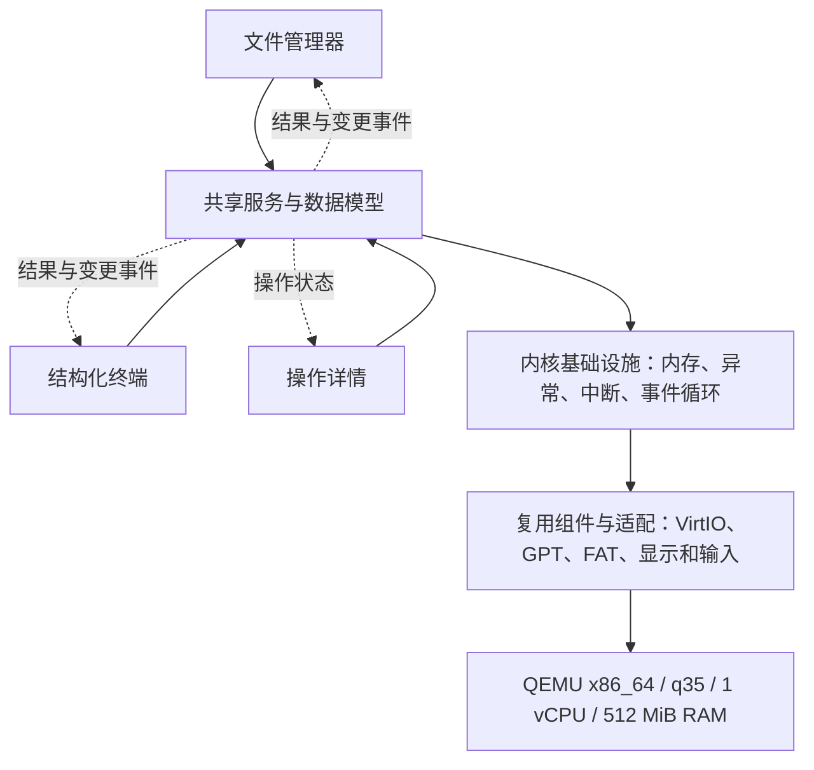
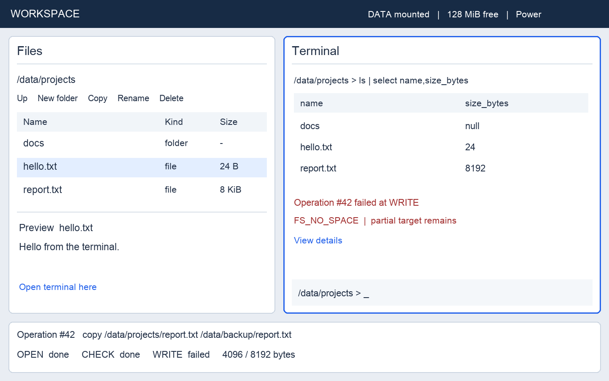

# RadishRoot（萝卜根系）MVP 项目规划

可解释的系统、文件管理器与结构化终端

文档基线 **2.0** · 2026 年 10 月 13 日 · 产品目标 **MVP v0.1** · 实施状态见[当前状态](status/current.md)

## 项目概览

### 定位与正式来源

RadishRoot OS 是以可解释操作与结构化交互为核心的 Rust 实验操作系统，标语为“看见状态，理解操作”。长期定位与后续候选见[完整产品规划](product-plan.md)，实际进度见[当前状态](status/current.md)。本文是第一 MVP 的技术、架构、UI、任务和验收真相源。

第一阶段在固定 QEMU 配置中独立运行，复用引导程序、VirtIO、GPT 与 FAT32 组件，自研必要的内核适配、共享服务和图形工作台。UI 与终端操作同一份真实数据；解释来自真实状态与错误链，不由语言模型生成事实。

### 第一 MVP 成功标准

从安装介质部署到空白虚拟盘，移除介质后独立进入工作台；在文件管理器中新建目录，在终端写入文件，列表自动刷新并能预览；触发一次复制失败并查看准确阶段和副作用；正常关机重启后数据保持，并由宿主独立读盘校验。

### 开发策略变化

- M0 保留真实存储可行性门槛；M1 就贯通双面板、真实 FAT、最小命令、操作记录和正常重启，形成内部预览。
- 文件操作与查询在已有完整路径上逐项扩展；完整自动验收不等到安装器完成才开始建设。
- 使用 FileEntry、VolumeInfo、MemoryStats、OperationRecord 等明确类型，公共接口服务真实重复，不预建万能对象系统。
- 每个阶段区分宿主测试、真实 QEMU、GUI 和独立磁盘校验；M1 预览不替代最终 MVP。
- 家族视觉采用 Workbench 原则；文档与治理保持轻量，工程任务按单人实际投入计算。

| 决策 | MVP 基线 |
| --- | --- |
| 运行环境 | QEMU x86_64 / 固定 q35 机器版本 / OVMF UEFI / 1 vCPU / 512 MiB 内存；TCG 验收 |
| 产品形态 | 固定双面板或单应用铺满，文件管理器、终端与操作详情 |
| 内核形态 | 模块化单体、单地址空间、单核事件循环、内置应用 |
| 存储与安装 | 1 GiB GPT raw 镜像、FAT32 ESP / DATA；复用 Linux Live 安装环境 |
| 首次交互门槛 | M1：已有开发镜像中的真实最小闭环，尚无完整安装交付 |
| 最终交付 | 源码、锁定依赖、镜像、安装介质、运行说明及验收报告 |
| 计划方式 | 32 项任务、94 人日占位估算；M0 后重估，不作日历交付承诺 |

### 使用说明

第 1–8 节定义契约，第 9 节定义阶段门槛，第 10–15 节列出 32 项任务，第 16–17 节列出 24 项验收及证据要求，第 18–19 节记录风险、冻结点和参考资料。FR 编号保留；T / AT 在 2.0 中重新编排，旧稿同号不能直接引用。

任务执行状态统一维护在下文各 T 任务的状态行，复选框只记录指定范围最终完成；current 引用活跃任务摘要和临时停止线。规划不是实现证明；只有对应环境、行为与失败路径获得证据后才能勾选，规则见[进度与证据来源](#planning-state-sources)。

## 能力专题地图

[产品规划](product-plan.md)维护整体目标与长期路线；本节是唯一能力地图，以五个大专题和文档内子专题组织第一 MVP。第 9 节 M0–M5 表示阶段，不代替能力归属；第 10–15 节 T01–T32 是实施切片，继续保留原位置、编号、前置、交付和通过条件。

每项任务只在下表出现一次作为主要归属；跨能力依赖按各任务“前置”及正文契约读取，不重复建任务。表中 FR 是该子专题的主要需求导航，不取代第 16 节完整 FR → AT 覆盖；AT 列由现有任务验收关联汇总，实际标准仍只在第 16–17 节维护。一个 AT 可以跨任务、跨阶段验收，局部通过不能据此宣称整个 AT 完成。

任务链接直达原切片正文与状态；表中不维护状态副本。方案状态、执行状态、验证事实及证据来源见下方[进度与证据来源](#planning-state-sources)。

### 内核与设备

让固定平台可启动、可输入，底层失败有界且可诊断。拥有引导、内存 / DMA、事件循环与设备输入契约；不扩展真机、多核或用户态隔离。依赖生命周期主线的锁定环境，向存储和工作台提供基础能力。

设计真相源：[系统架构](#3-系统架构与责任边界)、[技术选型](#2-技术选型与版本策略)。

| 子专题（本表内维护边界） | FR 导航 | 实施任务 / 状态入口 | 阶段 | 验收关联 |
| --- | --- | --- | --- | --- |
| 启动与故障停止 | FR01 | [T02](#t02-引导串口与最小故障停止) | M0 | AT01 |
| 内存与设备所有权 | FR08、FR11 | [T03](#t03-最小内存pci-与-dma-所有权) | M0 | AT03 |
| 异常、时钟与事件循环 | FR08、FR09 | [T06](#t06-异常时钟与单核事件循环) | M1 | AT04 |
| 图形输入与绘制基础 | FR03 | [T07](#t07-键盘鼠标与-framebuffer-基础) | M1 | AT07 |

**当前 MVP 范围完成条件：**在规定平台完成引导、内存 / DMA、异常与输入基础验收；设备失败与交互压力仍需跨主线集成复验，启动成功不能代表 MVP 完成。

### 存储与文件服务

让用户经共享服务操作真实文件，正常保存有可独立验证的结果。拥有块 / 分区、FAT、路径和文件服务；不绕过服务增加 UI 私有数据源，不承诺断电事务一致性。依赖设备所有权，供工作台消费，并与正常电源及失败解释协同。

设计真相源：[存储与电源行为](#7-存储与电源行为)、[文件与终端行为](#6-文件管理器与终端行为)。

| 子专题（本表内维护边界） | FR 导航 | 实施任务 / 状态入口 | 阶段 | 验收关联 |
| --- | --- | --- | --- | --- |
| 块设备与分区边界 | FR11 | [T04](#t04-块读写flush-与-gpt-边界) | M0 | AT02、AT03 |
| FAT 持久化 | FR11 | [T05](#t05-fat-持久化与独立读盘验证) | M0 | AT02、AT03 |
| 共享文件服务与文件工作流 | FR04、FR05、FR11 | [T08](#t08-明确类型与最小真实文件服务)、[T14](#t14-目录导航与新增--删除流程)、[T15](#t15-复制重命名与覆盖语义)、[T16](#t16-只读预览分页与-utf-8-保真) | M1 / M2 | AT06、AT08、AT10、AT11、AT12 |

**当前 MVP 范围完成条件：**真实文件正常与拒绝路径通过独立读盘核验；完整增改复制删除与预览成立，正常电源闭环和部分失败分别按协同任务验收。

### 工作台与终端

让文件浏览、命令输入与结果定位组成连续工作流。拥有界面、终端 / 查询与双应用联动；不复制 FileService 或拼接外部 shell。依赖设备输入、真实文件服务和操作记录，验收交由生命周期主线整合。

设计真相源：[图形工作台](#5-图形工作台与布局)、[应用行为](#6-文件管理器与终端行为)。

| 子专题（本表内维护边界） | FR 导航 | 实施任务 / 状态入口 | 阶段 | 验收关联 |
| --- | --- | --- | --- | --- |
| 终端输入与结构化查询 | FR06、FR07、FR09 | [T09](#t09-最小终端与共享操作记录)、[T17](#t17-行编辑历史与结构化表格)、[T19](#t19-查询-schema-与-where--select--sort) | M1 / M2 / M3 | AT06、AT09、AT11 |
| 双面板与文件列表 | FR03、FR04 | [T10](#t10-双面板骨架与最小文件列表) | M1 | AT07 |
| 双应用联动与定位 | FR03、FR04、FR10 | [T11](#t11-命令修改到列表与详情的联动)、[T18](#t18-完整双应用定位与文件工作流) | M1 / M2 | AT05、AT08、AT10、AT22 |

**当前 MVP 范围完成条件：**GUI 与终端对同一数据和操作给出一致结果，焦点、空态、错误、长输出及显式定位均可用；串口最小命令不代替完整 GUI 或查询验收。

### 操作解释与恢复

让用户看见真实状态、失败阶段和已知副作用，并在允许范围内继续操作。拥有状态查询、错误解释、代次 / 记录和故障恢复策略；不生成未知底层原因，不把内存操作记录视为跨重启审计。依赖设备与存储事实，由工作台显示，故障复验归整体验收。

设计真相源：[结构化数据与错误契约](#4-结构化数据与错误契约)、[故障验收](#17-故障验收材料与证据)。

| 子专题（本表内维护边界） | FR 导航 | 实施任务 / 状态入口 | 阶段 | 验收关联 |
| --- | --- | --- | --- | --- |
| 系统状态与失败解释 | FR08、FR09、FR11 | [T20](#t20-真实系统状态与对象查询)、[T21](#t21-失败阶段与部分修改解释) | M3 | AT12、AT13、AT14、AT24 |
| 代次、记录与设备故障恢复 | FR08、FR09、FR10 | [T22](#t22-代次事件缺口与记录淘汰)、[T23](#t23-长操作响应与设备故障收口) | M3 | AT11、AT15、AT16、AT18、AT22 |

**当前 MVP 范围完成条件：**真实查询、部分修改、事件缺口、引用过期和超时均有类型结果、可见边界与故障证据；早期 T08 / T09 基础记录只作为依赖，不重复计入任务归属。

### 安装与系统生命周期

让同一候选可构建、正常退出、独立安装并完整复验。拥有工具入口、电源、跨能力验收与安装交付；不由本地完成自动推导发布许可。依赖其余四条能力主线，保留内部预览、最终 MVP 与对外发行的边界。

设计真相源：[构建与安装](#8-构建运行与安装交付)、[里程碑](#9-里程碑与完成规则)、[验收矩阵](#16-验收矩阵与需求追踪)。

| 子专题（本表内维护边界） | FR 导航 | 实施任务 / 状态入口 | 阶段 | 验收关联 |
| --- | --- | --- | --- | --- |
| 构建与环境基线 | FR12 | [T01](#t01-建立可编译工作区与环境清单) | M0 | AT01、AT23 |
| 正常同步与电源 | FR02、FR11 | [T12](#t12-正常-syncreboot-与-shutdown) | M1 | AT05、AT14 |
| 整体验收与候选收口 | FR01–FR12（整合验收） | [T13](#t13-m1-演示入口与首轮真实验收)、[T24](#t24-扩展主路径自动化与独立校验)、[T25](#t25-资源循环与输入响应测量)、[T26](#t26-关键故障回归与交互复核)、[T27](#t27-开发镜像候选与范围收口)、[T32](#t32-完整候选端到端复验与交付审查) | M1 / M4 / M5 | AT01–AT24 |
| 安装与交付材料 | FR01、FR12 | [T28](#t28-完整发行镜像与校验清单)、[T29](#t29-linux-live-安装载体与目标保护)、[T30](#t30-安装失败与独立启动验收)、[T31](#t31-整理操作说明与交付来源) | M5 | AT19、AT20、AT23 |

**当前 MVP 范围完成条件：**完整候选满足 M0–M5、FR01–FR12 与 AT01–AT24，安装后独立启动和正常关机成立，来源 / 许可与缺陷门槛满足；对外发布仍单独授权。

### 进度与证据来源

| 事实 | 唯一维护位置与规则 |
| --- | --- |
| 产品方向与方案状态 | 产品规划、本文对应契约；草案 / 已确认 / 已替代单列，不等同执行结果 |
| 任务执行状态与完成范围 | T01–T32 各节状态行及契约；待开始、进行中、待验收、已完成，另标阻塞 / 暂停；复选框只表示该任务指定范围通过 |
| 当前重点与下一步 | [current](status/current.md)引用任务摘要，保留活跃阻塞、顺序与临时停止线，不复制全量任务表 |
| 验收标准与需求覆盖 | 第 16–17 节 AT 矩阵、FR 覆盖与证据要求；不在专题地图复制预期 |
| 运行证据与历史结果 | 任务契约指向的[环境清单](development/environment.md)、忽略目录报告及[月度日志入口](README.md)；记录候选、环境、实际结果与未验范围 |

T07 的基础输入、T08 的最小服务、T09 的串口命令各有完成边界。T10 图形工作台、T11 自动联动与 T12 专用电源验收按各自任务状态和本地证据判断。M1 的 Golden Path 与 AT05 / AT06 / AT07 整合结果见 [T13](#t13-m1-演示入口与首轮真实验收)。T32 汇总最终候选时保留早期证据各自的版本和覆盖范围。

子专题可以分期交付，大专题只汇总已交付基线与剩余范围，不按任务数计算产品完成率。新增细化留在所属任务或本表对应子专题；只有独立维护需要出现时才提取文件。本文基线 2.0、FR / T / AT 和 M0–M5 均保持不变。

## 1 功能范围与需求编号

下表全部为完整 MVP v0.1 的必需范围（范围优先级 P0，与缺陷等级分开）。M1 只验证其最小纵向子集，不代表本表全部完成。采用受限而完整的功能集；新需求先判断是否影响启动、存储、交互或验收链路，再决定纳入当前版本。

| 编号 | 范围 | 完成边界 |
| --- | --- | --- |
| FR01 | 启动与安装 | UEFI 从固定规格磁盘启动；安装介质可部署系统并校验；可移除介质独立启动 |
| FR02 | 电源管理 | sync、reboot、shutdown；写回失败时保留错误状态，不伪报成功 |
| FR03 | 图形工作台 | 文件管理器和终端双面板或单应用铺满；鼠标、键盘、焦点和滚动 |
| FR04 | 文件管理 | 路径导航、列表、详情、新建目录、单文件复制、重命名、删除文件及空目录 |
| FR05 | 文本预览 | 有大小上限的只读文本预览；超限、二进制和不支持字形有明确提示 |
| FR06 | 终端交互 | 命令行编辑、退格、历史、输出滚动、基础帮助和路径参数 |
| FR07 | 结构化查询 | 记录及表格结果；where、select、sort；字段和类型错误可解释 |
| FR08 | 系统可观察性 | system、memory、disks、volumes，显示真实状态及失败原因 |
| FR09 | 操作记录 | 唯一操作编号、阶段、结果、错误链、部分完成状态；有限容量记录 |
| FR10 | 双应用联动 | 打开终端定位目录；命令修改触发列表刷新；结果定位文件；共享操作详情 |
| FR11 | 持久化 | FAT32 文件在正常 sync 和关机重启后保持；不承诺突然断电后的事务一致性 |
| FR12 | 可重复交付 | 一组固定脚本完成构建、启动、测试；输出依赖和运行环境清单 |

### 明确的首版限制

单用户、单核、单地址空间。仅支持选定 QEMU 配置及固定设备；不包含真机、网络、USB、GPU 加速、第三方程序、POSIX 兼容、包管理、进程隔离和完整窗口管理器。

文件操作限定在数据卷内；复制和删除不递归，不支持跨卷移动、符号链接、权限管理、文件撤销、版本快照或热拔插。覆盖已有目标默认拒绝，终端显式参数或 UI 确认后才允许。

首版命令和界面文案使用英文，存储层保留 UTF-8 数据。中文输入法、完整 CJK 字库和复杂文字排版另行规划；遇到不支持的字形显示占位或转义，不损坏原始路径和文件内容。

## 2 技术选型与版本策略

“选定”表示本规划的默认方向；“待验证”表示必须在 M0 的目标环境中证明可用。没有任何库可以替代内核的资源所有权、地址映射和错误处理设计。

| 层次 | 默认选择 | 适配工作与状态 |
| --- | --- | --- |
| 虚拟硬件 | QEMU x86_64 + q35 + OVMF | 锁定 QEMU 版本、带版本机器名、固件和配置；TCG 为跨平台验收基线 [R1] |
| 引导 | Limine + Rust limine crate | 对齐协议修订；获得内存图与 framebuffer；校验请求是否受支持 [R2] |
| 工具链 | 固定日期 nightly；x86_64-unknown-none | no_std + alloc；提交 rust-toolchain.toml 和 Cargo.lock；精确日期在 M0 冻结 |
| CPU 与内存 | x86_64 + linked_list_allocator | 自建物理页分配与映射策略；预留内核、固件信息、framebuffer 和 DMA 内存 [R3] |
| 磁盘 | virtio-drivers / modern VirtIO-blk PCI | PCI 发现、BAR 映射、总线主控、DMA 分配、地址转换和完成等待 [R4] |
| 分区 | gpt_disk_io | 提供 BlockIo；校验边界、CRC 和主备结构；不实现交互式分区编辑 [R5] |
| 文件系统 | rust-fatfs / FAT32 | 关闭 std 等默认特性；块到字节流适配；固定可编译 release 或 commit [R6] |
| 显示 | framebuffer + embedded-graphics | 实现 DrawTarget；后台缓冲区、文字、图标和控件；软件绘制 [R7] |
| 输入与串口 | PS/2 + pc-keyboard；uart_16550 | 自建 i8042 接入与鼠标协议适配；接入现有扫描码解析 [R8] [R9] |
| 宿主 UI 验证 | embedded-graphics-simulator | 只用于宿主 runner；生产内核不链接宿主窗口库 [R10] |
| 镜像与安装 | Linux 工具环境 + GPT/FAT 工具 | 固定工具版本；复用已有 Linux Live 环境和部署工具，自研薄包装 |
| 构建与测试 | Cargo workspace + xtask + QEMU | 统一入口、超时、退出码、串口事件收集和结果校验 |

### 依赖管理规则

M0 记录每个组件的版本或 commit、许可证、功能开关、目标平台编译结果。Git 依赖必须固定 commit；默认禁止在持续集成中跟随主分支。保留上游许可证和必要声明。

若 FAT、VirtIO 或 Limine 的既定组合失败，先定位接口或工具链问题，再评估版本调整或兼容替代库。替换必须保留相同服务接口和验收用例；不同时维护两套引导或文件系统路线。

## 3 系统架构与责任边界

图 1  运行时依赖从界面到硬件逐层收敛  结构化结果和事件反向更新界面

文件管理器、终端和操作详情都调用共享服务。文件管理器直接提交类型化请求，不拼接 shell 命令。终端解析后也转换成相同请求，因此路径规则、写回规则和错误语义只有一份。

| 模块 | 职责 | 不得依赖 |
| --- | --- | --- |
| system-core | FileEntry、VolumeInfo、MemoryStats、OperationRecord 等明确类型与公共错误 / 事件契约 | 硬件、字体、终端排版 |
| services | FileService、SystemService、操作记录与变更发布 | 具体 UI 控件或命令字符串 |
| shell | 命令解析、参数校验、结构化查询 | framebuffer 和驱动细节 |
| ui | 视图状态、控件、焦点、渲染与应用联动 | 直接访问磁盘或解析 FAT |
| kernel / platform | 启动、内存、中断、时间、设备和电源适配 | 宿主 std 或桌面窗口库 |
| host-runner / xtask | 宿主模拟、镜像工具、构建与测试 | 不能成为内核运行时依赖 |

### 执行与内存模型

采用单核事件循环。中断只采集输入和计时事件，主循环执行服务与 UI 更新。长复制按块推进，阶段之间处理输入和重绘；首版不依赖线程、异步运行时或用户态进程。

轮询磁盘请求必须有超时。超时后若设备仍可能访问 DMA 缓冲区，不能直接释放或复用内存；先完成设备复位或将设备离线。内核与应用暂不隔离，一个内核缺陷可能影响全系统。

## 4 结构化数据与错误契约

| 契约 | 最小字段 | 规则 |
| --- | --- | --- |
| FileEntry / FileRef | volume_id、path、kind、size_bytes、generation | 文件大小为整数，目录大小为空；引用携带卷与代次，使用前重新验证 |
| VolumeInfo / DiskInfo | id、capacity_bytes、read_only、mount_state、flush_support | 从真实驱动与挂载状态读取，未知字段为空并标明范围 |
| MemoryStats | total_bytes、tracked_bytes、allocated_bytes、scope | 已统计与未知范围分开，不把未统计内存当作可用 |
| OperationRecord | boot_id、operation_id、request_kind、target、stage、status、error | 有限内存记录；事件累积形成视图，不能反过来改写执行事实 |
| TypedResult | schema、records、truncated | 值支持字符串、整数、布尔、空值；字节数保持数值类型；结果有容量上限 |
| CommandRequest | command、typed_args、context | 命令注册表声明参数、输出字段、是否修改数据；先校验再执行 |
| OperationEvent | boot_id、operation_id、seq、stage、status | 事件有序、关联到同一操作；时间使用启动后单调时钟 |
| SystemError | code、stage、object、cause、partial_effect | 保留底层错误来源；不知道原因时明确 unknown；记录已产生的副作用 |
| ChangeEvent | volume、paths、generation、operation_id | 成功修改或部分修改后通知；订阅者检测版本缺口后重新查询 |

### 具体类型优先

`SystemObject` 不作为万能属性字典落地。共享对象引用使用有穷枚举或明确结构，命令注册表声明具体输入与输出 schema。`TypedResult` 只承担公共展示和查询投影，底层服务保留领域类型；不为任意动态字段、插件注册和反射建立首版框架。

文件引用不是 FAT inode 身份承诺。卷代次变化后重新查询路径，不能把同路径的新文件当作旧对象；终端历史保留快照，定位时提示失效或要求用户重新选择。对象 ID、操作 ID、错误码的角色分开。

解释视图分别显示“已知事实 / 未知信息 / 可采取的动作”。建议重试不等于操作已经恢复；没有底层依据时不推断权限、磁盘损坏或数据完整性。

### 命令结果不等于打印文本

ls 返回 FileEntry 记录，包含 name、path、kind、size_bytes。目录大小暂用空值；UI 显示为横线。管道先在记录上筛选和选择字段，最后由串口或图形表格渲染。

示例：ls /data | where kind == "file" | select name,size_bytes。首版 where 仅支持一个字段与字面量的比较；select 接受字段列表；sort 接受一个字段及方向。null 仅支持相等 / 不等判断，排序固定置后；等值记录保留原顺序，字符串首版按 UTF-8 字节序比较，不承诺本地化排序。未知字段、类型不匹配和超限必须报明确错误。

首版管道只接受查询和变换命令，修改类命令单独执行。所有阶段先完成参数和 schema 校验；查询结果超限采用显式报错；目录列表另用分页，不允许悄悄返回看似完整的查询结果。

### 操作状态机

Created → Validating → Running → Flushing → Succeeded。任何阶段均可进入 Failed，并记录最后成功步骤、错误步骤及 partial_effect；只读操作不进入 Flushing。

“Succeeded”只有在该操作要求的文件系统写回与块设备 flush 完成后才发布。取消长操作暂不承诺；运行期间允许查看状态。磁盘满导致目标文件只写入一部分时，必须显示已写字节数和目标是否保留。

### 记录与稳定性

操作事件先写入有上限的内存环形缓冲区，并输出到专用调试通道；第一阶段不要求跨重启保存。事件被淘汰时保留缺失提示。常规日志、命令输出和机器可读测试事件应区分通道或采用明确帧格式。

## 5 图形工作台与布局

图 2  早期双面板布局参考；仅说明信息组织，非已实现界面或最终配色稿。正式视觉与状态规则以本节为准。

默认请求 1024 × 768 显示模式，实际按引导提供的尺寸和像素格式初始化。双面板以该尺寸作为设计与验收基线；支持单应用铺满。较小显示区域可以使用单面板布局，无法安全绘制时保留串口诊断。

### 家族视觉与首轮状态设计

参考 RadishX family-ui `v26.7.3` 的 Workbench：近白或低眩光中性工作面、克制的灰玉强调、有序密度、清楚的文本层级与状态。只借鉴规则，不复制 Web 组件、外部参考截图或整套主题运行库。M1 将 background、surface、text、muted、border、focus、accent、success、warning、error 映射为本地 Rust 样式值；映射集中定义，数值在实际 framebuffer 上核对后冻结。

M1 先覆盖启动中、空目录、正常列表、命令执行、成功、失败、操作详情和关机失败八种状态。M2 / M3 按功能扩展分页、预览、覆盖确认、只读、满卷、部分完成和事件缺口。每次增加状态同时验键盘、鼠标与清楚的恢复入口；错误不能只靠颜色区分。

第一版只要求一个可读主题，不预做主题编辑器、复杂动画或品牌欢迎页。字号、对比度、焦点、截断提示与 1024 × 768 下的可操作性优先。文档使用中文；产品英文界面与 UTF-8 保真分开，中文显示和输入另行评估。

### 工作台组成

顶部提供系统简况、应用切换和电源入口；左侧文件管理器包含路径、工具栏、文件表格和预览；右侧终端包含历史结果和命令输入；底部按需展开操作详情。焦点面板具有明确边框或标题状态。

### 绘制与控件

自研控件限定为文本、按钮、单行输入框、列表或表格、滚动条、分隔面板、对话框和进度条。图标使用简单几何或小型位图资源，首版不引入复杂主题或动画系统。

通过 embedded-graphics 绘制到内存后台缓冲区，再复制到 framebuffer。先完成正确的整帧刷新，测量后再增加局部刷新；UI 状态变化或光标更新才触发绘制。framebuffer 适配必须处理行跨度、像素格式和边界。

### 输入规则

统一输入事件包含按键、文本输入、指针移动、按下与释放。点击决定焦点；Tab 在可操作控件间切换，Enter 激活动作，Esc 关闭对话框。首版鼠标左键和拖动滚动条即可完成操作，滚轮属于可选增强。

## 6 文件管理器与终端行为

| 场景 | 文件管理器行为 | 终端与共享服务行为 |
| --- | --- | --- |
| 进入目录 | 路径栏、上级按钮、双击目录或 Enter | cd 修改当前目录；“在终端打开”显式同步目录 |
| 显示目录 | 名称、类型、大小；选中后显示详情 | ls 返回同一 FileEntry 数据；排序和字段筛选使用类型化值 |
| 创建与修改 | 新建目录、重命名、单文件复制；不做完整文本编辑器 | mkdir、write、cp、mv；mv 首版仅同卷重命名 |
| 删除 | 确认后删除文件或空目录；非空目录显示受限原因 | rm 使用同一删除服务；无回收站，帮助中写明语义 |
| 目标已存在 | 默认拒绝；明确确认后才能覆盖文件 | cp 和 write 需要显式覆盖参数；目录不能被文件覆盖 |
| 失败与部分完成 | 显示错误入口；部分修改后仍刷新相关目录 | 返回 SystemError，并提供 explain &lt;operation_id&gt; |
| 切换与定位 | 可打开终端到当前目录；查询结果可定位到文件 | 切换目录不隐式改变另一面板，只有显式联动动作才同步 |

### 必须实现的界面状态

文件区覆盖加载中、空目录、正常列表、读取失败、只读卷、磁盘满、对象已消失和路径过期。终端覆盖空输入、编辑中、执行中、成功、失败、结果超限和历史耗尽。每种状态都要能通过测试数据稳定触发。

目录采用分批加载和有限可见行，加载期间界面可响应。预览仅读取前 64 KiB；超过上限明确标示截断；二进制或非法编码显示“无法文本预览”，不得把预览错误当成文件损坏结论。

### 变更一致性

FileService 在修改成功或留下部分副作用后发布 ChangeEvent。文件管理器按路径范围重新查询；终端历史结果保留当时快照，不自动改写。点击旧结果定位文件时重新验证对象，重命名或删除后显示明确状态。

### 路径与文件语义

统一路径层负责绝对 / 相对路径、`.`、`..`、分隔符与卷边界；不得用字符串前缀替代边界判断。FAT 名称长度、非法字符、大小写与碰撞规则以锁定库的实测语义冻结，UI 与终端采用同一校验，不静默改名或转码。M0 验证 UTF-8 名称的写入与独立读回；不支持的名字明确拒绝，原始合法名称不得因显示缺字而损坏。

`write` 首版写入命令中的文本，不是完整编辑器；显式覆盖可能在失败时留下部分结果，不承诺原子替换。`mv` 只支持同目录或同卷的既定重命名能力，跨目录能力须由锁定 FAT 库验证；若库不能可靠实现，则在 M0 冻结为同目录重命名并在帮助中明确，不伪称支持跨卷移动。

### 终端能力边界

提供命令行插入、退格、光标移动、上下历史、输出滚动，以及结构化结果的文件定位动作。它运行内置命令；第一阶段不承诺终端模拟器兼容性、PTY、ANSI 全集、外部程序或 shell 脚本。

最小命令集为 help、clear、history、system、memory、disks、volumes、ls、cd、pwd、cat、mkdir、write、cp、mv、rm、where、select、sort、operations、inspect、explain、sync、reboot、shutdown。

## 7 存储与电源行为

| 区域 | 格式与容量 | 读写策略 |
| --- | --- | --- |
| 整盘 | 1 GiB raw 镜像，GPT，512 字节逻辑块 | 固定容量首版；根据实际容量校验主备 GPT 与分区边界 |
| EFI 系统分区 | 128 MiB FAT32 | 包含 Limine、内核、启动配置；系统内只读 |
| DATA 分区 | 其余可用空间，FAT32 | 挂载至 /data；目录和文件由统一服务访问 |
| 内存对象 | 启动事件、操作记录和 UI 状态 | 有限容量；不承诺跨重启保存 |

### 完整的读写路径

FileService → FAT 文件系统 → 分区字节流适配 → 块设备接口 → VirtIO-blk → QEMU 磁盘镜像。分区适配层负责起始偏移、长度和越界校验；不能让普通文件操作触及整盘或启动分区。

字节流适配处理非对齐读写、seek 和跨扇区访问。块设备明确容量、块大小、只读状态及 flush 能力；写入采用有边界的读改写，不假设 FAT 每次都给出完整扇区。

系统按分区类型与标识定位卷，不写死扇区偏移。GPT 主结构损坏但备份可验证时，可在明确降级状态下继续只读诊断；两者均无效时拒绝挂载。首版不自动修复损坏的分区和文件系统。

### 错误和写回

区分无空间、只读、未挂载、找不到文件、非法路径、设备 I/O 失败、超时和格式错误。FAT 库、字节流适配和驱动错误逐层保留原因。库不提供的信息不能通过猜测生成。

修改命令完成时刷新文件及目录元数据，再传递到底层块设备 flush；若设备不支持所需持久化能力，M0 不得通过。默认不另加全局异步写缓存，先减少写回状态数量。

### 正常关机

进入关机状态后拒绝新的修改请求，完成在途操作，刷新文件系统与设备，再由固定 QEMU 平台适配执行关机。第一版可使用针对该机器配置的电源实现，不要求通用 ACPI 解释器。

flush 失败时停止正常关机流程，界面保留错误和已知状态。测试中主动强制终止 QEMU 属于故障注入，不等同于正常关机成功。FAT32 没有被本项目增加事务保证；断电后一致性恢复另行规划。

## 8 构建运行与安装交付

### 工作区结构

| 目录或 crate | 职责 |
| --- | --- |
| kernel | 启动入口、平台适配、内存、中断、设备与电源 |
| system-core / services | 数据契约与服务实现；以 no_std + alloc 为共同基线 |
| shell / ui | 命令与结构化查询；视图、控件和双应用交互 |
| host-runner | 模拟显示和输入；内存后端或测试磁盘后端 |
| xtask / tests / assets | 构建和镜像工具；验收夹具；字体和图标资源 |
| docs / third-party | 架构决策、运行说明、验收记录；许可证清单 |

### 统一入口

统一入口为 `cargo xtask`。T01 已实现 `build --profile dev|release [--fresh]`、`check`、`test --host` 和 `help`；本机有工具链环境覆盖时须显式使用项目 nightly，实际命令见[开发规范](development/standards.md#t01-本地入口)。T02 已增加 `image`、`run --serial`、`test --vm`；T07 已增加 `run --gui` 与 `ui --host [--gui]`，T10 增加真实盘宿主工作台与 `--workbench-only`。T13 接入首轮 [`demo`](development/standards.md#t13-m1-自动演示入口)，整合验收按 T13 状态判断。`package` 与 `verify-install` 随 T24、T29–T31 的实际能力建立。每个入口需给出明确退出码、参数说明、超时和输出位置；不建立默认返回成功的占位入口。开发 shell 包装仅转发至同一 xtask 实现。

构建在宿主执行；镜像制作使用锁定的 Linux 工具环境，复用 GPT、mkfs.fat 和文件复制工具。固定工具链、固件、机器配置及依赖，并记录版本和校验值。目标是可重复构建和运行，不在首版承诺镜像逐字节可重现。

### 安装介质

复用已有 Linux Live 环境及磁盘工具，附带系统 raw 镜像、校验文件和部署包装。首版只处理指定的空白 1 GiB 虚拟磁盘；安装前展示目标容量与标识，拒绝源介质、非空盘和不符合规格的目标。

部署程序验证源镜像，写入整盘，执行写回，再从目标盘读取并校验。任何步骤失败都不能报告安装成功。中断后保留失败磁盘用于诊断，重新创建空白虚拟盘再安装，不自动覆盖已变为非空的目标。完成后移除安装介质，使用新的 UEFI 变量存储验证从目标盘启动，避免依赖安装环境留下的启动项。

### 首版交付包

交付源码与锁定依赖、system.img、安装介质、QEMU 启动脚本、校验清单、许可证声明、用户操作说明和 acceptance-report。报告记录代码版本、环境、用例结果、日志及截图位置。

镜像生成和安装仅操作任务创建的文件及测试虚拟磁盘。开发用磁盘副本与发布镜像分开保存；重新生成启动镜像不能默默覆盖用户数据盘。

## 9 里程碑与完成规则

| 阶段 | 目标 | 任务 | 退出门槛 | 估算人日 |
| --- | --- | --- | --- | --- |
| M0 | 依赖与真实存储可行性 | T01–T05 | 内核写入、flush、重启读回、宿主独立校验与候选组合冻结 | 14 |
| M1 | 第一条真实图形闭环 | T06–T13 | 在 QEMU 中完成列表、终端写入、刷新、操作详情和正常重启 | 24 |
| M2 | 完整文件工作流 | T14–T18 | 文件增改复制删除、覆盖边界、预览、分页、双应用定位与历史 | 16 |
| M3 | 结构化查询与完整解释 | T19–T23 | 查询管道、真实状态、部分失败、事件缺口及长操作均可验证 | 16 |
| M4 | 稳定性与复验收敛 | T24–T27 | 自动主路径、独立校验、压力、输入延迟和缺陷门槛通过 | 11 |
| M5 | 安装与 MVP 交付 | T28–T32 | 空白盘安装、移除介质独立启动、全部验收及复现材料 | 13 |
| 合计 | 完整 MVP | T01–T32 | 阶段预览不能替代发布验收 | 94 |

### 开发顺序与投入

按 M0 → M1 → M2 → M3 → M4 → M5 串行推进。M1 中宿主视图与服务测试可交替迭代，但阶段完成必须在真实 QEMU 与同一持久化磁盘成立，不假设额外并行人力。

每人日按 8 小时计，94 人日只是任务拆分的工作量占位（752 小时），尚无本项目实测速度。全职 40 小时 / 周约 19 周；预留 20%–30% 后约 23–25 周。若每周投入 h 小时，按 `752 / h` 估算基础周数再加缓冲；每周 10 小时约 75 周基础量，不应沿用全职日历。实施开始时记录实际预算，M0 后按实际接入成本重新估算，M1 后再按集成速度调整。不得为赶日期削弱存储或错误验收。

### 两个不同的完成概念

- **M1 内部预览**：已有开发镜像，固定 /data，最小命令和列表，基本输入、操作详情与正常关机。允许界面粗糙，不允许虚假成功、写坏卷或把内存后端当真实盘。
- **MVP v0.1 完成**：FR01–FR12 与 AT01–AT24 全部覆盖，安装交付和缺陷条件满足；最后一次候选变动后重跑受影响证据。

### Golden Path：固定演示故事

1. 从专用开发盘启动工作台，查看 /data。
2. 在终端执行 `write /data/hello.txt "hello RadishRoot"`；该路径在本次夹具中不存在。
3. 文件区无需手动刷新即出现文件；终端结果包含操作编号。
4. 打开详情，看到校验、写入、文件系统写回和设备 flush 的成功阶段；用已有文件名重复写入，默认拒绝且原内容不变。
5. 执行正常 shutdown，退出后宿主以独立 FAT 读取工具校验路径、长度和字节。
6. 用同一磁盘副本再次启动，列表与内容一致；新的 boot_id 不误关联上次内存操作记录。

M2 起扩展为文件管理器创建目录、终端写入、预览、复制重命名和定位；M3 起加入一次满卷或写入失败的解释；M5 将开发镜像起点替换为从安装介质部署。正常片段和故障片段使用独立镜像副本，避免互相污染。

### 完成定义

任务需有明确输入、实现 / 文档、实际验证、失败行为与证据位置；只完成宿主部分则不能标记要求 QEMU 的任务通过。新增 unsafe 记录所有权与资源前提。接口变化同步宿主与内核调用方，确认 no_std 依赖闭包。

证据必须与代码、工具链、固件、磁盘和 fixture 版本关联。支持生成结构化报告的入口只在能力存在时建立；没有入口不能填“检查通过”。开发者报告与独立校验分别留证。

### 资源与响应上限

初始预算：单行命令 4 KiB、历史 100 条、查询结果 1000 行或 1 MiB、文本预览 64 KiB、操作记录 256 条、目录每页 200 条。查询超过上限明确错误且不显示貌似完整的部分表格；目录通过分页访问全量。队列与记录溢出可观察，淘汰不扩大内存。

M1 记录内核 / heap / framebuffer / DMA / UI / 缓存预算及测量范围；内存不足不能覆盖保留区。固定验收宿主上连续 100 次输入，“输入事件进入 guest 到下一次可见绘制”的 P95 初始目标不超过 150 ms，空闲和复制期间分别测量；记录事件与帧的时序，人工截图不等于性能测量。主机、TCG 版本和负载随报告保存，必要的阈值变更先说明依据并更新正式基线。

## 10 M0 依赖与真实存储可行性任务

阶段门槛：内核写入、flush、同盘重新启动读回、宿主独立校验与候选组合冻结；正常 reboot / shutdown 另在 T12 验收。本阶段预估 14 人日；不是已确认排期。

T01–T05 的分批实施契约保留各自引入时的范围与证据，不表示后续实现仍停留在该阶段。当前组合以已落地的后续契约补充：T06 已将全程 IF=0 改为初始化后启用定时 IRQ，Exclusive 在短临界区保存 / 恢复 IF，MMIO 映射扩展到 HPET，块请求加入单调时限，默认启动进入持续事件循环。最新运行入口见开发规范，实际阶段及授权见 current。

### T01 建立可编译工作区与环境清单

- [x] 本地实现与必要验证通过；新增 Linux CI 配置已同步但远端未执行。实际证据与限制见[当前状态](status/current.md)及[开发环境清单第 2.10 节](development/environment.md#210-t01-工作区与真实链接验证)。

预计 2 人日 · 前置：无 · 验收关联：AT01、AT23

**交付：**Cargo workspace、固定工具链、目标配置和实际 build / host 检查入口；环境与来源记录。第一批没有第三方 crate，原创许可仍待定。

**通过条件：**干净目录能编译最小 no_std 内核，宿主与内核依赖隔离；环境清单记录 QEMU、机器版本、固件、Rust 与功能开关。

#### T01 实施契约与验证入口

本节细化已有 T01，不扩大到 T02 引导或业务功能。实施顺序为工作区与工具链选择、真实内核链接、宿主检查与失败测试、CI 接入及证据收口；每步保留实际输出，失败停在对应阶段。以下文件和三个实际入口已实现；本地验收见环境清单，远端 CI 与产品运行分别记录。

**最小文件与依赖范围：**

| 位置 | 具体职责与边界 |
| --- | --- |
| 根 Cargo.toml / Cargo.lock | 虚拟 workspace，仅含 kernel 与 xtask；edition 2024、resolver 3，default-members 为 xtask。产品版本仅由 workspace.package.version 提供，成员继承；当前开发版本为 26.10.0-dev，publish=false，不创建 tag 或宣称发行 |
| rust-toolchain.toml | 工具链日期的唯一配置源：nightly-2026-10-13、minimal、rust-src / rustfmt / clippy、x86_64-unknown-none；不把 macOS host 后缀写入跨宿主配置，不改全局默认 |
| .cargo/config.toml | xtask alias 只转发到宿主包；裸机 flags 仅放在对应 target 段。不开 workspace 全局 build.target，不把 kernel 的链接脚本或 panic 设置传播到宿主 |
| kernel/Cargo.toml、kernel/src/main.rs | 包名 radishroot-kernel，no_std / no_main，最小不返回的入口和 panic handler；不分配堆、不访问设备、不输出启动成功。关闭该裸机 bin 的宿主 test / bench harness；暂不建立库或业务模块 |
| kernel/linker.ld、kernel/build.rs | 链接布局单一来源；build.rs 只用标准库，按 CARGO_MANIFEST_DIR 取得脚本绝对路径，向本包 bin 发出链接参数、OUT_DIR 下的 linker map 输出和 rerun-if-changed，不编译 C、下载资产或实现产品行为 |
| xtask/Cargo.toml、xtask/build.rs、xtask/src/ | 包名 xtask，宿主 std；承担参数解析、前置检查、子进程执行、ELF 结构检查和结果记录。build.rs 仅记录编译器 commit / host，运行前与项目工具链核对；按这些实际职责组织模块，不依赖 kernel，不构造通用插件 / 进程管理框架 |
| .github/workflows/pr-check.yml、scripts/check-repo.py 及其 tests | Rust 检查进入既有 Candidate Quality；同步任务集合、超时规则与拒绝回归，详见下文 |

第一批不引入 crates.io / Git 第三方 crate；kernel 仅使用预编译 core，xtask 与 build.rs 仅使用标准库，Cargo.lock 由实际 workspace 离线生成并提交。保留 rust-src，但不启用 build-std、不新增自定义 target JSON、完整 LLVM 或交叉 C 工具链。system-core、services、shell、ui、host-runner 在有实际职责时再建立；alloc / allocator、Limine 配对与内存、设备初始化分别留在对应后续任务。

**工具链与目标隔离：**本机 RUSTUP_TOOLCHAIN=1.96.0 仍有效，初次入口显式使用 `cargo +nightly-2026-10-13 xtask …`。本地执行前设置仅本进程的 RUSTUP_AUTO_INSTALL=0，缺工具链 / 组件直接失败，不隐式安装。xtask 在仓库根清除仅探测子进程的 RUSTUP_TOOLCHAIN，让 rustup 按项目文件解析指定工具链；若解析来源是目录 override 或默认值则报错。将实际运行工具链与该解析结果比较，子命令使用同一已装工具链的 rustup run，不带 --install；不另抄一份日期到 Rust 常量、alias 或 CI。官方选择规则与自动安装开关见 [rustup overrides](https://rust-lang.github.io/rustup/overrides.html)、[环境变量](https://rust-lang.github.io/rustup/devel/environment-variables.html)。

宿主 triple 从选定 rustc -Vv 取得；宿主 check / clippy / test 与 kernel build / clippy 分别指定包和目标，禁止用 workspace 全量命令把 xtask 编成裸机或把 kernel 硬件入口当宿主测试。T02 新增无硬件访问的 kernel lib，允许仅以 `--lib` 运行其纯校验测试。检查会影响编译结果的外部 RUSTFLAGS / CARGO_ENCODED_RUSTFLAGS、CARGO_BUILD_TARGET、编译器 / linker override 和上层 Cargo 配置，只报告相关键及冲突，不打印整个环境或凭据。T01 对外部 Cargo 配置文件整体拒绝；项目配置只接受 xtask alias 与裸机 target 的 rustflags，工具链文件接受当前单行 schema，未知键或重复键拒绝；冲突时要求明确修正，不通过静默忽略或切换 target 继续。Cargo 分层配置和 target flags 依据[官方配置说明](https://doc.rust-lang.org/cargo/reference/config.html)。

**最小链接契约：**采用内置 x86_64-unknown-none 与 rust-lld GNU 模式，沿用 kernel code model、无 red zone、panic=abort；对裸机目标明确采用 static relocation 和非 PIE 链接，产出 ELF64 little-endian x86_64 ET_EXEC。链接脚本以 `0xffffffff80000000` 为 T01 虚拟链接基址，入口 `_start` 位于可执行段；按 4 KiB 对齐分离 text RX、rodata R、data / bss RW，空只读 / 数据段允许省略，禁止 RWX 段、动态解释器及动态链接段。入口、panic handler 仅形成最小不返回路径；Rust 2024 的导出符号 unsafe 属性须注明唯一符号与调用前提，不引入硬件 unsafe。

上述地址只约束静态产物，不代表已建立分页、物理装载地址或启动栈；实际加载及协议响应由 T02 完成。用 linker ASSERT 与产物检查同时拒绝入口 / 段布局错误，不以吞掉未知 alloc section 的方式让链接通过。脚本根据[LLD 文档](https://lld.llvm.org/ELF/linker_script.html)已实现的基本语法编写，最终以本机 LLD 23.1.3 的真实链接验证；不假定网页新版本中的全部功能在当前工具链可用。

**实际入口与失败行为：**

| 入口（统一前缀 cargo +nightly-2026-10-13 xtask） | 实际工作与成功条件 |
| --- | --- |
| check | 工具链 / 组件 / target / 配置前置检查；fmt --check；宿主与裸机分别 check / clippy 并拒绝警告。此命令不代替最终链接 |
| build --profile dev 或 release，可加 --fresh | 以 --locked --offline 显式构建 radishroot-kernel 的裸机 bin；使用本次输出文件检查 ELF，成功记录产物路径与身份；无输出、错误格式或子进程失败均不得成功 |
| test --host | 只运行 xtask 的真实宿主测试，包括参数、配置冲突、ELF 边界及子进程失败；不声称运行了裸机单元测试或 QEMU |

首次生成 Cargo.lock 使用 --offline，之后所有构建、检查、测试及依赖查询的 Cargo 子命令均使用 --locked --offline；fmt 只做检查、不改文件。初始只实现这三个子命令和 help；image / run / demo / package / verify-install 等未知或尚未实现的命令返回使用错误，不能空返回成功。退出码约定为 0 成功、2 参数错误、1 前置 / 构建 / 校验失败、124 超时；子进程原始退出码或信号单独记录。单个 Cargo 子进程初始上限 120 秒，可显式调整并记录；超时先停止本任务进程组并等待回收，不能残留 rustc / linker 或将半成品记为有效。

日常输出位于忽略的 target/；--fresh 为本次执行新建唯一子目录，同时关闭增量编译，不删除或复用旧目录。独立验收记录放在 evidence/ 下的任务目录，包括源码提交与工作树状态、工具身份、命令 / 目标 / features、锁文件与产物摘要、各阶段退出结果。摘要由已有系统工具读取，不为此引入散列 crate。目标目录创建冲突、符号链接越界或写入失败即停止；失败记录和成功产物分开标记，无后台常驻服务。

**验证矩阵与独立证据：**

| 验证 | 具体方法与通过标准 |
| --- | --- |
| 干净链接 | 新 target 子目录分别完成 dev / release 的真实 cargo build；核对不是复用旧产物，最终文件为 x86_64 ET_EXEC、入口位于 RX LOAD 段、无 PT_INTERP / PT_DYNAMIC / RWX，文件区间及内存区间合法；不把 cargo check 算作链接成功 |
| ELF 检查器 | xtask 只实现本任务需要的只读 ELF64 header / program-header 检查，不写通用加载器；限制输入 64 MiB、program header 数量 128，偏移 / 大小 / 地址计算用 checked arithmetic；检查 filesz≤memsz、LOAD 排序与不重叠、对齐及文件边界，允许空段按契约省略 |
| 独立核对 | 最终 ELF 另用系统 file 确认架构，并在 evidence 中用独立 Python struct 读取头和 program headers，对照本节手写期望及 linker map，核对 ELF entry 与 _start 地址相同；不调用 xtask 的解析实现作第二证据，不据静态结果宣称可启动。字段定义依据 [ELF Header](https://gabi.xinuos.com/elf/02-eheader.html)与[Program Header](https://gabi.xinuos.com/elf/07-pheader.html) |
| 宿主 / 内核隔离 | 保存分别限定 package / target 的 cargo tree、metadata 与 features；检查 lockfile 无外部包、kernel 无 std 或宿主运行依赖，build.rs 的宿主 std 仅属构建阶段。禁止以无第三方包推断已经验证未来共享核心 |
| ELF 负向用例 | 用手工确定布局的合成字节 fixture，分别覆盖截断头、非 ELF / 错架构、表区间越界或整数溢出、filesz>memsz、入口越出可执行段、非法对齐、重叠 LOAD、RWX 和动态段，逐项核对错误类别；不由生产解析器生成期望值 |
| 执行失败用例 | 覆盖缺工具链 / target、错误工具链选择、外部配置冲突、未知参数、子进程非零和超时；仅用任务临时目录与可回收测试进程，不卸载用户组件、不改 rustup 配置、不改真实内核源来制造失败 |
| 仓库 / CI | 本地运行治理检查、检查器回归和上述 Rust 入口；CI 同一候选中所有组件成功才允许 Candidate Quality 通过；本地结果不等于远端 Actions 已运行 |

**CI 同步范围：**在现有 ubuntu-24.04 工作流新增 rust-checks，调用同一 check、test --host 和干净 dev / release build 入口；保留 repo-hygiene，Candidate Quality 的 needs 明确包含两项。Rust 安装阶段按仓库 rust-toolchain.toml 解析 host 与组件，允许该 CI 步骤从官方源安装；后续构建关闭自动安装并离线锁定依赖，不增加工具链版本常量或浮动第三方 action。日期清单中的 Linux x86_64 宿主组件已标为 available，尚未在 runner 安装或运行；scripts/ci-rust.py 从同一工具链文件读取配置，仅 install 模式且位于 GitHub Actions 时允许安装，verify 模式复用四次 xtask 调用。新 job 预算 15 分钟，原治理 job / 聚合 job 的 5 / 2 分钟不变；检查器改为精确的逐 job 基线，不放开任意任务或取消超时校验。

同步修改 scripts/check-repo.py 中写死的 job 集合、needs 与各 job 约束，补充其实际聚合脚本回归：缺任一预期任务、failure、cancelled、skipped 和未知任务集合都不得通过；不关闭既有拒绝测试。checkout commit、只读权限、PR / 手动触发及禁止忽略失败的规则保留；本批仅同步本地实现，不改远端 Ruleset、push、PR 或启动 Actions。

T01 收口须同时具备真实工作区、工具链 / 配置单一来源、两种 profile 的干净链接、宿主检查 / 负向测试、依赖隔离记录及 CI 配置同步；已运行的本地与远端证据分开记录。T01 通过仍不代表 AT01 / AT23 或 M0 通过；T02 的十次启动、串口、引导响应校验不并入本批。

### T02 引导、串口与最小故障停止

- [x] 本地实现与真实 QEMU 验证通过；连续 10 次正常启动及 4 类注入失败均有独立证据，见[环境清单第 2.11 节](development/environment.md#211-t02-引导与失败验收)。

预计 2 人日 · 前置：T01 · 验收关联：AT01

**交付：**Limine 开发镜像、内存图 / framebuffer 校验、串口及最小 panic 输出。

**通过条件：**连续 10 次进入内核；协议不支持时明确停止；保留固件、内核和 framebuffer 区域，错误不导致无信息重启。

#### T02 本批实施范围与验收

本批接续 T01，已按明确授权实现 UEFI 开发镜像、串口及引导事实校验；不进入 T03 内存分配 / PCI / DMA 或文件系统。实际配对为 Limine 12.9.4、limine 0.6.5（base revision 6）、uart_16550 0.9.0 及其必要 bitflags 2.13.2；默认 / 可选依赖 features 均关闭，版本由 Cargo.lock 及 tools/boot/manifest.tsv 固定。具体来源与摘要见环境及许可记录。

- **引导与存储边界：**沿用 1 GiB GPT raw、128 MiB FAT32 ESP、剩余 DATA 分区；只在任务独占目录创建普通文件，使用既有锁定 Debian 工具镜像。ESP 放置 BOOTX64.EFI、内核、limine.conf 及必要第三方声明；DATA 保持空。此时没有内核磁盘写入或正常关机能力。
- **内核输入：**声明并保留 Limine request markers、base revision、内存图、framebuffer、HHDM、内核物理地址与栈请求。单核、禁用中断、不回收 bootloader / 固件 / 内核 / framebuffer 内存、不重建页表。协议提供的映射与对象生命周期属于引导交接前提；显式检查必要响应、修订、数量、整数溢出、区域覆盖、framebuffer 几何与像素布局。
- **串口与失败：**复用 uart_16550 的非阻塞发送接口，有界轮询输出阶段和稳定错误码；未满足输入要求时不得打印成功。panic 保留串口诊断并 cli / hlt 停止；不启用堆或无界串口等待。成功只表示完成 T02 引导校验，随后同样受控停止。
- **宿主入口：**扩展既有 xtask 的 image、run --serial、test --vm；镜像生成 / QEMU 参数、素材校验与日志由同一实现负责，不复制另一套版本表。所有材料按哈希识别；每次运行使用全新固件变量副本与独占日志。锁定 QEMU 11.1.2、pc-q35-11.1、TCG、1 vCPU、512 MiB，禁用网络和自动重启，单次启动上限 60 秒；资源退出后保留证据。
- **验收：**同一正常候选连续 10 次从全新变量存储启动，串口报告真实内存图、内核 / framebuffer 区域和校验成功；独立检查启动序列、成功事件唯一性及目标身份。另用隔离的故障候选覆盖协议不支持、缺必要响应、无效 framebuffer 和 panic；注入必须明确标识，复用生产校验路径，不篡改真实基线产物或把宿主测试当 guest 证据。
- **停止线：**授权范围内只推进 T02；不改宿主固件 / 系统配置，不接触真实磁盘，不启动 GUI，不推送或发布。缺依赖、哈希漂移、工具失配或运行环境受限时报告具体阶段与已验证部分，不放宽断言。

### T03 最小内存、PCI 与 DMA 所有权

- [x] 本地实现与真实 QEMU 验证通过，原批证据见[环境清单第 2.12 节](development/environment.md#212-t03-内存pci-与-dma-边界验收)；后续 T04 / T05 及 [M0 收口](development/environment.md#216-m0-干净候选补验与本地收口)已补齐固定平台的真实设备 DMA / 块 IO 与 AT03 验收。

预计 4 人日 · 前置：T02 · 验收关联：AT03

**交付：**页分配 / 堆、PCI 发现、BAR 映射及 VirtIO HAL；unsafe 和 DMA 资源清单。

**通过条件：**识别固定磁盘；分配对齐且不落保留区；非法范围拒绝；请求未确认结束不能释放缓冲区，M0 即有有界失败停止。

#### T03 本批实施契约

接续 T02 提交 63e2193。本批交付页分配、固定堆、PCI / BAR 映射和实际 virtio-drivers Hal 适配；不提前实现块读写、flush、GPT / FAT 或图形。延续单 BSP、IF=0、TCG / q35 / 512 MiB 和受信 Limine 映射交接。

- **物理内存：**仅从真实内存图的 usable 完整 4 KiB 页分配；低 1 MiB 额外保留，固件 / 引导器 / 内核 / framebuffer / 已有页表不回收。固定 512 MiB 地址上界和有界分配记录；连续页和 2 的幂对齐显式检查，越界 / 零长度 / 未知释放 / 重复释放 / 耗尽返回错误，不能回退到保留区。
- **映射与堆：**使用已验证 HHDM 访问 usable RAM；检查当前四级页表与物理地址，页表修改只用于已识别 PCI BAR 的独立 MMIO 窗口，使用 device 所需禁缓存属性并 flush TLB，不对任意地址加偏移冒充映射。固定堆从已记账的连续页建立，使用 linked_list_allocator；分配 / 释放与中断边界明确，无动态增长或备用堆。
- **PCI：**在固定 q35 的 root bus 0 扫描配置空间，识别 modern VirtIO-blk 的 vendor / device / class，拒绝多个候选；在关闭解码 / bus master 时探测 BAR 大小并恢复寄存器，检查 32 / 64 位、溢出、页对齐及与 RAM / 保留对象冲突。能力列表有界且检查循环 / 截断，映射范围限定于已核对 BAR，随后交给实际 PciTransport。该版本上游 Drop 含无界复位循环，适配层用 ManuallyDrop 保有对象并执行有界复位，成功 / 失败都保留 MMIO 映射到停止；不执行无界 Drop。
- **DMA：**独立记录分配、共享、提交、完成、隔离与释放状态；只有完成或确认设备停止后才可回收。超时只进入隔离，保留页及原缓冲区所有权；未知 token / 方向 / 尺寸不匹配拒绝。Hal 回调无法返回结构化错误的情况进入有串口原因的停止，不返回假地址。share 使用已登记连续 RAM 或专用 bounce 区，不假定任意 slice 物理连续；unshare 只允许未提交的取消、已完成或已确认设备停止。T03 不提交真实块 IO，因此设备 DMA 完成与复位的硬件验收留给 T04，当前通过真实 HAL 分配 / 映射与同一状态机负向用例验证边界。
- **验证：**宿主验证保留区、对齐、复用、耗尽、溢出、PCI / capability 坏输入及 DMA 不能提前释放；裸机验证页 / 堆读写、固定磁盘识别、BAR 映射、HAL 分配 / 共享往返及注入停止。沿用 xtask，正常启动回归和 T03 故障用例均有串口事实，不以宿主模拟替代真实设备发现。只读 1 GiB 专用开发盘，单次 60 秒，结束回收任务资源。

**已引入的精确依赖：**x86_64 0.15.5（仅 instructions）、linked_list_allocator 0.10.6（关闭 use_spin，以项目单核守卫管理）、virtio-drivers 0.13.0（关闭默认功能）；复用 bitflags 2.13.2。必要传递包为 bit_field 0.10.3、const_fn 0.4.12、rustversion 1.0.23、volatile 0.4.6、enumn 0.1.14、log 0.4.34、safe-mmio 0.3.2、thiserror / thiserror-impl 2.0.21、zerocopy / zerocopy-derive 0.8.63、proc-macro2 1.0.107、quote 1.0.47、syn 2.0.119 / 3.0.9、unicode-ident 1.0.27。版本与 registry 校验值已核对，按明确授权下载 / 更新 lockfile 并完成 T03 VM 验证；实际解析没有超出集合，既有包与全局工具链未升级。

**unsafe 与资源责任清单：**

| 入口 / 资源 | 前提、所有权与释放 |
| --- | --- |
| Exclusive / 固定堆 | 单 BSP、IF=0；原子 try-lock 防重入，不无界自旋；1 MiB 堆来自独占 usable 页并永久保留，分配以原 layout 释放 |
| HHDM / 页表 | Limine 受信映射保持有效；已有页表逐页检查属于 bootloader-reclaimable 且不回收；新页表页独占、清零后发布，永久保留；MMIO 窗口无旧映射或 HHDM alias，PCD/PWT 与 PAT entry 3=UC、NX 明确核对 |
| PCI 配置 / BAR | 仅操作选定的 00:02.0；BAR 探测前关闭解码 / bus master，恢复 BAR 后仅开 memory decode、禁 INTx；范围 / capability 校验失败立即 halt |
| MMIO / PciTransport | HAL 仅发放已核对 BAR 的非重叠范围；适配层保留映射和 claim 到 halt；状态复位最多轮询 100,000 次，绕过上游无界 Drop；当前没有 DMA 队列 |
| DMA RAM / bounce | 分配记录与代次防重复释放；share 期间调用者保留原缓冲独占和生命周期；Prepared 可取消，InFlight / Quarantined 拒绝 unshare 及原分配释放；超时保留全部页到停止，禁止重叠共享；真实完成 / 复位后回收留 T04 验证 |

### T04 块读写、flush 与 GPT 边界

- [x] 本地实现与分组验收通过；块 IO / flush、GPT 与隔离证据见[环境清单第 2.13 节](development/environment.md#213-t04-块存储与-gpt-验收)，FAT 文件闭环仍在 T05。

预计 3 人日 · 前置：T03 · 验收关联：AT02、AT03

**交付：**专用数据盘、块接口、主备 GPT 校验及分区适配；短轮询预算和超时隔离策略。

**通过条件：**已知块写入、flush 后由宿主独立比较；越界和只读拒绝；主备结构均无效不挂载；无永久等待。

#### T04 本批实施契约

接续 T03 提交 a37b3ef。本批复用固定 VirtIO PCI transport / queue，实现有界块请求与 flush、GPT 主备验证、仅 DATA 可写的分区接口及边界读改写；不接 FAT 文件服务、正常电源流程、GUI 或安装。块大小固定 512 字节，平台仍为单 BSP / IF=0、QEMU TCG / q35、1 vCPU / 512 MiB。

- **请求与 DMA：**使用 virtio-drivers 的真实 PciTransport / VirtQueue；不调用库内无界同步读写、flush、read_consistent 或 Drop 等待。仅协商 VERSION_1 / RO / FLUSH，单队列且同一时刻一个请求，要求 FLUSH 能力；显式有限轮询配置与 used ring。请求头、数据、状态、queue 页和 bounce 从提交到完成保有独占生命周期；完成 token 匹配后才 unshare / copy-back。超时或协议错误将设备离线，隔离全部活动资源并 halt，不回收或复用可能仍被设备访问的内存；写入后的错误保留已知副作用，不输出成功。
- **设备与分区：**块接口报告容量、512 字节逻辑块、只读与 flush 能力，检查零长、未对齐、溢出、容量和单次传输上限。GPT 读取通过 gpt_disk_io；限 128 个 128 字节条目，检查 header / array CRC、主备位置和互指、可用范围、GUID、分区重叠、类型及唯一性。主备均有效才允许 DATA 写入；一份格式损坏但另一份有效仅允许明确降级只读诊断，两份均无效或两份有效却矛盾时拒绝。IO 失败不隐式降级，不自动修复。
- **写保护与失败：**整盘写仅由内部驱动承接已校验的分区请求，普通调用没有绕过 DATA 边界的入口；ESP 不可写。分区字节读写显式检查完整范围，跨扇区读改写保留未覆盖字节；只读、越界、无 flush、错误完成状态、超时与 GPT 损坏都有稳定原因。GPT 库用于只读解析，避免其 Drop 吞掉 flush 错误；持久化由块适配层显式 flush 决定。
- **验证与资源：**沿用 xtask 的 image / run --serial / test --vm；定向复验用 test --vm --storage-only，只覆盖 T04 存储组。开发盘保持 GPT / ESP / DATA；验收时从只读引导盘启动，另接一张任务专用 VirtIO 盘，以便独立破坏 GPT 而不妨碍固件加载测试内核。默认启动只读探测，写入只由明确标记的 boot-test 用例触发，使用 DATA 尾部专用测试扇区与独立字节期望；flush 后重启同一盘只读验证，guest 退出后宿主独立读盘，并比较所有非目标区域。主备 GPT、越界 / 只读和请求超时分别有真实运行或明确标记的注入证据，不能用 CPU 拷贝冒充设备 DMA。

**已授权依赖与运行范围：**gpt_disk_io 0.17.0（关闭 std / alloc），必要传递包 gpt_disk_types 0.16.1、bytemuck 1.25.2、bytemuck_derive 1.12.1、crc 3.4.0、crc-catalog 2.5.0、ucs2 0.3.3、uguid 2.2.1；保留既有包版本，更新 Cargo.lock 并使用 work/cargo-home。继续使用既有 QEMU 11.1.2 与固定工具镜像；原批准至多 20 份 1 GiB 稀疏测试盘、40 次启动；只读引导设备配置修复后，用户明确扩额至共 40 份盘、60 次启动，每次 60 秒上限，预计 10–20 分钟。结束回收本任务进程和容器，保留证据；无真实磁盘、全局设置、远端推送或发布。

### T05 FAT 持久化与独立读盘验证

- [x] 本地 FAT 写入、flush、同盘重开与独立读取通过，见[环境清单第 2.14 节](development/environment.md#214-t05-fat-持久化与独立读盘验收)；随后已完成 [M0 本地收口](development/environment.md#216-m0-干净候选补验与本地收口)。正常电源流程仍留 T12。

预计 3 人日 · 前置：T04 · 验收关联：AT02、AT03

**交付：**字节流适配、FAT no_std 配置、预置材料、独立宿主读取流程；兼容矩阵及首批名称语义。

**通过条件：**跨扇区和 UTF-8 文件写入并 flush；同盘重启后读回；guest 退出后独立 FAT 工具验证路径、长度、内容；无临时快照丢弃写入。

#### T05 本批实施契约

接续 dev / 4bacb57。复用 T04 的 GPT 验证、DATA Partition、真实 VirtIO 请求和隔离边界；仅增加 FAT 字节流与持久化可行性验证，不进入 T06 或完整文件服务。默认启动保持只读探测；写盘仅限 boot-test 的专用用例及任务新建数据副本。

- **依赖候选：**rust-fatfs / fatfs 0.4.0，Git commit `38b3a7950bf0e765e34286d1dfe76c519ee347e2`；关闭默认特性，仅启用 alloc、lfn、unicode，不启用 std / chrono。复用 bitflags 2.13.2、log 0.4.34，其余既有版本保持；MIT 来源与完整许可随引入记录。候选须经宿主 / 裸机编译和真实 guest 验证后才算冻结。
- **名称：**API 接受 UTF-8，FAT LFN 以 UTF-16 保存；锁定库创建入口仅支持 BMP 字符、每个分量 1–255 个 UTF-8 字节（比 FAT 格式上限更窄），补充平面字符明确拒绝，保留大小写，不做 Unicode 规范化；拒绝控制字符、FAT 禁止字符、空分量、`.` / `..`、尾部空格 / 点。大小写及短名别名碰撞按锁定库查找结果拒绝，创建前检查已有项，不使用库的“已有文件则打开”行为冒充 create-new；同目录及跨目录文件重命名经测试记录能力，跨卷不支持。本阶段只接 DATA 相对路径，最多 1024 字节 / 8 个分量，不提前实现 shell 路径解析。未接时钟，时间戳使用库默认的 1980-01-01 基准，不冒充实际创建时间。
- **同步与失败：**逐个显式刷新文件目录项，释放目录句柄，显式卷 flush 写回 FSInfo，再显式卸载写回卷状态，最后真实设备 flush，全部成功才发布持久化成功。首次 IO / 同步错误锁存，后续析构不能再写入或通过自动重试抹去失败；保留块错误的阶段、扇区、确认字节和文件已写字节。失败后的磁盘可能部分改变，持久化状态为未确认，不自动删除、回滚或修复。仍执行设备停止协议，超时延续 T04 隔离规则。
- **验证：**预置文件、跨扇区内容、中文 / 空格及补充平面名称、长度边界、非法名称、大小写 / 短名冲突、重命名能力、只读拒绝；文件元数据写回失败及最终设备 flush 失败必须无成功终态。正常写入后同一盘只读重新启动读回，guest 退出且进程回收后，用既有 mtools 独立核对路径、长度及字节，用 dosfstools 只读检查结构；另比较 DATA 之外字节。此时宿主终止后重新启动不冒充正常电源流程；M0 关联 AT 的统一收口结论见[环境清单第 2.16 节](development/environment.md#216-m0-干净候选补验与本地收口)，正常电源另按 T12 / AT14 验收。
- **已授权资源：**本次用户确认最多 32 张新建 1 GiB 稀疏盘、32 次 QEMU 启动，实际新增磁盘分配上限 1 GiB；QEMU 11.1.2 / pc-q35-11.1 / TCG，串行 1 vCPU / 512 MiB，每次不超过 60 秒。复用 manifest 中固定 Debian 镜像，mtools 4.0.48-1 / dosfstools 4.2-1.2；容器无网络、1 CPU / 256 MiB。预计构建与验收 15–30 分钟；回收任务进程及容器，保留所有新旧磁盘和证据。只下载上述固定 FAT 包到 work/cargo-home 并更新 lockfile，出现其他新增包须另行确认；不提交、推送或发布。

M0 退出：本阶段全部任务满足各自通过条件，证据记录于当前状态指向的报告；发现 P0 / P1 缺陷先修复，不以文档数量或局部编译通过晋级。固定候选的本地退出门槛已取得[第 2.16 节证据](development/environment.md#216-m0-干净候选补验与本地收口)，不代表 M1 或完整 MVP 验收通过。

## 11 M1 第一条真实图形闭环任务

阶段门槛：在 QEMU 中完成列表、终端写入、刷新、操作详情和正常重启。本阶段预估 24 人日；不是已确认排期。

### T06 异常、时钟与单核事件循环

- [x] 状态：固定 QEMU 平台 T06 / AT04 本地门槛通过；证据见[环境清单第 2.17 节](development/environment.md#217-t06-异常时钟与事件循环验收)

预计 4 人日 · 前置：T05 · 验收关联：AT04

**交付：**异常诊断、单调时钟、事件队列、内存边界补齐、有界设备等待；内存计量基线。

**通过条件：**页错误 / 分配失败可诊断；队列溢出有策略；中断不做文件 I/O；设备超时隔离并保留必要 DMA 资源；不能因普通非法输入崩溃。

#### T06 实施契约与验证方案

2026-10-25，方案先提交为 `5a52758`，随后按用户确认的中断 ABI 特性与 VM 额度实现并验证。以下维护当前实施契约，实际结果与失败修复见第 2.17 节。范围限固定 QEMU 单核平台；T07 输入 / 绘制、T08 文件服务、T09 shell、T12 电源及完整 AT16 响应性留各自任务。

**实现接入与启动顺序**

- 沿用 kernel / xtask，无新 crate。纯时限、队列、统计与输入校验规则放 kernel lib，硬件异常 / 时钟接入放裸机模块；继续复用 platform_memory、Exclusive、block_driver 和同一 VM 编排。需要从 BAR 映射中提取共同的 MMIO 范围 / 页表验证能力，不能再造绕过冲突检查的 HPET 映射入口。
- `_start` 保持 IF=0：先安装不依赖堆的早期异常 IDT，再验证 T02 交接；建立 T03 内存后安装本内核 GDT / TSS、独立 double-fault IST 栈及最终 IDT，完成时钟 / 中断控制器初始化，最后才允许外部 IRQ。准备期间失败只诊断并停止；早期 IDT 之前的故障只能由宿主观察，不能保证任意坏栈可诊断。
- 默认启动先完成既有只读存储探测，再进入持续事件循环。T04 READY 变为正常路径的中间标记；事件循环实际处理多个定时唤醒、验证时间推进与计量后才发布 T06 READY。boot-test 的 T02–T05 独立用例保留各自终态，已进入设备路径的用例须使用同一时限实现；T06 模式只通过既有白名单进入。
- 默认保留现代 VirtIO 轮询、禁用设备 INTx；仅开启定时 IRQ。所有 IRQ 不分配内存、不打印串口、不访问文件 / 块服务、不获取可能被主流程持有的锁；只更新定长事件 / 状态及完成中断应答。主流程 PCI CF8/CFC 成对访问、队列索引与账本修改使用短临界区；不把整段轮询、格式化或文件 IO 包在 cli 中。

**异常与内存失败**

- 至少覆盖 CPU 异常向量的合法处理签名，重点诊断 page fault、general protection、invalid opcode、double fault；保留 vector、error code、RIP / RSP / RFLAGS，页错误另外记录 CR2 和访问属性，double fault 使用独立 IST。栈页 / guard 映射必须验证，不复用可能耗尽的普通栈；不动态分配异常栈。
- 致命异常、panic 与不可恢复的全局分配失败走统一紧急串口：不取普通锁、不依赖堆或时钟，限制总输出字节与每字节轮询，重入只输出最短标记后 cli / hlt。分配失败记录请求大小、对齐及最近已提交的计量快照，注明快照可能滞后；不在分配器锁内重新读取分配器。
- 普通非法名称 / 范围 / 队列请求返回类型化错误；可恢复的分配使用 fallible 接口。验证全局分配失败必须实际取得分配拒绝并进入分配失败处理，不靠直接打印预设 FAIL。致命路径不 unwind、不执行 FAT / VirtIO Drop、不返回到可能被 DMA 引用的栈帧之外；保留全部未确认停止的设备资源。

**时钟与唤醒**

- 单调时间使用固定平台 HPET 主计数器；8259 PIC 重映射到 0x20 / 0x28，8254 PIT channel 0 约 100 Hz 仅负责 IRQ0 唤醒，其他硬件 IRQ 保持屏蔽。HPET 不启用 comparator 中断和 legacy replacement，避免接管 PIT 路由。单核 PIC 模式显式关闭并读回 IA32_APIC_BASE 的 enable 位，拒绝 x2APIC 模式；固定平台已经真实验证，不以 IRQ 次数换算真实经过时间，也不猜测 qemu64 的 TSC 频率。
- 用既有 Limine 0.6.5 的 RSDP request，在已要求的 base revision 6 下按 HHDM 虚拟地址处理；验证 RSDP、XSDT 和 HPET 表的签名、校验和、长度、地址范围。只读解析必要表，不执行 AML；单表上限 64 KiB、根表上限 256 项，所有物理表访问先确认在允许的已映射内存区间。缺响应、重复 / 冲突 HPET、非 System Memory 地址、映射冲突或不支持的计数器直接失败，不扫描猜测固定地址或静默改用其他时钟。
- 只接受 64 位计数器和有效 period；一致性读取采用有界高 / 低 / 高采样，避免拆分读取跨低位回绕。启动时验证推进，之后只读计数，不重置；用 checked / 扩展整数计算 boot 内 elapsed_ns / deadline。后退、算术溢出、读取不一致或持续不推进分别报错，未知时间不能返回 0。该时间是 guest 单调时间，不是 UTC、FAT 实际日期或跨重启 ID。
- 有界等待使用双重边界：请求为 2 秒、复位 100 毫秒，并保留现有请求 2000000 次 / 复位 100000 次总轮询上限作为独立保险；先触发次数上限时明确报 PollBudgetExhausted，不谎称真实超时。每次等待检查时钟有效性；时钟停滞检测另有连续相同读数上限，固定为 100000 次，不能将同一 tick 的单次重复读当故障。这些数值集中在 runtime_contract 并已实测，调整必须保留旧失败证据。
- 空闲循环原子地检查待办并执行 sti / hlt，避免检查与休眠之间丢失唤醒；已有待办则继续工作。PIT 丢失且 CPU 已休眠时不能靠同一 CPU 保证诊断，宿主 60 秒监控负责报告无进展；CPU 整体停滞也不能承诺由 guest 自救。

**事件、设备所有权与计量**

- 使用固定容量 64 的类型化 FIFO，满时保留旧项、丢弃新项并对种类计数，计数饱和并标记饱和；不覆盖未消费数据。TimerWake 单独合并为 pending 标志，时间从 HPET 读取，避免高频 tick 挤满队列；设备完成与关键失败留在设备自身状态中，不依赖可丢弃事件传递。每轮最多取 16 个事件，然后处理定时 / 设备状态，不能无界清空队列饿死其他工作。
- T06 补齐同步块请求的有界等待；等待期间允许定时中断，但不得重入同一设备或从等待内部递归执行文件操作。后续长文件任务的切片调度由 T13 / 后续文件操作任务实现，T06 不能据此宣称完整 UI 响应性通过。
- used 完成、响应状态和 flush 成功仍逐项确认；正常停止仍须 status=0、bus master 关闭后释放。请求时限 / 轮询保险 / 时钟异常发生在提交之后时，沿用 T04 Quarantined 状态并原地停止，拒绝释放和复用，保存原始借用缓冲与 DMA bounce / queue。失败发生在提交前时才允许按明确所有权回收；不以错误返回跨出仍被设备访问的栈帧。计时重构不得调用上游可能无界等待的析构。
- MemoryStats 保留 total_bytes、tracked_bytes、allocated_bytes、scope，按范围分别报告：物理帧的 total_bytes 只表示已校验内存图中 Usable 字节，tracked_bytes 表示当前分配器实际纳管的完整页（仍限 1 MiB–512 MiB），allocated_bytes 表示其中当前已分配帧；差值分别是未纳管与纳管空闲。该 scope 明确不等于整机 RAM，保留区 / 固件 / 未知容量不推断为空闲。
- 堆另报固定堆容量及实际分配占用，物理帧侧已包含整段堆页，两者不相加；页表、DMA 和隔离资源计入所属物理分配，静态内核 / IST 栈标为该统计范围之外。计量更新跟随真实分配 / 释放结果；失败不改变已分配值。快照在短临界区复制，展示时不持锁。以上保留现有 1 MiB 堆与帧追踪边界，不顺带扩大内存配置。

**验证与实际通过标准**

先完成宿主规则测试、fmt / check / 严格 clippy、宿主与 no_std 编译、dev / release 最终链接及 ELF 检查，再进入经授权的 VM。宿主覆盖 ACPI 截断 / 错误长度 / 校验和 / 地址溢出、时钟转换与回绕 / 不推进、双重等待边界、FIFO 顺序 / 溢出 / tick 合并、统计分母 / 失败不增量，以及异常日志解析器的缺字段、重复终态和伪成功拒绝。真实 IRQ / 页表 / DMA 行为不能由这些测试替代。

| T06 VM 用例 | 注入与独立期望 |
| --- | --- |
| 正常循环 | 默认 release 只读启动，实际 IRQ 唤醒后主循环处理至少 100 次；HPET 时间推进且无后退；临时屏蔽 IRQ 的有界区间内 HPET 仍推进；结束前记录帧 / 堆快照与真实计数，不仅检查 READY 文本 |
| page fault | 访问经页表核对的未映射测试页，真实进入向量 14；CR2、错误码、预期故障 RIP 与 ELF 符号对应；无正常终态 / 自动重启 |
| double fault | boot-test 使 page-fault gate 不可用后触发页错误，验证真实向量 8 在独立 IST 执行，串口输出受控；不是直接调用 handler |
| allocation failure | 独占测试实际耗尽固定堆 / 超出可分配块，验证全局失败入口及请求参数；不得破坏分配账本或在 handler 再分配 |
| queue overflow | 主流程暂停消费后注入 65 个普通事件，64 个按序保留、1 个拒绝且计数正确；另验证重复 TimerWake 合并；恢复后继续处理合法事件 |
| clock stalled | 启动后在 boot-test 停止真实 HPET 计数，PIT 保持唤醒；有限读取内报告时钟失效，无成功终态；本用例未提交 DMA |
| invalid input | 通过现有 FAT 名称验证入口提交非法分量，明确拒绝且设备提交计数不变；随后合法事件仍被主循环处理。未有 shell / FileService，不能宣称其错误恢复已验收 |
| request timeout | 向专用只读 DATA 副本提交真实块请求并隐藏完成观察；测试配置提高次数保险以确保 2 秒时限先触发，记录 elapsed 与原因；保留 / 拒绝释放 / 拒绝复用的 DMA 账本可核对。宿主结束 guest 后全盘只读比较，不能声称设备物理延迟 |
| missing HPET | 本次 QEMU 使用 hpet=off，启动明确报告不支持 / 缺失时钟，不进入 READY；其他用例固定 hpet=on，禁止 fallback |

所有注入只在 boot-test 白名单启用，正常 release 不接受故障模式。host / guest 使用同一用例定义与结构化状态，但通过期望由宿主独立检查；page fault / double fault / OOM 要求真实机制触发。`test --vm --runtime-only` 复用完整套件的同一用例函数，与已有分组参数互斥；本轮定向尝试首例失败后转入最终全套验证，九类均在最终全套中覆盖，不声称定向组曾完整通过。按模式选择终态：正常 / T06 必须等 T06，旧用例保留既有终态；提前退出、超时、缺诊断和意外 panic 均失败，预期致命停止只能判该故障测试通过，不能判产品正常运行。

最终候选因改动启动、页表 / 中断、PCI 临界区和存储等待，需回归现有 T02–T05 的全部 31 次启动及独立磁盘验证；10 次正常启动同时覆盖 T06 正常循环，再加 8 个 T06 独立故障 / 对照用例，共 39 次。定向分组通过不替代最终候选回归；AT04 只在相关真实注入、普通错误恢复和计量证据齐备后勾选。保留源码清单、ELF、配置、VARS、串口、时间读数 / 计数、所有权与独立读盘报告；日志中删去必要诊断的坏副本必须被验收器拒绝。

**依赖、资源与实施顺序**

1. 依赖方案：不新增包、不升级工具链，复用 x86_64 0.15.5 / limine 0.6.5；已按授权为现有 x86_64 启用 `abi_x86_interrupt`，在固定 nightly-2026-10-13 使用相应 ABI 与分配失败 handler 特性。该 crate 特性在缓存源码中为空依赖列表；宿主 / 裸机检查及最终链接通过，Cargo.lock 未改变。ACPI 最小只读解析与 PIC / PIT 接入在现有内核内实现；若需要新包、lockfile 或工具版本变化，先列明版本、许可和影响再确认，不自动下载。
2. 实施顺序：异常 / 计量与纯规则 → 时钟 / IRQ / FIFO → 有界存储等待与临界区复核 → runner 终态 / 注入 / 定向验证 → 最终候选回归。若固定平台不具备候选时钟条件，先报告实际证据并重议平台契约，不静默替换。本轮实现与资源已经用户明确授权；没有扩大到 T07。
3. 已批准额度：先定向最多 9 次启动，最多 9 张引导 / 源盘 + 1 张 timeout DATA 副本；最终 39 次启动，最多 30 张引导 / 源盘 + 11 张 DATA 副本。合计最多 **48 次启动、51 张新建 1 GiB 稀疏 raw**，无额外失败重试额度。raw 与 FAT 分区材料实际新增分配上限 **1.5 GiB**，源码 / 构建 / 日志 / 证据另限 **2 GiB**。本轮在定向首例失败后不再额外重跑整组，最终全套覆盖九类 T06；累计 40 次启动、42 张新盘，实际占用与回收见验收报告。剩余额度仅属于本次 T06，不构成后续任务授权。
4. 环境沿用 QEMU 11.1.2 / pc-q35-11.1 / TCG / qemu64、串行 1 vCPU / 512 MiB，无 GUI / 网络；既有固定 Debian 工具镜像不拉取，容器 1 CPU / 256 MiB。单 VM 60 秒、单宿主命令 120 秒；自动验证预计 15–25 分钟，总执行停止线 60 分钟（不含编码）。启动前核对磁盘身份和当前余量，达到任一上限即停；失败材料不删除。回收本任务 PID / 容器，保留新旧盘、VARS 和证据；仅超时用例使用新的只读 DATA 副本，存储回归写入范围沿用既有用例。宿主终止 guest 不算正常电源验收。

设计依据：[Intel HPET 1.0a](https://www.intel.com/content/dam/www/public/us/en/documents/technical-specifications/software-developers-hpet-spec-1-0a.pdf) 用于计数 / 寄存器边界，[ACPI 6.5 表结构](https://uefi.org/specs/ACPI/6.5/05_ACPI_Software_Programming_Model.html)用于只读表验证，[Limine 协议](https://github.com/Limine-Bootloader/limine-protocol/blob/trunk/PROTOCOL.md)用于 RSDP 地址语义（实现仍锁定现有协议与 crate），[x86_64 0.15.5 IDT](https://docs.rs/x86_64/0.15.5/x86_64/structures/idt/index.html)用于 ABI 特性边界。以上支持设计边界；固定 QEMU 的实测证据独立保留在验收报告。

### T07 键盘鼠标与 framebuffer 基础

- [x] 状态：共享视图、后台页、PS/2 与宿主 runner 已实现；固定本地平台的自动与窗口基础验收通过，见[环境清单第 2.18 节](development/environment.md#218-t07-图形输入与窗口验收)。M1 的 AT07 整合证据见 T13。

预计 4 人日 · 前置：T06 · 验收关联：AT07

**交付：**PS/2 输入、指针范围、DrawTarget、后台缓冲区及宿主同视图 runner。

**通过条件：**QEMU 中按键、文本、移动和左键正确；尺寸、stride、像素格式与裁剪有验证；后台缓冲区不越界。

#### T07 实施契约与验证方案

2026-10-25 确认方案，2026-10-29 基于 `e1b72f4` 实施并完成本地验证。以下维护实际实施契约；失败尝试、资源与证据见环境清单第 2.18 节。T07 交付可操作的输入 / 显示基础校验页及同视图宿主 runner；真实文件列表、完整双面板、shell、模态窗口、滚动条与电源分别留 T08–T13 及后续任务。AT07 只能登记本批基础子项，不能整体勾选。

**接入、所有权与可见结果**

- 保留既有 kernel / xtask 分层。纯 Surface / 像素格式、输入事件、校验页状态及绘制放 kernel lib 的同域模块，裸机模块只负责 framebuffer / i8042 / PIC 接入；新增 host-runner workspace 包依赖同一视图，不复制控件行为。先按职责拆分现有 runtime 接入点，不能把输入、绘图和验证全部堆进当前 runtime.rs。
- `boot::Facts` 保留经过 T02 验证的 framebuffer 描述与地址，不能稍后绕过校验重读一个无界像素切片。复用 Limine 的现有 framebuffer 映射，验证物理范围、虚拟地址和可写映射；不把设备内存纳入 Frames，不另建不同缓存属性的别名，也不把任意物理地址直接强转成 RAM 引用。
- 默认只读存储探测后初始化显示 / 输入并进入同一事件循环；T06 的真实 tick、时钟、计量与异常验证仍成立。旧 T02–T06 独立用例保留原终态；正常路径的 T06 READY 在 T07 建立后只是中间证据。正常 release 不接受测试白名单注入。
- 基础页使用英文，明确标题为输入与显示校验，显示真实尺寸 / 格式、色块、ASCII 字形、带边框的有限文本输入区、指针位置及左键状态。提供两个可聚焦目标，以点击 / Tab 改变焦点、Enter 激活计数、Esc 清除校验页当前输入；不伪装成已经可用的文件管理器。文本区最多 128 字节，超限拒绝并显示文字状态，已有内容保留；UTF-8 展示遇到缺字用占位，原始值不改写。
- 样式集中映射第 5 节的 background / surface / text / muted / border / focus / accent / success / warning / error，先使用既有 Workbench 方向。指针、焦点与错误同时有形状 / 文字差异；使用 embedded-graphics 内建 ASCII 6×10 字体，800×600 以上为 10×20；已在 QEMU 与 SDL 窗口核对可读性，不下载独立字体或外部图标包。

**framebuffer、DrawTarget 与内存边界**

- 继续要求 RGB、32 bpp、三个互不重叠的 8 位通道；不得默认内存一定是 BGRA 或 pitch=width×4。地址、pitch×height、像素偏移和缓冲区容量都使用 checked 运算；T02 保留既有交接验证，T07 再检查渲染资源上限。后台使用紧密排列的规范 RGB 像素，present 按实际 mask 打包，只写每行可见 width×4 字节，行尾 padding 保持不变；有对齐证明才用宽写，否则逐字节 volatile 写设备映射。
- 1024×768×4 的后台缓冲区为 3145728 字节，超过当前 1 MiB 堆。通过既有 Frames 增加明确的 Surface 分配用途及单一所有者，直接预留、清零并持有页面；堆仍为 1 MiB。渲染上限为 4194304 像素 / 16 MiB，外加两页边界哨兵和按页取整；超限或实际分配失败返回明确错误，不缩小尺寸后假装全屏成功。基线后台分配为 768 页，连同前后哨兵共 770 页；哨兵是越界检测，不称硬件 guard。
- 分配账本更新放在短临界区，数 MiB 清零、渲染、拷贝均在锁外且允许定时 IRQ。Surface 不可复制，slice 不得长于所有者生命周期；所有读写结束才可释放，正常运行期间持有。物理页计量包含后台缓冲区，单独报告可用像素字节 / 实际页占用，不与堆再相加。任一初始化失败仅释放已经证明没有引用的本次 RAM 分配，保持旧 DMA 所有权边界。
- DrawTarget 的逻辑坐标有符号，负坐标、四边越界及矩形端点溢出先裁剪 / 拒绝，不能先转 usize。背景、文字、光标都画入后台；先完整重画再 present，不做未测量的局部刷新或直接擦写前台光标。只有状态变化置 dirty，静止时不每 tick 重画；每轮最多一次有界整帧，处理完本轮输入后绘制，记录耗时但不据此声称 AT18 达标。
- 基线请求 1024×768，另验证真实 800×600。实际尺寸从响应读取，布局按可用区域裁剪；小于 320×240、超过渲染上限或不能安全映射时保持串口诊断并受控停止，不继续危险绘制。该停止属于明确的不支持状态，不能计为图形成功。

**PS/2 初始化、IRQ 与输入语义**

- 固定 q35 的 i8042 双端口，选择键盘 Scan Code Set 2、关闭控制器翻译、US 104 布局；pc-keyboard 只接收 i8042 已组成的字节，不重复执行 GPIO 级 PS/2 位解码。鼠标复位为标准三字节、ID=0、1:1 缩放 / stream 模式，T07 不启用滚轮协商或 USB 输入。
- HPET / IDT 就绪后，在 PIC 屏蔽键鼠 IRQ 的阶段完成控制器禁用、有限清空输出、配置读写与读回、自检 / 端口检查、设备 reset / ACK / BAT、键盘扫描集设定与查询、鼠标身份确认及启用。ACK / RESEND 按目标端口和事务阶段解释，AUX 状态用于分流；回复不能误当普通输入。只写必要控制位，不使用可能改变 A20 或重置机器的输出端口命令。
- 普通控制器 / ACK 等待上限 100 ms、设备 reset 1 s、整个初始化 3 s；另设每步 100000 次轮询保险。RESEND 最多重发两次；真实超时、次数耗尽、意外回复、parity / timeout 状态分别记录阶段与端口。失败屏蔽输入 IRQ 并保留串口原因；显示已安全建立时显示 Input unavailable，不能打印 T07 READY。没有隐藏的轮询键盘 fallback。
- 最后在现有 PIC 模式开放 IRQ1、IRQ12 及 slave cascade IRQ2，保留 IRQ0；slave IRQ 应答先 slave 再 master。ISR 每次最多读取 32 个现成字节，记录来源 / 错误位到固定 256 项 raw FIFO，然后应答；不等待 ACK、不分配、解码、打印、绘图或调用服务。剩余待收字节由主循环的有限补读处理，避免达到 ISR 批量上限后因缺新边沿而永远搁置。
- 原始 FIFO 采用单 BSP 中断生产、主循环关中断短批量取出的明确封装，复用已有队列纯规则；不能无保护共享普通 Queue，也不能让 ISR 获取被打断流程的锁。主循环每轮最多解码 64 个 raw 项，再将类型化 Key / Text / PointerMove / PointerButton / InputReset 送入现有 64 项事件队列，每轮最多消费 16 项。容量、每轮限额、计数饱和和最大等待均集中定义。
- 按键保留按下 / 重复 / 释放与 modifiers；可打印文本只在合适的按下 / 重复时产生，释放不重复输入。Shift / Caps 的文本结果、扩展码、方向键、Backspace / Tab / Enter / Esc 和 Ctrl / Alt 组合独立验证；不把控制组合偷偷转换为普通字符，不承诺 IME / 中文输入。
- 鼠标按包首同步位、符号及 overflow 位校验，正确处理负位移、Y 方向和左键边沿；坐标用扩大类型累加后夹到 [0,width−1] / [0,height−1]。移动不能丢失按钮变化或跨按钮边沿重排；光标整体裁剪，边角无越界和拖影。
- 丢失 raw 字节、非法协议序列或类型化队列溢出不能只丢掉 release 后留下粘键 / 拖动。锁存独立于满队列的 InputReset 状态、计数并显示错误，清除修饰键 / 按钮 / 捕获，禁止从丢失区间补造字符或点击；主循环最多一次有界重初始化，失败则输入离线。恢复验证先释放宿主按键再发新序列；丢失事件不是正常无损输入。局部可判定的无效包在完整丢弃并重新同步后才恢复解码。

**依赖版本与引入边界**

| 已引入组件 | 放置与特性 | 影响及核验边界 |
| --- | --- | --- |
| embedded-graphics `=0.8.2` | kernel lib / shared view，default-features=false | no_std 绘图、DrawTarget 与内建字形；上游 MIT OR Apache-2.0。新传递依赖包括 graphics-core、az、byteorder、float-cmp、micromath 等，按最终 lock 精确列出 |
| pc-keyboard `=0.9.0` | 内核输入纯解码，关闭非必要特性 | 上游 MIT OR Apache-2.0；已按该版本 API 适配并在固定 nightly 验证 |
| embedded-graphics-simulator `=0.8.0` | host-runner 默认无 SDL，显式 gui 特性启用 with-sdl | 上游 MIT OR Apache-2.0；新增 image（上游仅启用 PNG）/ base64，GUI 引入 sdl2 0.38.0 和 ouroboros 等；不得进入裸机依赖图 |
| serde_json `=1.0.154` | 仅 xtask，默认 std，不启用 preserve_order 等可选能力 | 用结构化 JSON 校验 QMP 及 T09 串口命令结果，避免手写宽松 JSON parser；新增宿主依赖闭包须登记，不能让 xtask 继续被描述为 std-only |
| sdl2 `=0.38.0` | host-runner 可选直接依赖，仅 gui | 用户另行批准从既有传递闭包显式列入，以原始事件保留 Esc / FocusLost；无额外版本或系统安装 |
| 已安装的原生 SDL 兼容层 | sdl2-compat 2.32.72 → SDL3 3.4.16，仅宿主动态链接 | 已核对 sdl2-config / 安装收据 / 库摘要，并完成真实 SDL 窗口交互。通过单次子进程的精确链接路径复用，不改 shell / 全局库路径，不启用 bundled、静态打包或安装 CMake |

依赖引入范围包括精确直接版本、功能开关、必要传递闭包、lockfile 增量和许可材料；T07 已执行授权与结果见[环境清单第 2.18 节](development/environment.md#218-t07-图形输入与窗口验收)，后续授权及停止线统一见[当前状态](status/current.md#已确认范围与停止线)。实施时在隔离缓存中解析并登记必要传递包的精确版本、来源和校验值，再核对新增锁项与目标依赖图；已确认范围内直接推进，不重复审批。不得更新现有无关锁项；出现额外直接包、非必要传递包、系统安装或超出预算时先说明差异。字形保留精确 crate 内字体来源与声明，不能只用 crate 总许可代替字体核对；原生兼容层的本地兼容证据不扩大为其他平台支持，新的链接或事件语义失败须报告，不能自动安装 SDL2 Classic 或迁移宿主图形栈。

**验证入口与判定**

已建立 `ui --host`（无窗口输出）、`ui --host --gui`（交互窗口）、`run --gui`（QEMU Cocoa）及 `test --vm --graphics-only`及按同一用例选择的 `--graphics-cases CASE,...`；均由 xtask 同一编排管理。host-runner 默认关闭 SDL，普通 check / host 测试与 CI 可验证无窗口共享视图；GUI 构建 / 运行单独明确记录，不能在缺 SDL 时跳过后仍宣称 GUI 通过。宿主包不进入裸机构建，CI 现有 check / test 分派包含无 SDL 的 host-runner；远端实际 Actions 未在本批运行。

- 宿主先验证纯几何 / 像素转换 / padded pitch、负坐标 / 极限尺寸、前后哨兵、独立计算的色块像素和至少一组字形行；input fixture 覆盖 make / break / repeat / modifiers、ACK 交错、鼠标负值 / 溢出 / 重同步、队列丢失后的 reset 与合法恢复。容量拒绝不增加分配值，重复绘制后计量稳定；共享视图相等不能替代独立像素期望。
- VM 自动交互走任务私有 Unix QMP socket，不开 TCP / VNC / 网络。xtask 有界解析 greeting / capabilities / reply ID / error / 异步事件，消息上限 64 KiB、单回复 3 s、整个用例 60 s；`input-send-event` 注入键盘、相对鼠标和按钮，经真实 PS/2 链路到内核，不能直接向应用塞“已解码输入”。正常序列按 guest 已处理计数推进，防止测试注入本身制造未声明的设备溢出。
- 以 QMP screendump 导出实际扫描输出 PPM，记录尺寸、帧代次和 SHA-256；用独立像素断言检查角点 / 色序 / 裁剪 / 光标旧位置恢复，并与同一状态的宿主渲染对照。静态像素不能只由 guest 自报 CRC 判定。T07 READY 只证明初始化及首帧；交互用例还须等预定输入状态和对应帧更新，不能提前结束。正常 release 不等待测试器命令才能工作。
- 补一轮有窗口的 QEMU Cocoa 和宿主 SDL 校验，检查真实窗口内键盘 / 相对指针、焦点切换、左键释放、字形可读性和截图；关闭全局键盘抓取，不改系统辅助功能权限。QMP 硬件交互与 Cocoa 前端 / 人工观察分开记录，后者未完成时明确保留缺项，不能以 headless 截图充当窗口交互通过。

| 九类 T07 定向用例 | 机制与通过条件 |
| --- | --- |
| 正常 1024×768 | 同一 release 页面接受实际键盘 / 鼠标；Shift / Caps 文本、Tab / Enter、左键、四边夹取和光标移动符合预期；状态与真实屏幕对应，磁盘保持只读 |
| 真实 800×600 | 通过本次 Limine 配置请求，必须读到实际 800×600，不能靠修改描述冒充切换；页面重排 / 裁剪与输入边界一致 |
| Surface 分配失败 | boot-test 将本次 Surface 可用分配范围限制到不足请求，真正调用 fallible 分配并拒绝；无 framebuffer 写入、账本无泄漏，不能直接打印预设 FAIL |
| 错误 Surface 描述 | 对真实响应的局部副本注入非法 pitch / 范围，构造阶段拒绝；记录零写入，原响应及其他内存不改动。其他格式组合由宿主纯测试覆盖，不冒充 QEMU 实际输出 |
| PS/2 回复超时 | 发真实初始化命令后隐藏预期 ACK 的观察，触发明确时间 / 次数失败，IRQ 屏蔽且无 READY；不声称设备物理故障 |
| 损坏输入流 | boot-test 在 raw 边界插入带标记的非法扫描码 / 鼠标包，验证 reset / 计数 / 无伪字符点击，随后真实 QMP 输入恢复；不冒充硬件发送坏包 |
| 输入队列溢出 | 测试暂停 raw 消费，QMP 分批发实际按键直至 raw FIFO 确认满并拒绝；恢复后 InputReset，无粘键 / 按钮残留，新合法输入仍可处理。设备层未到达字节与软件丢弃分别计数，不假称总输入无损 |
| 绘制边界 | 在真实后台上绘制四边负坐标与越界图元，哨兵及非目标字节不变、实际屏幕符合独立裁剪期望；宿主额外覆盖非紧密 pitch / RGB-BGR，不修改物理 framebuffer 几何伪造格式 |
| 连续重画与输入 | 至少 100 次真实输入驱动状态 / 帧变更，tick 继续推进，后台页 / 堆计量稳定，dirty 清除后不持续重画；仅记录耗时，不宣称完整 AT18 或长文件任务响应通过 |

最终候选改变默认启动 / IRQ / 内存与 runner，须重放既有 39 次及独立存储核验：10 次正常覆盖 T07 首帧，其中至少一次完成上述正常交互；再加 8 个独立 T07 用例，共 47 次。定向组和全套复用同一定义。破坏实际截图的一个关键像素、删除输入释放 / reset 证据、伪造或重复 READY 的副本都必须被验收器拒绝。保留源码 / 锁 / ELF / 字体与依赖身份、配置 / VARS、QMP 往返、串口、状态 / 图像、独立报告和清理记录；缺项标注，不放宽阈值或只更新 golden 图掩盖失败。

**资源预算与实施顺序**

1. 按 current 中已确认的依赖及必要解析 / 下载范围，登记精确锁与来源；再实现纯 Surface / 输入规则与宿主同视图 → 页面所有权 / present → i8042 / IRQ / 事件恢复 → QMP 与截图断言 → 定向、全套及窗口交互。若需要额外 crate、平台变化或系统安装，列出差异后另确认。
2. VM 预算：定向 9 次 / 9 张引导盘；最终 47 次 / 38 张引导或源盘 + 11 张 DATA 副本；另 1 次 QEMU Cocoa 交互 / 1 张新引导盘。合计最多 **57 次启动、59 张新增 1 GiB 稀疏 raw**，含失败尝试，无额外重试额度；不沿用 T06 剩余额度。T07 新增用例全盘只读，旧 T04 / T05 回归写入仍仅针对本任务专用新副本。
3. raw / FAT 分区材料实际新增分配上限 **2 GiB**；源码、依赖缓存、构建、截图与证据另限 **4 GiB**，下载材料最多 **256 MiB**（计入前述 4 GiB）。以上为资源上限，不是已经解析出的包体大小；授权及剩余额度以 current 和本轮运行记录为准。复用固定工具链、QEMU、固件和 Debian 镜像，不拉新系统镜像；串行 1 vCPU / 512 MiB，工具容器沿用 1 CPU / 256 MiB。
4. 自动单 VM 仍限 60 s；普通宿主子命令 120 s，新图形依赖首次宿主构建可显式限 600 s，不全局放宽旧入口。自动验证含构建总限 60 分钟，预计 20–35 分钟；另宿主 SDL 窗口和 QEMU Cocoa 各最多 10 分钟，总验证上限 80 分钟（不含编码 / 等待用户操作）。达到任一资源上限即停止并保留失败，新增重试需先核对余量。
5. GUI / VM 按 current 中的明确授权在实施阶段启动，记录 PID、容器、socket 与输出路径；结束仅回收本任务进程和私有 socket，保留新旧盘、VARS、截图及失败材料，不清理旧证据。缺少窗口操作条件时先交付可独立完成部分，窗口证据留未验收项。

候选与接口依据：[embedded-graphics 0.8.2](https://docs.rs/crate/embedded-graphics/0.8.2)、[pc-keyboard 0.9.0](https://docs.rs/pc-keyboard/0.9.0/pc_keyboard/)、[simulator 0.8.0 的 SDL 特性](https://docs.rs/crate/embedded-graphics-simulator/0.8.0/features)、[serde_json 1.0.154](https://docs.rs/crate/serde_json/1.0.154)、[SDL 兼容层说明](https://github.com/libsdl-org/sdl2-compat)、[QEMU 11.1.2 i8042](https://github.com/qemu/qemu/blob/v11.1.2/hw/input/pckbd.c)及[PS/2 实现](https://github.com/qemu/qemu/blob/v11.1.2/hw/input/ps2.c)、[QMP 输入与屏幕导出](https://www.qemu.org/docs/master/interop/qemu-qmp-ref.html#input)。上游文档和本机库存在性只支持方案，固定版本解析、许可归档和本地实际验收见环境清单第 2.18 节，不据此扩大其他宿主或真机支持。

### T08 明确类型与最小真实文件服务

- [x] 状态：最小服务已实现并通过固定平台本地验证。图形接入见 T10，M1 的 AT06 整合证据见 T13。

预计 3 人日 · 前置：T05、T06 · 验收关联：AT06

**交付：**FileEntry、FileRef、VolumeInfo、OperationRecord、SystemError、ChangeEvent；list / read / create-text 真实 FAT 服务和仅测试使用的宿主替身。沿用现有 kernel lib 分层，无新增 crate、依赖或磁盘格式。终端、双面板、覆盖、复制 / 删除、正常电源与完整 AT06 留后续任务。

#### T08 实施契约与验证方案

- **路径与引用：**统一解析绝对 `/data` 和相对当前目录路径，按分量处理 `.` / `..`，拒绝越过 DATA 根及其他卷。总输入最多 1024 字节、规范路径最多 8 个 FAT 分量；名称沿用 T05 的 UTF-8 字节数 / BMP / 大小写与短名碰撞规则，不另做大小写转换或 Unicode 归一化。空输入、重复分隔符明确拒绝；末尾分隔符规范化，不提供 POSIX 类型推断。FileRef 带 boot_id、DATA GPT GUID、规范路径和卷代次，旧启动 / 错卷 / 旧代次在 IO 前拒绝，调用方必须重新查询。
- **查询：**目录每页最多 32 项，游标绑定目录、启动与代次；每次有界扫描最多 4096 个目录项，超过显式报 ResourceLimit。保留磁盘顺序，不承诺排序；目录 size_bytes 为空。read 按 offset / limit 读取原始字节，每次最多 64 KiB，返回 eof，不能把截断当作完整文件或推断文本编码。非法参数在访问后端前拒绝。
- **创建：**create-text 只创建新文件，文本最多 64 KiB，不创建缺失父目录，不覆盖已有文件 / 目录 / 大小写或短名别名。单 BSP 同步调用防止检查与创建间有第二写入者。文件 flush → 卷 flush → unmount（含脏标记写回）→ 最终设备 flush 全部成功后才记录 Succeeded。读操作使用只读 Partition，不能因库析构产生写入。
- **所有权与失败：**真实后端持有唯一设备借用和已验证 GPT Layout，只通过 Partition / Stream 访问 DATA。每个请求独立挂载 / 卸载，避免自引用所有权和跨请求残留脏缓存。文件 IO 首错锁存，任何失败在句柄 Drop 前封锁后续设备访问；记录确知的文件创建、已确认负载字节及可能未知副作用，不自动删除半成品。发生 IO / 损坏 / Stream 预算耗尽或可能部分修改后将服务离线，后续请求明确拒绝；名称冲突、未找到及纯输入错误可继续处理。设备超时沿用底层 DMA 隔离和停止规则，不捕获后继续使用危险缓冲区。
- **事实与事件：**操作 ID 为启动身份加单调序号，使用有穷请求 / 阶段 / 状态 / 原因类型。每次保留最后成功阶段、错误阶段和 partial_effect；最多 32 条操作记录、128 条阶段事件、32 条变更事件，淘汰计数显式可查。写入成功或可能留下副作用后卷代次递增，事件包含目标及父目录；纯拒绝不发布变更。序号 / 代次耗尽时拒绝，不能回绕。记录与变更只存在内存中。
- **启动身份与默认路径：**固定 QEMU 验证由 xtask 每次启动从宿主 OS 随机源生成 16 字节非零 boot_id，经只读 fw_cfg 项 `opt/radishroot/boot-id` 提供。guest 有界读取并拒绝缺失 / 非法身份，不用时间戳或固定值冒充跨启动身份。协议依据 [QEMU fw_cfg 官方说明](https://www.qemu.org/docs/master/specs/fw_cfg.html)，限当前 q35 平台。默认启动保留 T04 只读探测后的同一活动 Driver，由文件服务独占（报告 LIVE，不伪报已 STOP）；独立 T04 用例仍确认停止 / 释放。随后通过真实服务读取 DATA 根目录并将同一实例交给事件循环，T09 控制台在此复用服务，不自动创建示例文件；默认运行盘仍只读，显式 write 遵守真实只读状态。T08 / T09 的写入验证只在 boot-test 的专用可写数据副本运行，宿主替身以 cfg(test) 隔离。
- **执行粒度：**T08 小文本请求同步且有字节 / 项数 / IO 次数边界，设备请求仍有 HPET 时限。完整满卷扫描可能先触及沿用的 100000 次 Stream 调用上限，此时返回 ResourceLimit / 原始 Budget，不能猜测为 NoSpace；只有 FAT 库明确返回无空间才映射 NoSpace。这里不宣称长任务 UI 响应性；大文件复制与可交互切片由 T13 / 后续文件操作任务处理。
- **必要验证：**宿主测试覆盖路径 / 游标 / 旧引用、同一操作的错误与事件、容量及 ID 边界、纯拒绝无后端调用、各写回失败不成功和部分修改通知。真实 T08 组覆盖创建 / 同盘重开、只读、文件 / 卷 / 最终 flush 失败、损坏 FAT；独立 mtools / dosfstools 与分区外比较验证内容和拒绝语义。另做 T05 七例回归、默认真实图形 / 服务读取以及 fmt / check / clippy / dev 与 release 链接，不声称重新通过全部 T02–T07 套件。

实际结果、验证边界和失败修复见[环境清单第 2.20 节](development/environment.md#220-t08-共享文件服务验收)；当前接续任务由 current 维护。

**资源授权（2026-10-29）：**所有者已批准最多 24 次无窗口 VM 启动、36 张任务专用 1 GiB 稀疏 raw；盘及分区材料实际新增分配最多 1.5 GiB，其他构建 / 证据最多 3 GiB，自动执行累计最多 45 分钟。单次 VM 最多 60 秒；复用已安装工具，离线构建，无下载 / 安装 / GUI。失败尝试计入，结束关闭任务进程 / 容器，保留材料；不沿用 T07 额度，不自动提交或推送。

### T09 最小终端与共享操作记录

- [x] 状态：六命令与串口行输入已实现并通过本地验收。图形终端见 T10，M1 的 AT06 整合证据见 T13。

预计 3 人日 · 前置：T08 · 验收关联：AT06

**交付：**help、ls、write、cat、operations、explain 的最小解析、共享行输入状态和类型结果；复用 T08 的 boot_id / operation_id、真实阶段、错误与部分副作用。no_std + alloc 模块接入默认串口控制台；T10 再接图形终端与双面板，不新增依赖或另一套文件语义。

#### T09 实施契约与验证方案

- **命令与解析：**静态注册表声明六个命令的名称、用法、修改性和结果类型。命令行最多 1024 UTF-8 字节、8 个参数；空输入、未知命令、参数数目 / 数值错误、未闭合引号、未知转义明确拒绝且不调用服务。单双引号保留空格；双引号和未引号部分支持 `\\`、`\"`、`\'`、`\n`、`\r`、`\t`，单引号按字面值处理。没有 shell、环境变量、外部程序、重定向或管道执行；未引号的管道 / 控制运算符明确拒绝。
- **最小语法：**`help`；`ls [path]` / `ls --next`；`write <path> <text>`（只新建）；`cat <path> [offset]`（每次最多 4096 字节，返回原始字节和 eof）；`operations`；`explain <32位boot十六进制:十进制序号>`。初始 cwd 为 `/data`，本批无 cd。ls 的下一页游标由会话保留并通过服务校验；修改后旧游标不能静默继续。不能把 cat 的有界读取或 ls 的单页当成完整结果。
- **结果和事实：**命令编号与服务操作编号分开；解析失败没有虚构操作 ID。文件命令返回同一服务的原始领域结果 / SystemError；operations 读取当前有界记录快照，explain 按完整 ID 查询同一记录与可用阶段事件。不同启动、已淘汰 / 不存在的操作显式报错；记录和事件淘汰计数可见。查看详情不产生新的文件操作，不补造已丢失事件。
- **输入状态：**1024 字节有界单行编辑器，按 UTF-8 边界插入、退格 / Delete、左右 / Home / End、上下 16 条历史；恢复草稿并报告历史淘汰。Enter 提交，正常编辑时 Esc / Ctrl-C 取消；输入重置调用同一 cancel 规则清除未提交输入。UART 解码逐字节接收 UTF-8 与有限方向键序列，非法字节 / 未知控制序列 / 输入溢出使本行拒绝，直到换行或 Ctrl-C 恢复，不能执行损坏后的剩余文本。
- **默认路径与通道：**默认服务实例交给事件循环中的控制台，使用非阻塞 COM1 接收，每轮有界取字节。命令结果以 `RR:CONSOLE:` 独立帧和转义字段输出，与 T02–T08 机器验收及普通日志区分；外部文本不能伪造新帧。QEMU 使用任务私有 Unix 字符 socket 和串口 logfile，依据 [QEMU 字符后端说明](https://www.qemu.org/docs/master/system/qemu-manpage.html)，不开放 TCP。现有自动 run 仍在取得所需终态后由宿主关闭；它不宣称永久终端会话或正常关机。
- **失败与限度：**所有修改只经 FileService，保留无覆盖、完整写回、离线与部分修改语义；命令结果只表示该次事实。串口错误清除未提交状态并记录，不猜测设备原因。T09 小请求同步，不宣称长文件任务响应性；图形输出滚动、文件定位、命令管道、完整命令集和正常电源各留既定后续任务。
- **验证：**宿主验证语法 / Unicode / 编辑 / 历史 / 容量和类型结果、坏输入零后端调用、同一操作成功 / 冲突 / 部分失败详情；真实 QEMU 通过串口输入命令并核对结构化输出、同盘重开、只读 / 写回失败，独立读盘与 T08 回归确认存储契约。默认服务 / 图形启动回归、fmt / check / clippy、宿主测试及三个 ELF 另行记录；无 GUI 或完整 M1 声明。

实际运行、宿主与 guest 的逐字段等价性及资源见[环境清单第 2.21 节](development/environment.md#221-t09-最小终端与操作记录验收)。

### T10 双面板骨架与最小文件列表

- [x] 状态：共享工作台已实现并通过固定平台本地验收。真实图形输入、201 项分页、创建 / 冲突 / 部分失败、SDL 失焦及独立磁盘证据见[环境清单第 2.22 节](development/environment.md#222-t10-双面板工作台验收)。Cocoa 物理输入及 M1 的 AT06、AT07 整合证据见 T13。

预计 3 人日 · 前置：T07、T08、T09 · 验收关联：AT07

**交付：**固定文件区、终端输入 / 输出、基本焦点与操作详情；本地 Workbench 语义样式。

**通过条件：**真实 /data 列表、空态、输入、成功和失败可用；点击 / Tab / Enter 工作；同一视图代码在宿主和 QEMU 验证，不使用硬编码列表。

#### T10 实施契约与验证方案

- **范围与分层：**默认图形路径接入共享 `workbench` 状态与绘制；T07 输入校验页保留为专用回归场景。文件区直接调用唯一 FileService 的 List 请求，终端复用 T09 Shell / Editor 和类型结果。沿用 no_std + alloc、现有后台页与语义样式；不新增依赖、工具链、字体、磁盘格式或宿主文件语义。宿主工作台仅读取显式指定的普通 GPT / FAT 镜像副本，经同一服务取得列表，不读取个人目录、不使用固定示例列表。
- **布局与输入：**1024 × 768 默认文件区 / 终端双面板，底部展开同一操作详情；较小尺寸或显式切换采用当前面板铺满。点击或 Tab / Shift-Tab 选择控件，Enter 激活动作，Esc 清空未提交输入或关闭详情；终端沿用插入、退格、Delete、左右、Home / End 与 16 条历史。提供可点击的刷新、下一页、面板切换、输出翻页与详情入口；键盘路径等价。输入队列丢失 / 宿主失焦取消草稿、清除按下 / 拖动状态，不能执行丢失前残留文本。
- **列表：**固定 `/data`，每页沿用服务的 32 项和绑定启动 / 代次的游标，有限可见行可滚动到本页所有项。明确区分加载、空目录、列表、失败；刷新重查第一页，下一页只能使用服务返回的游标，过期显示真实错误并提供刷新入口。写入后不改写旧列表快照，明确显示其查询代次；自动订阅刷新留 T11，目录导航 / 文件预览留 M2。
- **终端与详情：**六个已有命令及同一解析失败行为；提交先产生可绘制的执行状态，再在主循环执行一次有界请求。显示命令、结果类型、操作 ID、阶段、原因与已知副作用；解析错误不伪造操作 ID。选择最近命令 / 列表操作进入服务当前记录与阶段事件，已淘汰、异启动或不存在明确提示，不能补造事件。终端保留最近最多 16 个类型结果及原始字节，保守计量总额最多 256 KiB，先达到任一限额即淘汰旧结果；单个结果展示最多 512 行 / 64 KiB，超限明确标示显示截断，原始类型结果仍保留到该条历史淘汰。详情与输出各自可翻页，淘汰计数可见。
- **显示与预算：**复用 T07 样式和内建 ASCII 字体，非 ASCII 字符显示 `?` 并注明 glyph 限制；原始 UTF-8 名称与字节不变。二进制 / 非法编码提供原始 hex 展示，不能称为文件损坏。命令仍为 1024 字节，输入超限整行拒绝直到 Enter / Esc 清除；列表只留一页，输出历史逐项淘汰，禁止无限累积帧或显示字符串。沿用 framebuffer / DMA 所有权；记录实际 heap 与后台页计量，工作台动态分配不再套用 T07 固定 heap 断言，T07 专用回归仍严格验证该断言。
- **失败与停止线：**只读、名称冲突、坏解析及服务离线均有文字状态和恢复入口；首错离线、部分修改和写回成功边界由服务决定。服务查询失败仍进入工作台显示该失败，不能以空列表冒充成功。图形初始化失败沿用串口诊断；未通过真实输入和同盘独立字节校验前不勾选 T10，不宣称完整 AT06 / AT07 / M1 通过。正常电源留 T12。
- **验证：**宿主使用既有真实 FAT fixture 复核空态 / 分页 / 成功 / 冲突 / 只读 / 离线 / 详情、输入重置、输出淘汰与长内容；检查无新解析器或服务旁路。执行 fmt / check / 严格 clippy、宿主测试、dev / release 链接和仓库检查。真实 QEMU 用实际键盘 / 指针驱动图形命令、分页与详情，记录帧 / 状态和独立磁盘预期；补适用 Cocoa 修饰键与 SDL 失焦。默认路径和 T07 / T09 按受影响范围回归，不以宿主渲染代替真实运行。
- **运行资源授权（2026-11-03 已确认）：**复用已安装且锁定的 QEMU / SDL / Debian 工具镜像，离线构建；最多 24 次无窗口 VM（每次 60 秒）、2 次窗口 VM 与 2 次 SDL 窗口（每次 600 秒；随后为指针修复复验单独追加 1 次 SDL 窗口），40 张任务专用 1 GiB 稀疏 raw，盘及分区实际新增分配最多 2 GiB，其他构建 / 证据最多 3 GiB，自动执行累计最多 60 分钟。失败计入额度，结束回收自建进程 / 容器 / socket，保留任务材料与报告；不继承旧批额度，不含安装、远端动作、提交、推送或发布。

### T11 命令修改到列表与详情的联动

- [x] 状态：最小自动刷新与原操作联动已实现并通过固定平台本地验收；105 项宿主测试、本批 19 次无窗口 VM 及最终四例复验见[环境清单第 2.23 节](development/environment.md#223-t11-自动刷新与操作联动验收)。不据此宣称正常电源、完整 AT05 或 M1 通过

预计 2 人日 · 前置：T10 · 验收关联：AT05

**交付：**最小订阅刷新、操作选择、历史快照与状态链接；只刷新受影响目录。

**通过条件：**终端创建后列表自动出现文件；详情与终端具有同一操作 ID；失败不显示成功；不依赖手工重载。

#### T11 实施契约与验证方案

- **订阅与归属：**工作台记录同一 FileService 的 boot_id / volume / 已观察代次，每轮只检查有界 ChangeEvent 历史；串口和图形命令的变更均可触发。固定 `/data` 列表仅响应真实影响该目录的路径分量或父目录，不能用字符串前缀代替路径关系；无变更的纯拒绝不刷新。服务离线状态变化单独显示，不推测丢失的底层原因。
- **自动列表：**收到直接子项变更后自动重新查询目录；为使分页目录中的新建目标也可见，按服务新游标逐页查找事件中的真实目标，每轮最多一个 List 请求、最多 128 页 / 4096 项。新命令与详情优先于后台翻页，输入草稿不因刷新清除。目标不存在时显示真实查询结果而不补造条目。首次成功查到目标后滚动到该项，保留原写操作作为更新来源；查询本身仍有自己的操作 ID。
- **代次与缺口：**新变更合并到最新状态，旧分页游标不继续使用；刷新途中代次变化最多自动重启 4 次，继续变化则明确停止并提供 Refresh。历史中缺少预期代次时可见地报告事件缺口并重新查询第一页，未知目标不猜测。服务身份改变时重新订阅并重查，旧终端结果仍按原启动身份解释。完整事件恢复与旧对象定位仍留 T22。
- **历史与详情：**文件列表重新查询不改写终端的类型结果、原始字节、成功 / 失败或操作 ID。选择历史结果可查看对应原操作；文件区的更新来源链接指向触发变更的同一操作，首次加载 / 手动刷新没有虚构修改来源。记录或阶段事件已淘汰时显式提示，不补造历史，也不把最新列表操作当成原写操作。
- **失败：**可能部分修改的失败同样触发重新查询；服务已离线时显示查询失败和原命令失败，不能留下“刷新成功”或“写入成功”假状态。列表读取本身失败时保留原始阶段和原因，不能用后续 Offline 查询覆盖。只读、同名冲突和解析拒绝没有变更事件时不重复查询。已知旧游标仍由服务拒绝；GUI 自动查询只使用新返回的游标，不静默改写代次。
- **实现与验证：**沿用现有 workbench / FileService / Shell 与共享绘制，无新依赖、格式或第二套订阅总线。宿主真实 FAT 验证图形 / 外部调用触发、跨页目标、无关目录、事件缺口、合并 / 停止、原历史与同 ID 详情、失败离线及输入保留；执行相关 fmt / check / clippy / tests 与 dev / release 链接。真实 QEMU 验证自动出现、详情、分页、串口写入联动和部分失败，并独立读盘；复用串口输送入口后回归 T09 七例，并按受影响范围回归 T10，不把本任务当完整 AT05 / M1 或电源验收。
- **运行资源授权（2026-11-03 已确认）：**复用现有工具、离线运行；最初批准最多 18 次无窗口 VM，随后为最终错误保留修复复验追加至总计 19 次（单次 60 秒）；40 张专用 1 GiB 稀疏 raw，盘及分区实际新增分配最多 1.5 GiB，其他验收构建 / 证据最多 2 GiB，自动执行累计最多 30 分钟。不启动窗口，不沿用 T10 额度；失败计入，结束回收任务进程 / 容器 / socket，保留候选与原始材料。不包含 push、PR 或发布。

### T12 正常 sync、reboot 与 shutdown

- [x] 状态：固定平台正常 sync / shutdown 与两进程受控 reboot 链已实现并通过本地验收；111 项宿主测试、本批 22 次无窗口 VM、真实退出与独立读盘见[环境清单第 2.24 节](development/environment.md#224-t12-正常同步与电源验收)。不据此宣称同进程连续重启、完整 AT14、安装或 M1 通过

预计 2 人日 · 前置：T06、T08、T10 · 验收关联：AT05、AT14

**交付：**关机拒绝新写入、排空在途操作、文件系统 / 设备 flush、固定平台电源适配。

**通过条件：**正常关机先 flush 后电源请求；一次注入 flush 失败阻止安全关机并保留界面错误；重启用同一磁盘。

#### T12 实施契约与验证方案

- **入口与共享状态：**在唯一 Shell 命令表加入无参数的 `sync`、`reboot`、`shutdown`，串口和图形终端使用同一类型化服务请求及操作记录。工作台显示实时电源状态与错误，历史命令保留原结果；“同步完成”“已准备电源请求”“实际正常退出”分别表达，不能把准备完成写成关机成功。原有六命令契约不变。
- **停写与排空：**单 BSP 服务仍同步独占执行，无跨请求文件句柄、异步写缓存或未完成文件请求。电源请求取得服务独占权后关闭新修改入口，先前请求已完成或失败；显式记录 Drain 边界，再执行既有 FAT 卷 flush、unmount 和真实设备 flush。文件 flush 已由此前每次修改请求完成，不虚构再次刷新不存在的文件句柄。`sync` 成功后恢复正常服务；reboot / shutdown 保持停写，直到设备停止及平台请求。失败后不开放写入，不提供强制关机或自动重试。
- **失败与身份：**离线、缺 flush 能力、同步、设备停止或平台验证失败均阻止电源请求，保留原操作 ID、真实阶段 / 原因及持久化边界。纯同步不产生虚构文件 ChangeEvent。电源准备结果不是 Succeeded 电源终态；后续设备 / 平台错误更新同一操作记录，界面实时保留，help / operations / explain 仍可诊断。已停止设备不再用于文件查询；设备未确认停止时不释放 DMA 缓冲，也不请求正常电源。
- **固定平台：**沿用 QEMU 11.1.2 / pc-q35-11.1 / TCG / qemu64、现有 ACPI 只读范围与校验和规则。核对 FADT 的 PM1 控制与 reset GAS，仅接受该固定 ICH9 布局；S5 类型按锁定 QEMU 源码为 0，reset 值取经验证的 FADT。不新增 AML 解释器、依赖或猜测端口 fallback。不支持或寄存器写入后仍运行则显式失败，不能 halt 冒充关机。平台请求前确认设备 reset=0、bus master 关闭及 DMA 回收安全。
- **重启与宿主证据：**保留 `-no-reboot` 将真实 guest reset 转为可观察的正常进程退出；只有核对 QMP 的 guest-reset 事件、guest 同步 / 停机记录和无宿主强杀后，编排才重新打开同一 DATA 专用盘并发放新 boot_id。该受控重启链包含两个 QEMU 进程，分别记录；不宣称同一进程内连续重启。避免 fw_cfg 的每进程固定身份在重启后复用旧内存操作 ID。shutdown 必须有 guest-shutdown 事件及自然退出；故障例由宿主结束，明确与正常电源区分。
- **验证：**宿主覆盖解析 / 参数拒绝、真实 FAT sync、停写、无虚构变更、失败阶段与同 ID 记录、设备停止 / 平台错误及错误展示；执行 fmt / check / 严格 clippy、宿主测试和 dev / release 链接。`test --vm --power-only` 复用真实图形 / UART 输送入口，覆盖 sync、shutdown、受控 reboot / 同盘读回、卷同步失败、设备 flush 失败、平台拒绝和只读同步；退出后独立 mtools / dosfstools 检查字节、结构与 DATA 外不变。按影响回归 T11 四例、T09 七例和默认启动。没有真实退出及独立读盘证据前不勾选 T12；不自动扩大为完整 AT14、安装或 M1。

- **运行资源授权（2026-11-03 已确认）：**最多 24 次无窗口 VM（每个进程单独计数，单次最多 60 秒），48 张专用 1 GiB 稀疏 raw；盘及分区新增分配最多 1.5 GiB，其他构建 / 证据最多 2.5 GiB，自动执行累计最多 40 分钟。计划 T12 八次、T11 四次、T09 七次和默认一次，余量仅供排障复验；复用现有工具、离线、不启动窗口，失败计入，结束关闭本批进程并保留材料，不含提交、push、PR 或发布。

平台依据为锁定版本的 [QEMU ACPI 构表](https://github.com/qemu/qemu/blob/v11.1.2/hw/i386/acpi-build.c)与 [ACPI 控制实现](https://github.com/qemu/qemu/blob/v11.1.2/hw/acpi/core.c)，仅核对协议行为，不复制第三方实现。

### T13 M1 演示入口与首轮真实验收

- [x] 状态：M1 内部预览在 `bc27a11` 内核候选上通过本地验收。AT05、AT06 和 AT07 的 M1 范围、隔离写回失败、空闲输入延迟与内存采样见[候选无窗口复验](development/environment.md#234-m1-候选无窗口复验与空间盘点)。同候选的实体键鼠、旧操作 ID 拒绝及正常关机、独立读盘与同盘重开见[候选 Cocoa 复验](development/environment.md#235-m1-候选-cocoa-预填复验)。

预计 3 人日 · 前置：T11、T12 · 验收关联：AT05、AT06、AT07

**交付：**可复用 demo 故事、最小宿主与 VM 自动断言、人工 GUI 清单、独立磁盘校验报告。

**通过条件：**完整完成第 9 节 Golden Path，附输入 / 界面 / 事件 / 独立文件字节证据；缺陷与未实现范围可见；M1 明确标为内部预览。

#### T13 首轮实施契约

- **候选与材料。** 从 `dev` / `c55ff01` 接续。`xtask demo` 沿用锁定开发环境，使用普通 release 内核、只读引导盘、独立可写 DATA 副本与每次新复制的 UEFI VARS。首启前用独立 FAT 工具准备并校验合成材料，`hello.txt` 必须不存在。命令与详情都经现有工作台和共享服务。
- **首启与关机。** 经 QMP 实际键鼠输入完成第 9 节创建、自动列表、详情和同名冲突。核对列表来源和详情关联原写入 ID，阶段事件覆盖校验、写入、文件写回和设备 flush，同名拒绝保留原内容。随后输入 `shutdown`，核对同 ID 的同步、设备停止、平台请求顺序、QMP `guest-shutdown` 与进程自然退出码 0。
- **独立读盘与再启动。** 首个 guest 完全退出后，只读核对路径、长度、原始字节、FAT 结构与 DATA 外字节，再以新进程只读打开同一 DATA 副本。第二次实际列表和 `cat` 读回原内容，以 `explain` 验证旧操作引用因启动身份不同被拒绝，并正常关机。两次启动保留独立 `boot_id`，再启动后核对整盘摘要。
- **失败与证据。** 同步失败、提前退出、错误 QMP 原因或独立读盘不符时在对应阶段失败，保存串口、QMP、帧、盘与工具输出，读盘通过后才允许第二次启动。首轮失败对照复用独立 DATA 的 `t12-volume-fail`，核对原阶段、原 ID、停写与无平台请求。人工 GUI、AT06 宿主与 guest 等价、AT07 交互、M1 输入延迟与内存测量分开留证。新增 VM 次数、磁盘、时限和清理预算在运行前确认。

#### T13 Cocoa 人工验收契约

- **入口与边界。** 基于 `dev` / `408bac8` 增加 `xtask demo --gui`。沿用首轮夹具、普通 release 内核、专用 DATA、两次启动和共同的关机 / 独立读盘断言。每次使用新 UEFI VARS 和任务内 Cocoa bundle，窗口时限取 `--timeout-secs` 与 600 秒的较小值。QMP 采集帧、退出事件，并在次启读回后预填 `explain` 和首启成功写入 ID 的启动部分。冒号、操作序号、Enter 及其余交互由操作者提供。
- **交互与证据。** 按 [人工验收清单](development/standards.md#t13-cocoa-人工演示入口与清单) 顺序操作，等待检查点取帧。首启核对自动列表、鼠标释放和打开同 ID 详情、Tab 焦点、Shift+Tab 与 Enter 关闭详情及冲突详情。次启核对只读列表、原内容、旧 ID 拒绝和关机。预填前后及提交后分别取帧，依据 QMP 和 guest 输入记录区分宿主预填与实体按键，逐字节核对提交的完整 ID，并保留键盘释放及 Shift 冒号证据。实体鼠标证据由首启提供。原生窗口中的可读性和实际输入来源由操作者记录。
- **停止条件。** 跳过证据点、错误的操作结果、关机失败、提前关闭或超时均保留失败材料。须先验证自然关机及独立读盘，再打开同一 DATA。窗口运行资源单独批准，人工结果与 AT06、完整 AT07、输入延迟和内存测量分开记录。

#### T13 AT06 命令等价复验

- **输入与后端。** 以 AT05 已验收的本地候选接续，使用同一份命令字节。宿主通过共享串口输入解码器和内存块设备上的真实 FAT 夹具运行，guest 通过现有 T09 私有串口、实际块设备和新专用 DATA 运行。两侧从空卷开始。序列覆盖空列表、缺参数、未知命令、含空格的路径、1024 字节边界创建、同名拒绝、1025 字节整行丢弃以及后续读回、列表和操作记录。
- **比较与失败。** 逐条对照命令回复与输入错误。只替换经校验的当前启动及卷身份，保留操作序号、命令序号、字段类型、阶段、错误来源和副作用。独立期望确认解析错误无操作、冲突零写入、超限无回复且下一条仍可执行。guest 停止并退出后用独立工具核对精确文件和 DATA 外字节。
- **证据边界。** `test --host --shell-equivalence` 只核对宿主结果，`test --vm --shell-equivalence` 额外比较真实串口 guest。图形终端的 AT06 补验另行登记。实跑前单独确认该轮资源额度。
- **图形入口。** 复用同一输入和工作台键盘驱动，通过 guest 接收事件重建输入。图形端在超限时显示提示，Enter 清空整行且不产生回复，后续读取恢复。对照宿主结构化结果时，单独核对启动检查、文件区初始列表和写入后的自动刷新三个额外只读记录，再比较用户命令和对应的操作顺序。保存超限帧、恢复帧和独立读盘材料。

#### T13 AT07 工作台交互复验

- 在 1024 × 768 的只读专用镜像中，经 QMP 驱动鼠标与 Tab / Enter。依次核对双面板、终端铺满、文件区铺满和返回双面板。核对可见焦点、只读错误的文字和同一操作的详情，以及文件区通过键盘刷新。M1 的操作详情是底部抽屉，M2 的模态确认按验收矩阵另验。
- 保留 guest 状态、实际输入轨迹和帧，使用同一只读盘进行宿主逐像素重放，同时用独立期望核对字形、焦点边框、留白和 framebuffer 格式。T07 的实际裁剪及宿主非紧密 stride 证据继续引用原报告。比较启动前后整盘摘要，运行额度单独确认。

#### T13 M1 空闲输入与内存测量

- 只读工作台空闲时，通过 QMP 交替按下和释放 A、B 键。逐次确认实际输入并等待对应帧，收集 100 个按下样本。起点为 PS/2 接收 make 字节后的 guest HPET 时间，终点为同一 guest 完成该次 framebuffer 写入后的时间。按序号、输入长度和帧代次配对，缺样、乱序、输入重置或未绘制均失败。采用最近秩 P95，第 95 个排序样本须不超过 150 ms。
- 保存原始样本、可见输入帧、主机与负载、内核保留范围、堆容量和采样用量、framebuffer 与后台页、DMA 活动页及 UI 固定上限。帧采样用量与分配瞬时峰值分别看待，UI 动态分配和 FAT 临时缓存随各自资源计量。复制期数据随 T25 / AT18 的真实复制工作负载采集。

M1 退出：本阶段全部任务满足各自通过条件，证据记录于当前状态指向的报告；发现 P0 / P1 缺陷先修复，不以文档数量或局部编译通过晋级。

## 12 M2 完整文件工作流任务

阶段门槛：文件增改复制删除、覆盖边界、预览、分页、双应用定位与历史。本阶段预估 16 人日；不是已确认排期。

### T14 目录导航与新增 / 删除流程

- [ ] 状态：未开始

预计 3 人日 · 前置：T13 · 验收关联：AT08

**交付：**mkdir、rm、cd、pwd、路径栏、上级导航、新建与删除确认；同一服务处理。

**通过条件：**创建目录、删除文件与空目录、相对路径成功；卷外路径和非空目录删除拒绝；确认框不能把按键传给背景操作。

### T15 复制、重命名与覆盖语义

- [ ] 状态：未开始

预计 4 人日 · 前置：T14 · 验收关联：AT08、AT12

**交付：**cp、mv、显式覆盖标志 / 对话框；分块复制的基本状态推进与冲突规则。

**通过条件：**文件字节与名称正确；默认不覆盖；取消确认无副作用；显式覆盖失败按实际副作用报告；同卷 / 同目录边界符合冻结策略。

### T16 只读预览、分页与 UTF-8 保真

- [ ] 状态：未开始

预计 3 人日 · 前置：T14 · 验收关联：AT10、AT11

**交付：**64 KiB 预览、二进制判定、目录每页 200 项、缺字显示与原路径分离。

**通过条件：**分页可到达全部记录；大文本明确截断；无效编码不误报文件损坏；非 ASCII 路径独立读盘一致；显示占位不参与文件定位。

### T17 行编辑、历史与结构化表格

- [ ] 状态：未开始

预计 3 人日 · 前置：T09、T10、T16 · 验收关联：AT06、AT11

**交付：**插入 / 删除 / 光标、history / clear、输出滚动、类型表格与结果上限提示。

**通过条件：**正常及错误之后可继续输入；带空格名称不丢失；4 KiB 和历史上限生效；数值保留类型，输出区域滚动不夺取输入焦点。

### T18 完整双应用定位与文件工作流

- [ ] 状态：未开始

预计 3 人日 · 前置：T15、T16、T17 · 验收关联：AT08、AT10、AT22

**交付：**在终端打开目录、结果定位文件、预览与共享详情联动；扩展 demo。

**通过条件：**两个面板目录各自保持，只有显式动作同步；旧结果定位前复核对象；创建 / 复制 / 重命名 / 删除后正常重启独立读盘正确。

M2 退出：本阶段全部任务满足各自通过条件，证据记录于当前状态指向的报告；发现 P0 / P1 缺陷先修复，不以文档数量或局部编译通过晋级。

## 13 M3 结构化查询与完整解释任务

阶段门槛：查询管道、真实状态、部分失败、事件缺口及长操作均可验证。本阶段预估 16 人日；不是已确认排期。

### T19 查询 schema 与 where / select / sort

- [ ] 状态：未开始

预计 3 人日 · 前置：T17、T18 · 验收关联：AT09、AT11

**交付：**有类型查询管道、全管道参数预检、空值与稳定排序、超限拒绝。

**通过条件：**数值不是字符串排序；未知字段、类型不符和修改命令进入管道均在执行前拒绝；超限不返回貌似完整的表格。

### T20 真实系统状态与对象查询

- [ ] 状态：未开始

预计 3 人日 · 前置：T06、T08、T18 · 验收关联：AT24

**交付：**system、memory、disks、volumes、inspect；明确对象枚举与覆盖范围。

**通过条件：**状态与设备 / 分配器实际值匹配；未知值不写成零；查询能进入对象或相关操作详情；没有 UI 私有状态源。

### T21 失败阶段与部分修改解释

- [ ] 状态：未开始

预计 4 人日 · 前置：T15、T19、T20 · 验收关联：AT12、AT13、AT14

**交付：**操作状态机细化、partial_effect、满卷 / I/O 故障材料和用户解释。

**通过条件：**创建和覆盖中途失败分别显示已写字节、目标状态与持久化是否确定；未确认的副作用标未知；UI / 终端一致且刷新已改变目录。

### T22 代次、事件缺口与记录淘汰

- [ ] 状态：未开始

预计 3 人日 · 前置：T18、T21 · 验收关联：AT11、AT22

**交付：**目录代次、ChangeEvent 缺口重查询、boot_id 隔离、操作缓冲区淘汰提示。

**通过条件：**丢弃事件后恢复一致；重命名、删除或同路径重建不把旧引用当当前身份；第 257 条记录触发有界淘汰且明确提示。

### T23 长操作响应与设备故障收口

- [ ] 状态：未开始

预计 3 人日 · 前置：T15、T21、T22 · 验收关联：AT15、AT16、AT18

**交付：**协作分块推进、受限请求等待、超时复位 / 离线与故障后的查询策略。

**通过条件：**复制和故障期间可查看状态；超时不提前复用 DMA；只读 / 满卷 / GPT / FAT 异常在真实 VM 或明确标识的注入点有证据；无无限卡死。

M3 退出：本阶段全部任务满足各自通过条件，证据记录于当前状态指向的报告；发现 P0 / P1 缺陷先修复，不以文档数量或局部编译通过晋级。

## 14 M4 稳定性与复验收敛任务

阶段门槛：自动主路径、独立校验、压力、输入延迟和缺陷门槛通过。本阶段预估 11 人日；不是已确认排期。

### T24 扩展主路径自动化与独立校验

- [ ] 状态：未开始

预计 3 人日 · 前置：T19、T20、T21、T22、T23 · 验收关联：AT05、AT06、AT23

**交付：**实际 host / VM 测试、串口帧格式、时限、非零失败码、独立期望与 GUI 证据关联。

**通过条件：**已有验收按版本重放；故意破坏预期可使检查失败；不能只搜“成功”文案或由生产服务生成唯一预期。

### T25 资源、循环与输入响应测量

- [ ] 状态：未开始

预计 3 人日 · 前置：T24 · 验收关联：AT17、AT18、AT21

**交付：**20 次启动关机、100 次复制删除、队列 / 内存 / 渲染及大目录报告。

**通过条件：**正常循环内容一致；分配未持续增长，固定池 / 缓存可解释；空闲与复制各 100 次输入 P95 满足基线；测量范围可追溯。

### T26 关键故障回归与交互复核

- [ ] 状态：未开始

预计 3 人日 · 前置：T24、T25 · 验收关联：AT04、AT07、AT11、AT12、AT13、AT14、AT15、AT16、AT17、AT18、AT22、AT24

**交付：**异常、只读、满卷、flush、超时、过期对象、覆盖确认和焦点的完整矩阵。

**通过条件：**AT04、AT07、AT11–AT18、AT22、AT24 的已实现范围全部复验；P0 / P1 清零；宿主模拟通过不替代 QEMU 复核。

### T27 开发镜像候选与范围收口

- [ ] 状态：未开始

预计 2 人日 · 前置：T26 · 验收关联：AT23

**交付：**可运行候选、版本 / 环境清单、FR 到 AT 覆盖审查及已知限制。

**通过条件：**除安装类 AT19–AT20 及最终交付材料外均有候选证据；无未解释范围缺口；此时仍不标最终 MVP 完成。

M4 退出：本阶段全部任务满足各自通过条件，证据记录于当前状态指向的报告；发现 P0 / P1 缺陷先修复，不以文档数量或局部编译通过晋级。

## 15 M5 安装与 MVP 交付任务

阶段门槛：空白盘安装、移除介质独立启动、全部验收及复现材料。本阶段预估 13 人日；不是已确认排期。

### T28 完整发行镜像与校验清单

- [ ] 状态：未开始

预计 2 人日 · 前置：T27 · 验收关联：AT19、AT23

**交付：**标准 1 GiB GPT / ESP / DATA 镜像、实际 image / package 入口；开发盘与产物隔离。

**通过条件：**干净 NVRAM 可启动；主备 GPT 与分区边界有效；校验清单完整；重新打包不覆盖开发数据盘。

### T29 Linux Live 安装载体与目标保护

- [ ] 状态：未开始

预计 4 人日 · 前置：T28 · 验收关联：AT19、AT20

**交付：**选定 Live 来源、依赖 / 许可清单、目标识别和部署薄包装；实际 verify-install 入口。

**通过条件：**只对专用空白规定容量虚拟盘写入；排除源盘 / 启动盘；先验源、再写入、flush、读回比较；安装结果不靠工具退出码单独判断。

### T30 安装失败与独立启动验收

- [ ] 状态：未开始

预计 3 人日 · 前置：T29 · 验收关联：AT19、AT20

**交付：**坏源、非空 / 错容量 / 源目标、写入中断与重新安装的材料和报告。

**通过条件：**拒绝场景未写目标；中断不报成功，保留失败盘并用新空白盘重做；移除介质、全新 UEFI 变量后独立启动并通过扩展 Golden Path。

### T31 整理操作说明与交付来源

- [ ] 状态：未开始

预计 2 人日 · 前置：T30 · 验收关联：AT23

**交付：**构建 / 安装 / 使用 / 故障说明、锁定清单、来源与许可、校验文件及候选范围说明。

**通过条件：**复现入口和说明相符；原创与第三方许可满足拟交付方式；产物来源可追溯，未验证结论明确留空；材料交给 T32 独立复验，不预填最终通过。

### T32 完整候选端到端复验与交付审查

- [ ] 状态：未开始

预计 2 人日 · 前置：T31 · 验收关联：AT01–AT24

**交付：**同一候选的 AT01–AT24 报告、自动与人工证据清单、安装后回归及最终 MVP 范围审查。

**通过条件：**按干净环境说明构建与运行，全部验收有通过证据；安装后主路径和正常循环成立；任务 / FR / AT 无悬空项，产物与证据同源，发布阻断缺陷为零。未执行 / 受阻不算通过；对外发布另按授权执行。

M5 退出：本阶段全部任务满足各自通过条件，证据记录于当前状态指向的报告；发现 P0 / P1 缺陷先修复，不以文档数量或局部编译通过晋级。

## 16 验收矩阵与需求追踪

所有验收都须绑定代码版本、fixture、QEMU / 固件 / 机器配置、镜像哈希与实际环境。下表的“首次阶段”用于逐步取得证据，不代表后续增加功能后可永久沿用早期结果；M5 对同一完整候选核对全部 AT。任务完成以任务自身通过条件为准，涉及尚未实施子项的 AT 标记部分覆盖。

### 正常、功能与数据验收

| 编号 / 需求 | 首次阶段 | 操作与材料 | 通过标准 | 必需证据 |
| --- | --- | --- | --- | --- |
| AT01 FR01 FR12 | M0 | 从锁定的开发镜像和干净 UEFI 变量存储连续启动 10 次；另给不支持的引导协议 / 无效必要响应。 | 正常进入内核且保留内存图与 framebuffer 事实；无效输入有串口原因并停止，不无信息重启。 | VM / 串口 / 配置 |
| AT02 FR02 FR11 FR12 | M0 | 读取预置文件；写入跨扇区文件及含 UTF-8 名称的文件，flush 后重启同一盘；guest 完全退出后独立读取镜像。 | guest 与独立 FAT 工具读到相同路径、长度和预期字节；明确关闭丢弃写入的 snapshot / 临时 overlay；记录 cache / flush 配置。 | VM / 独立读盘 |
| AT05 FR02 FR03 FR04 FR06 FR09 FR10 FR11 | M1 | 完整执行第 9 节最小 Golden Path：终端创建、列表刷新、操作详情、冲突拒绝、正常关机、独立读盘与重启。 | GUI 和终端引用同一操作；完整 flush 后才成功；失败不改原内容；正常重启数据一致；报告包含实际键盘 / 鼠标与界面证据。 | GUI / VM / 独立读盘 |
| AT06 FR06 FR09 | M1 | 对宿主和 guest 输入同一合法 / 非法命令序列，包含空格路径、缺参数、未知命令及输入上限；在 M2 重验完整行编辑 / 历史。 | 字段类型、错误码和副作用等价；比较时只归一化 boot_id、时间等明示差异；解析失败无修改；错误后能继续执行。 | 宿主 / VM / GUI |
| AT07 FR03 | M1 | 检查 1024 × 768 双面板、单面板、焦点、鼠标 / Tab / Enter；M2 加入滚动及模态确认；M4 重验完整控件。 | 基本字形、边界裁剪、stride 和像素格式正确；焦点清楚；对话框背景不响应；错误有文字与状态，不能仅靠颜色；最终无关键遮挡。 | 宿主渲染 / GUI |
| AT08 FR04 FR11 | M2 | 使用两种入口创建目录、写入、复制、重命名、删除文件及空目录；拒绝非空目录删除，测试显式覆盖与取消确认。 | 内容和目标准确；默认不覆盖；取消无副作用；路径不能越卷；正常关机后的结果由独立读盘验证；帮助明确非递归与重命名范围。 | 宿主 / GUI / VM / 独立读盘 |
| AT09 FR07 FR09 | M3 | 对不同大小文件执行 where、sort、select；另测 null、等值顺序、未知字段、类型不符和管道中修改命令。 | 按整数排序、null 固定置后、同值稳定；字段正确；整条管道预检拒绝非法组合且无修改；解释指向具体阶段 / 字段。 | 宿主 / VM / GUI |
| AT10 FR05 FR11 | M2 | 预览小文本、超过 64 KiB 文本、二进制、非法编码和含不支持字形的名称。 | 超限明确截断；预览限制不被说成文件损坏；显示占位与真实路径分开；预览前后独立校验原文件与名称未改变。 | GUI / 独立读盘 |
| AT18 FR03 FR12 | M4 | 固定宿主与 TCG 配置，空闲和较大文件复制期间各输入 100 次；同时查看操作进度和目录。 | 输入至绘制 P95 满足第 9 节冻结阈值；无丢操作或无限卡死；记录时间、测量点、主机负载与长操作结果，不以截图推算性能。 | VM / 时序测量 / GUI |
| AT19 FR01 FR12 | M5 | 从 Linux Live 安装到专用空白 1 GiB 虚拟盘；读回比对；移除安装介质，使用全新 UEFI 变量再次启动。 | 目标盘独立进入工作台，完成扩展 Golden Path；不依赖安装器遗留 NVRAM；镜像 / 目标校验和及源目标身份可追溯。 | 安装 VM / GUI / 独立读盘 |
| AT23 FR12 | M0 起，M5 完整 | 在干净工作目录按锁定环境构建；重放 demo / 测试 / 安装；核对报告、产物哈希和来源声明；破坏一项断言进行对照。 | 命令确实存在、有时限和失败码；坏结果可被发现；产物与证据对应同一候选；只承诺可重复构建运行，不伪称位级可复现；交付许可满足用途。 | 构建 / 报告 / 独立复核 |
| AT24 FR08 FR09 | M3 | 查询 system、memory、disks、volumes、inspect，查看成功和失败的操作详情，改变只读 / 挂载状态后重查。 | 字段来自真实驱动 / 服务；计量范围明确；详情含请求、对象、阶段、结果、已知副作用；事实 / 未知 / 建议分开，GUI 与终端一致。 | 宿主契约 / VM / GUI |

### 需求覆盖索引

此表由本节 AT 需求关联复核，不增加另一套需求定义。

| 需求 | 对应验收 |
| --- | --- |
| FR01 | AT01、AT19、AT20 |
| FR02 | AT02、AT05、AT14、AT21 |
| FR03 | AT05、AT07、AT11、AT16、AT17、AT18 |
| FR04 | AT03、AT05、AT08、AT12 |
| FR05 | AT10 |
| FR06 | AT05、AT06、AT11 |
| FR07 | AT09、AT11 |
| FR08 | AT04、AT15、AT16、AT17、AT24 |
| FR09 | AT04、AT05、AT06、AT09、AT11、AT12、AT13、AT14、AT15、AT16、AT22、AT24 |
| FR10 | AT05、AT11、AT22 |
| FR11 | AT02、AT03、AT05、AT08、AT10、AT13、AT14、AT21 |
| FR12 | AT01、AT02、AT17、AT18、AT19、AT20、AT21、AT23 |

## 17 故障验收、材料与证据

| 编号 / 需求 | 首次阶段 | 操作与材料 | 通过标准 | 必需证据 |
| --- | --- | --- | --- | --- |
| AT03 FR04 FR11 | M0 | 向专用测试盘执行块边界、分区越界、只读、未对齐读改写与 DMA 生命周期测试。 | 请求不会访问卷外或 ESP；范围、溢出、对齐错误明确拒绝；设备可能仍写 DMA 时缓冲区保持有效；真实块内容与独立预期一致。 | 宿主边界 / VM / 内存所有权复核 |
| AT04 FR08 FR09 | M1 | 注入页错误、分配失败与事件队列溢出，并执行普通非法输入对照。 | 致命错误串口可诊断并受控停止；普通输入错误不中止系统；队列溢出有计数，统计不虚报未知内存为空闲。 | VM / 故障注入 |
| AT11 FR03 FR06 FR07 FR09 FR10 | M2 起，M3 完整 | 分别触及 4 KiB 命令、100 条历史、1000 行或 1 MiB 查询结果、256 条操作记录上限；目录创建至少 201 项并跨页浏览。 | 每项限额按契约生效；查询超限明确失败，历史 / 操作淘汰有提示；目录所有项可到达；内存有界，界面仍可操作。 | 宿主边界 / VM / GUI |
| AT12 FR04 FR09 | M2 起，M3 完整 | 只读卷写入、访问不存在路径、未挂载卷、同名覆盖及非法路径；对覆盖失败检查已知副作用。 | 错误码、目标、阶段正确；无隐式覆盖和绕过；副作用如实记录；不崩溃；拒绝路径通过独立检查确认未修改目标。 | 宿主 / VM / GUI / 独立读盘 |
| AT13 FR09 FR11 | M3 | 以独立副本构造满卷，在新文件复制和显式覆盖的中途触发空间耗尽 / I/O 失败。 | 不报告完整成功；显示最后成功步骤、已写字节、目标保留 / 删除 / 未知状态及持久化是否确定；目录刷新；独立读取与已知事实相符。 | VM / 故障注入 / GUI / 独立读盘 |
| AT14 FR02 FR09 FR11 | M1 起，M3 完整 | 分别在文件系统写回与块设备 flush 注入失败，再请求 shutdown；复验 reboot 同一保护。 | 成功终态未发布，正常电源流程被阻止，GUI 保留原因且仍可查看状态；没有“安全保存”假提示；不把强制终止当正常成功。 | VM / 故障注入 / GUI |
| AT15 FR08 FR09 | M3 | 损坏 GPT 主表、主备表和 FAT 必要结构，分别启动独立副本。 | 主损坏但备份有效时仅明确降级只读诊断；两者无效拒绝挂载；非法 FAT 不自动修复 / 格式化；错误来源可查，其他允许的系统查询仍可用。 | VM / 镜像材料 / GUI |
| AT16 FR03 FR08 FR09 | M3 | 模拟设备不完成请求或完成超时；在等待、复位 / 离线期间输入查询并审查 DMA 处置。 | 在冻结超时边界退出等待；输入不无限阻塞；未确认停用的设备仍拥有缓冲区，不能释放复用；错误与离线状态真实可见。 | VM / 明确标识的注入 / 资源复核 |
| AT17 FR03 FR08 FR12 | M4 | 重复 100 次复制与删除，施加内存压力、事件溢出及大目录 / 长输出。 | 内存回到可解释稳定区间，固定缓存单列；不足时明确失败或受控停机，不越界；数据独立校验正确；无持续增长与隐藏请求。 | VM / 资源测量 / 独立读盘 |
| AT20 FR01 FR12 | M5 | 依次使用源介质、非空盘、错容量盘、损坏源镜像；另中断写入，随后用新空白盘重做。 | 拒绝项在写入前终止且目标未改变；中断不报成功、不自动覆盖变非空目标；保留诊断副本；重新安装与 AT19 成功。 | 安装 VM / 写前写后校验 |
| AT21 FR02 FR11 FR12 | M4，M5 安装后重验 | 同一测试盘连续 20 次正常启动关机；另用隔离副本强制中断，单独观察。 | 正常循环文件一致、无误判成功或卡死；安装后的相同循环成立；强制中断结果独立记录，不能宣称 FAT 断电事务一致性。 | VM / 独立读盘 |
| AT22 FR09 FR10 | M2 起，M3 完整 | 显式同步目录、旧结果定位、删除后同路径重建、丢失 ChangeEvent、重启后旧操作引用。 | 目录仅在显式联动时同步；历史不改写；过期引用重新验证或失效，事件缺口触发重查；不同 boot_id 不串联旧内存记录。 | 宿主 / VM / GUI |

### 统一合成材料

首次实现时建立一套有版本的 fixture 清单：空目录、跨扇区文本、1 MiB 文件、超过 64 KiB 预览文件、至少 201 项的目录、超过查询行数 / 字节数上限的数据、带空格与 UTF-8 名称、二进制、非法编码、只读盘、满卷、GPT / FAT 损坏盘、源镜像被修改及错容量安装目标。

每个案例记录准备步骤、输入、手写或独立生成的预期与清理方式。故障材料与正常演示隔离；镜像使用独立副本，磁盘路径 / 标识明确，不读取真实个人文件。注入点、条件、次数和是否运行在 guest 中写入证据；合成超时只证明该边界处理，不冒充真实硬件故障复现。

### 独立持久化复核

guest 完全停止且宿主确认进程退出后，保存镜像哈希，使用与 guest FAT 实现独立的工具只读解析目标分区并比较路径、大小、原始字节或独立摘要。不能并发挂载活动 guest 数据盘。不得只比较 guest 自己生成的“成功”日志、使用同一服务读回，或依赖退出时丢弃写入的临时快照。

M0 冻结具体宿主工具、版本、分区读取方法和基准 fixture；可以使用锁定 Linux 工具环境，但这不是要求新增宿主操作系统支持。正常关机和强制终止分别记录，宿主文件系统缓存配置也纳入环境清单。

### 证据分层与记录字段

| 层级 | 能证明 | 不能据此宣称 |
| --- | --- | --- |
| 文档 / 静态检查 | 链接、规则、类型或编译的对应事实 | 程序已经运行、数据已经保存 |
| 宿主测试 / 模拟界面 | 解析、服务契约、状态转换、绘制逻辑 | 内核驱动、输入或 QEMU 集成成立 |
| 真实 QEMU / GUI | 固定目标中的实际启动、存储、输入和工作流 | 真机、其他架构和其他设备支持 |
| 独立读盘 | 停止 guest 后镜像中的实际内容 | 突然断电事务保证或所有硬件持久性 |
| 安装及干净启动 | 指定空白盘部署与独立引导 | 非空盘升级、真实设备安装或公开发行就绪 |

每条报告至少记录：文档基线、T / AT / FR、候选提交（无 Git 则内容清单哈希）、工具与设备配置、输入材料哈希、实际步骤、期望、实际结果、证据位置、结论、未覆盖项和缺陷编号。结论使用通过 / 失败 / 部分覆盖 / 未执行 / 受阻，后面三种不算通过。

文件、截图、串口与机读事件通过案例 ID、boot_id、operation_id 关联；日志与测试帧区分。GUI 可自动化，也可按固定手工清单复验，但不能省略用户可见行为。核心断言不能只镜像实现；输入材料和预期必须可独立审查。

### 缺陷与发行阻断

缺陷 P0：误写磁盘、数据破坏、无法启动；P1：关键流程失败、虚假成功、无限卡死、资源安全边界破坏；P2：有明确绕行方式的次要缺陷；P3：外观或文字问题。范围中的 P0 必需项与缺陷 P0 是不同维度。

MVP 完成要求全部 FR / AT 覆盖且没有未解决 P0 / P1；P2 必须不违反必需范围，记录影响、绕行和后续处置。关键失败未验证、未满足许可分发条件、安装目标保护缺失、候选与报告不一致，均阻断对应交付。发布、上传、远端写入仍需实际授权，验收通过不自动发布。

## 18 风险、冻结点与变更

| 风险 | 触发信号 | 对策与关闭节点 |
| --- | --- | --- |
| no_std 依赖组合不兼容 | std 渗入、nightly / API 不匹配 | T01–T05 固定候选并实际编译 / 运行；替换单一后端，不并行维护两条路线 |
| DMA / PCI 接入复杂 | 地址或 BAR 错误、队列永久等待 | T03 起就有所有权与有界失败；T06 定时、T23 故障完整收口；AT03 / AT16 |
| FAT 成功语义不完整 | 成功后重启丢失字节 | T05 独立读盘、T12 / T21 写回故障；AT02 / AT14 |
| 早期 UI 脱离真实数据 | 宿主演示很完整，guest 仍只启动 | M1 强制 AT05，任何默认内存后端或硬编码列表都不能过阶段 |
| 通用对象与框架膨胀 | 反射、任意属性、插件层先于用例 | 具体领域类型优先；T08 / T20 只统一稳定标识与查询投影 |
| FAT 名称或重命名差异 | 大小写碰撞、跨目录行为不同 | T05 实测冻结，T14–T16 双入口共同语义；不隐式改名或越卷 |
| 轮询和长操作阻塞 | 复制中 UI 失去输入 | 分块状态机、有界请求、测量；T15 / T23 / AT18 |
| 事件和旧对象混淆 | 列表不更新、重建文件被当旧文件 | 代次、重查、历史快照；T22 / AT22 |
| 安装误写 | 依赖盘序或源盘排除不足 | T29 白名单式目标识别、空白 / 容量 / 源目标校验、读回；AT20 |
| 中文期望扩大 | 缺字被认为数据损坏 | 文案英文、存储 UTF-8 保真、显示限制明确；AT10；中文输入后置 |
| 治理或多项目切换占据实施 | 大量文档更新却无新的真实 demo | 每批回到 Golden Path；current 简短、日志归档；按每周投入和实测重估 |
| 发布许可不明 | 原创策略未定、固件 / Live / 字体不可按预期分发 | 依赖冻结时记录来源，T28–T32 按实际产物复核；不自行套兄弟许可 |

### 必须冻结的决定

| 节点 | 冻结内容 | 证据 |
| --- | --- | --- |
| T01 | Rust 候选、目标、QEMU 版本与带版本机器名、宿主路线 | 干净构建与环境清单 |
| T05 | 引导协议、VirtIO transport、FAT / GPT 版本与特性、镜像布局、flush、独立工具、名称语义 | boot-storage 报告与独立读盘 |
| T06–T07 | 单调时间、等待上限、DMA 失败策略、framebuffer 格式和尺寸 | 异常 / 输入 / 裁剪与资源报告 |
| T08–T13 | 最小类型、操作 ID / 状态、事件、基本 UI 映射、第一 demo | 宿主契约与真实 Golden Path |
| T19–T23 | 查询 null / 排序、完整错误、副作用与事件恢复契约 | 边界矩阵与真实 guest 故障注入 |
| T25 | 资源与响应基线 | 固定宿主测量报告；变更须说明依据 |
| T29 | Live 来源、目标识别、部署与校验方法 | 安装正常 / 拒绝 / 中断证据 |

T01–T05 的已验证固定组合见[环境清单](development/environment.md#214-t05-fat-持久化与独立读盘验收)，同候选收口证据与 AT 结论见[第 2.16 节](development/environment.md#216-m0-干净候选补验与本地收口)；T06 的时钟、异常与有界等待见[第 2.17 节](development/environment.md#217-t06-异常时钟与事件循环验收)；其余后续节点仍是实施完成后应形成的冻结结果，不能据此宣称尚未实施的能力已锁定。M0 若超过初估仍无独立持久化证据，记录原因、收敛组件与平台并重估；不压缩数据正确性验收来维持日期。

长期候选与产品范围变更统一见[产品规划](product-plan.md)，开发规范见[工程规范](development/standards.md)。本次未增加真机、ARM、网络、完整中文或第三方应用任务。

## 19 参考资料与实施入口

以下沿用 2026-10-13 初始规划所核对的官方入口，本次主要重排产品与工程计划，未重新进行组件版本兼容验证；`latest` / 主分支链接仅用于发现资料，不能用作最终版本锁。实现时按实际 release / commit、功能开关、许可和目标测试冻结。

[R1] QEMU System Emulation  系统模拟、机器类型、TCG、虚拟设备和 GDB 调试。

[官方资料](https://www.qemu.org/docs/master/system/introduction.html)

[R2] Limine 与 Rust 协议绑定  引导程序、GPT/FAT 支持及内核启动接口。

[官方资料](https://github.com/Limine-Bootloader/Limine)

[R2a] limine crate  请求、响应和协议修订检查。

[官方资料](https://docs.rs/limine/latest/limine/)

[R3] x86_64 crate  CPU 寄存器、描述符表和页表相关基础设施。

[官方资料](https://docs.rs/x86_64/latest/x86_64/)

[R3a] linked_list_allocator  基础堆分配器。

[官方资料](https://docs.rs/linked_list_allocator/latest/linked_list_allocator/)

[R4] virtio-drivers  裸机 VirtIO 驱动、HAL 与 DMA 接口。

[官方资料](https://docs.rs/virtio-drivers/latest/virtio_drivers/)

[R5] gpt_disk_io  基于 BlockIo 的 no_std GPT 读写接口。

[官方资料](https://docs.rs/gpt_disk_io/latest/gpt_disk_io/)

[R6] rust-fatfs  FAT 文件系统与 no_std 功能配置。

[官方资料](https://github.com/rafalh/rust-fatfs)

[R7] embedded-graphics  no_std 图形绘制和 DrawTarget 接口。

[官方资料](https://docs.rs/embedded-graphics/latest/embedded_graphics/)

[R8] pc-keyboard  PS/2 扫描码与键盘布局解析。

[官方资料](https://docs.rs/pc-keyboard/latest/pc_keyboard/)

[R9] uart_16550  串口基础设施。

[官方资料](https://docs.rs/uart_16550/latest/uart_16550/)

[R10] embedded-graphics-simulator  宿主图形交互和视图验证。

[官方资料](https://docs.rs/embedded-graphics-simulator/latest/embedded_graphics_simulator/)

### 开始实施的第一步

T01–T05 覆盖最小构建、引导、内存与 DMA 边界、真实块 IO、FAT 写入与同盘读回。M0 已通过干净候选重放、31 次完整 VM 与独立磁盘复核，覆盖 AT01、AT02、AT03 和 AT23 的 M0 已实现范围，完整 AT23 留到 M5。M1 以 T06–T12 的异常、输入、共享服务、工作台与电源能力为基础，在 [T13](#t13-m1-演示入口与首轮真实验收) 贯通真实图形闭环并完成内部预览本地验收。实际进度、下一步与授权边界见[当前状态](status/current.md)。

[R1]: https://www.qemu.org/docs/master/system/introduction.html
[R2]: https://github.com/Limine-Bootloader/Limine
[R2a]: https://docs.rs/limine/latest/limine/
[R3]: https://docs.rs/x86_64/latest/x86_64/
[R3a]: https://docs.rs/linked_list_allocator/latest/linked_list_allocator/
[R4]: https://docs.rs/virtio-drivers/latest/virtio_drivers/
[R5]: https://docs.rs/gpt_disk_io/latest/gpt_disk_io/
[R6]: https://github.com/rafalh/rust-fatfs
[R7]: https://docs.rs/embedded-graphics/latest/embedded_graphics/
[R8]: https://docs.rs/pc-keyboard/latest/pc_keyboard/
[R9]: https://docs.rs/uart_16550/latest/uart_16550/
[R10]: https://docs.rs/embedded-graphics-simulator/latest/embedded_graphics_simulator/
